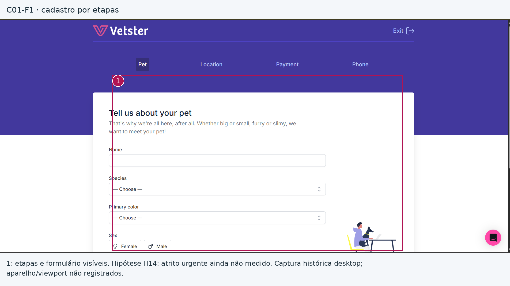
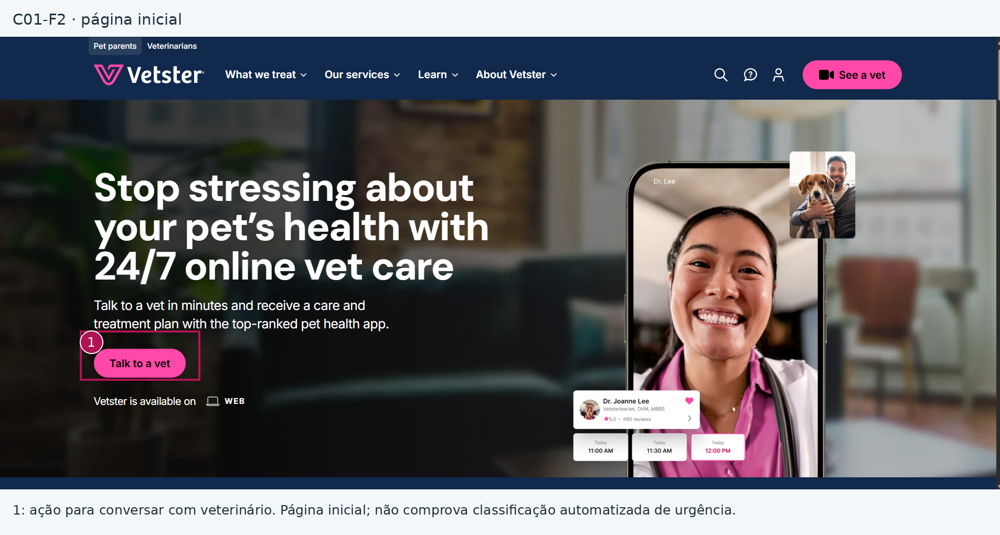
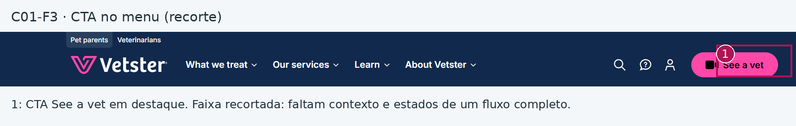
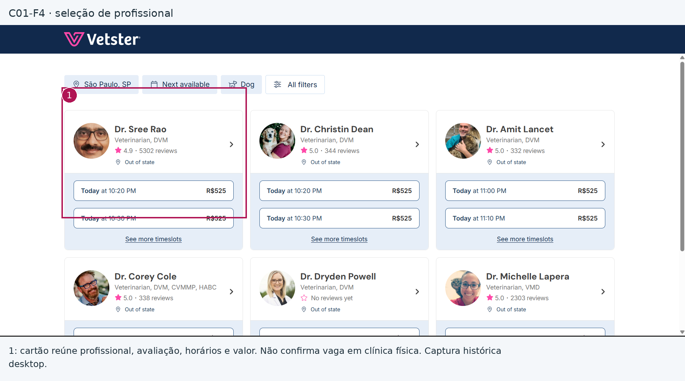
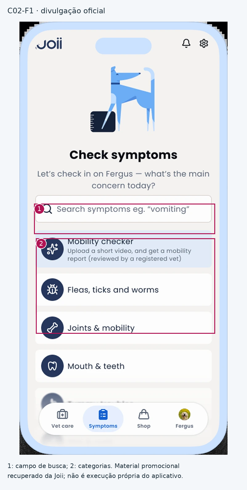
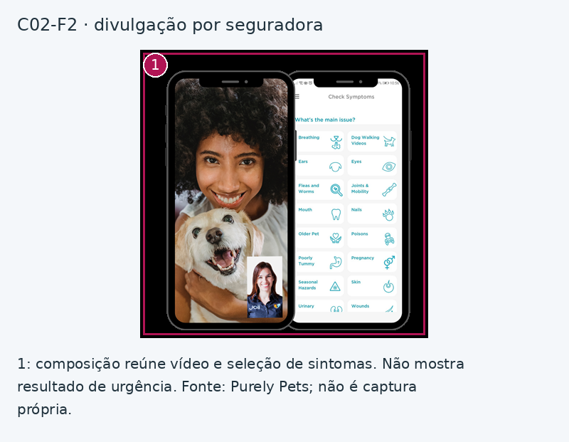
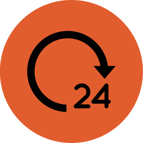

# Entrega 2 — Público-alvo e análise de concorrência

**Data:** 31/08/2026  
**Status:** 🟨 revisão em andamento — capturas próprias pendentes  
**Responsabilidade mínima:** cada integrante analisa pelo menos 1 concorrente/interface representativa; a equipe produz síntese comparativa.

## Objetivo da atividade

Compreender soluções do mesmo domínio **e também interfaces familiares ao público-alvo**. O objetivo não é copiar telas, mas identificar convenções, padrões, affordances percebidas, problemas recorrentes, expectativas e oportunidades de design.

> **Concorrente não precisa ser idêntico ao produto.** Pode atuar na mesma área, resolver objetivo semelhante ou disputar a mesma necessidade. Quando não houver concorrente direto, use produtos análogos e softwares que o público já utiliza.

### Para TCCs que não previam interface

Não procure apenas um “concorrente do algoritmo”. Investigue **interfaces profissionais que materializam atividades semelhantes** às que o usuário escolhido precisaria realizar.

Exemplos:

- TCC de banco de dados → consoles de administração, ferramentas para DBA, monitoramento e análise de consultas;
- TCC de LLM/ML → painéis de experimentos, gestão de modelos/datasets, comparação de métricas, revisão de resultados;
- TCC de análise de dados → dashboards, ferramentas de BI, filtros, relatórios e exploração;
- TCC de infraestrutura/API → portais administrativos, observabilidade, logs, gestão de credenciais e uso;
- TCC de cibersegurança → consoles de alertas, triagem, histórico e auditoria.

A pergunta é: **“que convenções esse perfil já conhece para executar tarefas equivalentes?”**

## Entrada obrigatória da Entrega 1

Retome o mapa inicial de alternativas e produtos citado na Entrega 1. Aqui a equipe deixa de trabalhar apenas com impressão inicial e passa a **investigar sistematicamente** cada solução.

| Item citado na Entrega 1 | Tipo | Por que foi citado | Status inicial | Decisão nesta entrega |
|---|---|---|---|---|
| Contato direto com clínica ou hospital veterinário | processo manual | Relatar e pedir orientação inicial | F: fluxo de referência, E1 | Investigação de campo adiada para E7; o contato aparece documentalmente em E2:C01–C03, sem comprovar o fluxo local (H03/H05). |
| Consulta veterinária presencial ou emergencial | processo manual | Triagem e avaliação profissional | F: E1 | Mantida como referência de cuidado; observação presencial fora desta análise de interfaces; investigar decisão de deslocamento em E7. |
| Telemedicina veterinária | concorrente | Orientação remota | F: existência, E1 | Analisada em E2:C01 (agendamento humano da Vetster) e E2:C02 (Joii). |
| Chatbots ou consultas digitais veterinárias | análogo | Relato e resposta em linguagem natural | F: existência, E1 | Complemento documental E2:C04 (AiVets) e levantamento brasileiro; não houve teste de resposta clínica ou validação de LLM. |
| Mecanismos de busca, redes sociais e conteúdos gerais | análogo | Buscar informação | H07 | Google Search na seção 3; redes sociais adiadas por ausência de amostra definida. A frequência de uso depende de E7. |
| Avaliação própria e apoio de familiares | processo manual | Decidir se espera ou busca ajuda | H | Investigação adiada para entrevistas/diários de E7; representada como hipótese em E4:C01/C03. |
| Aplicativos de mapas, rotas e localização | ferramenta cotidiana | Localizar serviços | H10 | Google Maps na seção 3; critérios efetivos do tutor permanecem H10a–c. |
| Aplicativos de mensagens | ferramenta cotidiana | Texto e áudio | H07/H09 | WhatsApp na seção 3; não foram observados todos os estados de gravação. |
| Sistemas de gestão de clínicas / prontuários | ferramenta profissional | Continuidade operacional | H05 | Análise operacional adiada: clínica fora do caminho principal, pendente de H05; investigar com profissionais em E7. |

Se uma hipótese da Entrega 1 for confirmada ou refutada durante esta análise, atualize `H01`, `H02`... em [`../RASTREABILIDADE.md`](../RASTREABILIDADE.md).

## 1. Público-alvo desta análise

**[F]** O tutor responsável por cão ou gato é o usuário prioritário previsto na Entrega 1 e no TCC. Seu objetivo é proteger o animal e decidir como conseguir cuidado diante dos sinais percebidos.

**[H]** Uso predominante pelo celular, pressão emocional, canais familiares e preferência por voz permanecem H06–H09. As interfaces analisadas não confirmam esses comportamentos no público brasileiro.

**Histórico de revisões — 21/10/2026:** mantidas as três análises e suas autorias originais; corrigido o objeto de E2:C01, localizadas as imagens recuperáveis, numeradas as figuras e separadas observação, divulgação, opinião e hipótese. Acrescentado um contraponto de IA e mercado brasileiro por pesquisa documental. Os enunciados e cabeçalhos do modelo foram preservados. E2:C01–C04 identificam concorrentes/análogos; E4:C01–C03 identificam cenários. A revisão não declara que a equipe executou fluxos novos.

**Limite da evidência:** capturas completas de resultado, próximo passo, erro e sessão no aplicativo ainda precisam ser produzidas pelos integrantes. As imagens de divulgação abaixo são complementares e não substituem esse requisito. Em particular, não houve execução de um fluxo autenticado, teste com animal real, consulta paga nem teste de resposta de IA. Datas antigas são as informadas no documento original; recuperação e revisão documental ocorreram em 21/10/2026.

## 2. Concorrentes diretos/indiretos

### Análise C01 — Vetster (agendamento de atendimento remoto)

**Autor(a):** Julian Ryu Takeda — 22.224.030-1  
**Tipo:** análogo  
**Link oficial:** https://vetster.com  
**Data de acesso:** 26/08/2026 (registro original); revisão documental em 21/10/2026.

#### Contexto e proposta

O objeto mostrado é o site e o cadastro/escolha de profissional para consulta remota. Não foi demonstrado um módulo automatizado de teletriagem. A [página oficial](https://vetster.com/en-us/for-pet-parents) descreve consulta e acesso posterior ao registro. São transferíveis a organização da escolha e do contato; regras, preço e acesso no exterior não comprovam adequação ao Brasil.

#### Funcionalidades relevantes

| Funcionalidade | Como é realizada | Evidência/print | Observação de IHC |
|---|---|---|---|
| Cadastro do pet | Formulário com nome, espécie, cor e sexo; etapas Pet, Location, Payment e Phone | [C01-F1](../assets/02_concorrencia/vetster_f1_anotada.png) | **Observado:** coleta e sequência explícitas. **[H] H14:** esse cadastro pode atrapalhar um relato urgente; a imagem não mede abandono. |
| Entrada no serviço | Página inicial anuncia atendimento e mostra ação para conversar com veterinário | [C01-F2](../assets/02_concorrencia/vetster_f2_anotada.png) | **Observado:** ação de contato em destaque. Não é navegação comprovada por categorias de sintomas. |
| CTA na navegação | Faixa de menu com “See a vet” | [C01-F3](../assets/02_concorrencia/vetster_f3_anotada.png) | **Observado:** CTA identificável. O recorte não permite avaliar a tela inteira ou o estado de triagem. |
| Escolha do profissional | Cartões com nome, avaliação, horários e valor | [C01-F4](../assets/02_concorrencia/vetster_f4_anotada.png) | **Observado:** dados comparáveis antes da escolha; não prova disponibilidade de clínica física ou vaga emergencial. |

*C01-F1–F4: capturas já anexadas pela equipe; data de acesso informada no original: 26/08/2026. Navegador desktop inferido pelas dimensões; dispositivo físico e viewport não registrados. Recuperadas e anotadas em 21/10/2026. Originais e URLs de origem constam no registro de figuras do pacote. Os números sobrepostos indicam o elemento comentado; não representam um teste novo.*

#### Experiência do usuário e opiniões

Use avaliações públicas, relatos, estudos, testes próprios ou outra fonte identificável. Não trate opinião isolada como verdade universal.

Na consulta documental de 21/10/2026, o [Trustpilot](https://www.trustpilot.com/review/vetster.com) apresentava 4,9/5 e 2.928 avaliações. Exemplos: Sara H (13/06/2026) elogia facilidade de agendar; Pumpernickel (07/10/2026) relata demora na entrega de receita. São depoimentos individuais, não uma amostra representativa nem evidência de interface automatizada. A segunda crítica se refere à continuidade do serviço, não ao tempo de inferência do nosso sistema.

#### Preço/modelo de negócio

Atendimento pago e modalidades de assinatura anunciadas pelo fornecedor. Não foi realizada compra nem comparação regional de preço; os valores visíveis em C01-F4 são os da captura histórica.

#### Padrões e tendências percebidos

Observados em C01-F1–F4: formulário em etapas, ação principal e cartões comparáveis. Cartões de urgência por cor e resumo clínico revisável antes do resultado não foram mostrados; as atribuições anteriores foram retiradas.

#### Pontos positivos, limitações e lições

| Ponto | Evidência | Implicação para nosso projeto |
|---|---|---|
| Positivo: etapas de coleta identificadas | C01-F1, marcador 1 | Explicitar onde o tutor está; não importar cadastro/pagamento sem tarefa que os justifique. |
| Positivo: ação de contato visível | C01-F2/F3, marcador 1 | RC04: uma ação principal contextualizada. |
| Positivo: dados para comparar opções | C01-F4, marcador 1 | RC09: exibir informações úteis, sem confundir profissional on-line com clínica disponível. |
| Limitação do estudo: escopo observado | F1–F4 não mostram resultado de urgência | Não atribuir ao produto falhas ou vantagens de uma classificação não executada. |
| Hipótese de projeto: atrito no início | C01-F1 mostra cadastro; H14 ainda aberta | Testar entrada sem cadastro completo; não alegar redução de abandono. |

### Análise C02 — Joii Pet Care

**Autor(a):** João Pedro Gardenghi Peterutto — 22.125.066-5  
**Tipo:** direto (objetivo de apoiar a decisão inicial), com componente de atendimento humano  
**Link oficial:** https://www.joiipetcare.com  
**Data de acesso:** registros originais divergem entre 27 e 31/08/2026; datas históricas não confirmadas. Revisão documental em 21/10/2026.

#### Contexto e proposta

A [página oficial de serviços](https://www.joiipetcare.com/pages/services) apresenta verificador de sintomas e consulta por vídeo. As figuras mostram seleção de sintomas e um material que reúne vídeo e categorias; não documentam a execução de um questionário completo. O serviço britânico é referência de interação, sem presumir transferência de preços ou condições ao Brasil.

#### Funcionalidades relevantes

| Funcionalidade | Como é realizada | Evidência/print | Observação de IHC |
|---|---|---|---|
| Seleção do sintoma | Campo de busca e categorias visíveis em imagem oficial | [C02-F1](../assets/02_concorrencia/joii_f1_anotada.png) | Busca e reconhecimento são alternativas visíveis na divulgação; não comprovam relato livre ou perguntas adaptativas. |
| Acesso a consulta | Divulgação apresenta videochamada junto à seleção de sintomas | [C02-F2](../assets/02_concorrencia/joii_f2_anotada.png) | Evidência de apresentação do serviço; duração e escalonamento em um caso real não foram testados. |
| Resultado e próximo passo | Descritos pelo fornecedor | Página de serviços; sem captura de resultado executado | **[?]** Conteúdo exato nos ramos de baixa urgência/incerteza ainda não capturado. |
| Perfil/histórico | Citados na análise anterior | Sem captura de revisão de resumo antes da orientação | Não sustenta “resumo persistente revisável” como padrão observado. |

*C02-F1: material da Joii; C02-F2: material da seguradora Purely Pets. Recuperados em 21/10/2026. A imagem representa um dispositivo móvel, mas não é captura própria da equipe em aparelho identificado; versão e data de produção não informadas. Os marcadores apontam elementos visíveis, não estados de uso verificados.*

#### Experiência do usuário e opiniões

Use avaliações públicas, relatos, estudos, testes próprios ou outra fonte identificável. Não trate opinião isolada como verdade universal.

O [Trustpilot](https://www.trustpilot.com/review/joiipetcare.com), consultado em 21/10/2026, apresentava 4,6/5 e 8.630 avaliações. Sue (09/10/2026) relata dificuldade no cadastro e elogia a resposta de suporte; Peter Freeman (30/03/2026) descreve uma consulta durante viagem. São exemplos individuais. O levantamento anterior mencionava encerramento de chat por inatividade, mas não preservou o depoimento específico; RC05 mantém esse tema como risco a investigar, sem declarar uma política atual de expiração da Joii.

#### Preço/modelo de negócio

Verificador anunciado como gratuito e consultas com condições dependentes de plano/parceria. O valor antigo de £28 não é usado como preço vigente: a página de serviços consultada anuncia £24, sujeito à oferta e ao acesso. Não houve contratação.

#### Padrões e tendências percebidos

Busca por sintoma, categorias e navegação inferior são visíveis em C02-F1; o contato profissional é apresentado em C02-F2 e no site oficial. O resultado, o erro e a retomada de sessão não foram capturados.

#### Pontos positivos, limitações e lições

| Ponto | Evidência | Implicação para nosso projeto |
|---|---|---|
| Positivo: busca e categorias | C02-F1, marcadores 1 e 2 | Oferecer apoio de reconhecimento; a combinação com relato livre é proposta H15. |
| Positivo: acesso profissional | C02-F2 e descrição oficial | RC13: permitir buscar ajuda profissional quando necessário, sem prometer disponibilidade. |
| Limitação documental: material promocional | C02-F1/F2 | Não concluir duração, eficácia, acessibilidade ou comportamento adaptativo. |
| Risco de acesso e continuidade | Depoimento de cadastro no Trustpilot; relato anterior de expiração não preservado | RC05: testar preservação e retomada no nosso protótipo. |

### Análise C03 — Petriage

**Autor(a):** Vinícius de Castro Duarte — 22.224.020-2  
**Tipo:** direto  
**Link oficial:** https://petriage.com  
**Data de acesso:** registros originais divergem entre 27 e 31/08/2026; datas históricas não confirmadas. Revisão documental em 21/10/2026.

#### Contexto e proposta

A [FAQ oficial](https://petriage.com/for-pet-parents/faq-pet-parents/) descreve avaliação de urgência para cães/gatos e comunicação com clínica participante. A [página para veterinários](https://p3triage.petriage.com/vets) lista quatro categorias. É concorrente do objetivo de decisão inicial, sem evidência de equivalência ao relato livre com RAG do TCC. A operação brasileira e a compreensão dos termos ingleses não foram verificadas.

#### Funcionalidades relevantes

| Funcionalidade | Como é realizada | Evidência/print | Observação de IHC |
|---|---|---|---|
| Avaliação dos sintomas | Verificador descrito na FAQ | Documentação oficial; imagem de questionário do blog original inacessível nesta revisão | Não foi executado um caso; linearidade e duração não foram constatadas. |
| Quatro categorias | Non-threatening, Worrisome, Urgent e Emergency | C03-F1 a F4, ícones oficiais abaixo | Ícones distinguem categorias; não mostram a tela completa com explicação e ação. |
| Localização/contato | FAQ menciona busca de clínica e comunicação quando a clínica participa | FAQ oficial, sem captura do fluxo | A existência descrita não comprova vaga nem necessidade de interface própria para nossa P03. |

*C03-F1–F4: ícones fornecidos pela Petriage, recuperados em 21/10/2026; não são prints nem possuem dispositivo/viewport. Elemento positivo: categorias distinguíveis; limite: ícone isolado não comprova redundância de texto, ícone e cor na mesma tela. A imagem de questionário do blog MacCormick retornou HTTP 403 e não foi substituída por uma imagem inventada.*

#### Experiência do usuário e opiniões

Use avaliações públicas, relatos, estudos, testes próprios ou outra fonte identificável. Não trate opinião isolada como verdade universal.

Não foi constituída amostra de avaliações independentes do produto nesta revisão. O material do fornecedor descreve funcionalidades; não comprova satisfação ou compreensão dos usuários. A lacuna é explícita.

#### Preço/modelo de negócio

Segundo a FAQ, o verificador é gratuito para tutores e serviços profissionais podem ter cobrança. O preço B2B antigo foi retirado por não ser necessário à decisão de interação nem ter sido revalidado.

#### Padrões e tendências percebidos

Categorias explícitas e canais de continuidade estão documentados. Não se conclui que a interface depende fortemente da cor, nem que possui redundância acessível: ambos exigem tela completa e verificação específica.

#### Pontos positivos, limitações e lições

| Ponto | Evidência | Implicação para nosso projeto |
|---|---|---|
| Categorias nomeadas | Página oficial e C03-F1–F4 | RC14: validar rótulos em português; quatro níveis não se transferem automaticamente ao escopo de duas categorias. |
| Continuidade descrita | FAQ oficial | RC13: prever acesso profissional, sem garantia de recepção. |
| Resultado de baixa urgência não capturado | Ausência de captura executada | Não derivar conteúdo clínico de um ícone; modelar o nosso ramo como proposta H13. |
| Explicabilidade e acessibilidade não testadas | Sem contraste, alvo, leitor de tela ou fluxo completos | RC03/RC11 são decisões de projeto a avaliar, não falhas comprovadas da Petriage. |

> Repita a subseção para C02, C03... até atender à quantidade da equipe.

### Análise C04 — AiVets: contraponto conversacional e mercado brasileiro

**Responsabilidade:** complemento documental da revisão da equipe; não substitui as autorias de C01–C03.  
**Tipo:** análogo; público profissional, distinto do tutor prioritário.  
**Link oficial:** https://aivets.com.br/  
**Data de acesso:** 21/10/2026.

#### Contexto e proposta

O fornecedor brasileiro descreve conversação por web/WhatsApp e busca em base científica veterinária para estudantes e profissionais. É um contraponto ao questionário: aceita perguntas em linguagem natural, mas não demonstra pré-triagem leiga validada. Fonte: página oficial, seções “Pesquisas Científicas Conversacionais” e FAQ.

#### Funcionalidades relevantes

| Funcionalidade | Como é realizada | Evidência/print | Observação de IHC |
|---|---|---|---|
| Conversa com IA e consulta à base | Descritas pelo fornecedor | [Página oficial](https://aivets.com.br/); sem sessão executada | Contraponto documental de entrada livre; não comprova precisão, recuperação ou tratamento de incerteza. |
| Web e WhatsApp | Canais anunciados | Documentação oficial | Linguagem e responsabilidade profissional não podem ser copiadas para tutores leigos. |

#### Experiência do usuário e opiniões

Não foi coletada avaliação independente. Números promocionais de satisfação não são adotados como prova de usabilidade.

#### Preço/modelo de negócio

Assinatura anunciada; contratação não realizada.

#### Padrões e tendências percebidos

Interação conversacional documentada, sem teste do aplicativo.

#### Pontos positivos, limitações e lições

| Ponto | Evidência | Implicação para nosso projeto |
|---|---|---|
| Comparação com questionários | Documentação oficial | H15: investigar relato livre e complemento dirigido. |
| Limite de público e evidência | Sem teste de resposta ou acesso autenticado | RC08/RC11: investigar origem e limites; não alegar equivalência clínica ou superioridade. |

**Levantamento brasileiro — L04:** busca documental em 21/10/2026 por “veterinário chatbot inteligência artificial Brasil”, “site.aivets.com.br inteligência artificial perguntas banco conhecimento científico” e “site.flyvet.com.br assistente ia veterinário WhatsApp”. Além da AiVets, a [Fly Vet](https://www.flyvet.com.br/lp/servicos/assistente-ia/) anuncia atendimento/agendamento por WhatsApp e encaminhamento humano; seu objetivo comercial difere da pré-triagem. O levantamento é parcial, não exaustivo; funcionalidades anunciadas não foram executadas. L04 permanece aberta para investigar soluções acessíveis ao tutor brasileiro, inclusive resultados não emergenciais e incerteza.

## 3. Softwares que o público-alvo usa no cotidiano

Analise interfaces que moldam a expectativa do público, mesmo que não sejam concorrentes.

| Software | Por que o público usa | Padrões relevantes | Prints | O que aprender |
|---|---|---|---|---|
| Google Search | **[H] H07:** uso por tutores ainda a investigar | Campo livre visível na imagem histórica | [SC01-F1](../assets/02_concorrencia/google_f1.jpg), de Business Insider | Reconhecimento de entrada textual; não demonstra confiabilidade dos resultados ou frequência de uso. |
| Google Maps | **[H] H10:** busca de serviços | Mapa, lista e informações de local visíveis | [SC02-F1](../assets/02_concorrencia/maps_f1.png), de Similarweb | Comparar informações e conferir contato; listagem não garante capacidade de atendimento. |
| WhatsApp | **[H] H07/H09:** canal familiar e áudio | Imagem de divulgação de transcrição | [SC03-F1](../assets/02_concorrencia/whatsapp_f1.jpg), de Bug.hr | Não comprova gravação, cancelar ou retomar; estes estados exigem captura própria e teste. |

*SC01–SC03 são imagens de terceiros recuperadas em 21/10/2026, já referenciadas na entrega original. Datas de produção, versões e dispositivos físicos não foram registrados. Não constituem observação de uso da equipe. Capturas próprias com busca de clínica e estados completos de áudio permanecem pendentes; fontes estão no registro de figuras.*

## 3.1 Padrões de interface relevantes ao escopo de IHC

Registre somente padrões encontrados nas soluções analisadas e que possam ter relação com objetivos reais da equipe.

| Padrão observado | Produto(s) | Para qual tarefa serve | Vantagem percebida | Risco/limitação | Aplicável ao nosso escopo? |
|---|---|---|---|---|---|
| Formulário em etapas | Vetster, C01-F1 | Identificar contexto | Etapas visíveis | Atrito urgente não medido | Apenas dados essenciais; H14 |
| Ação principal e cartões comparáveis | Vetster, C01-F2/F4 | Escolher atendimento | Informações reunidas | Profissional on-line não equivale a vaga clínica | Sim, RC04/RC09 |
| Busca e categorias de sintomas | Joii, C02-F1 (divulgação) | Encontrar sinal | Duas formas de localizar | Não demonstra adaptatividade | Proposta H15; testar |
| Quatro categorias | Petriage, ícones e site | Comunicar urgência | Nomes distintos | Tela de resultado e compreensão não verificadas | Adaptar ao recorte; RC14 |
| Mapa e lista | SC02-F1 (terceiro) | Buscar serviço | Dados comparáveis | Disponibilidade não garantida | Sim, com confirmação; H10 |
| dashboard | Não demonstrado no recorte observado | Nenhuma tarefa central o exige | — | Acrescentar tela sem necessidade | Não no caminho central |
| relatório | Resumo revisável não observado antes do resultado | Preparar contato | Benefício esperado, H03 | Propagar erro | Hipótese; não padrão aprendido |
| histórico + filtros | Continuidade descrita documentalmente, não testada | Recuperar contexto | Benefício esperado | Acesso e retenção indefinidos | Secundário; L03 |
| administração/CRUD | Cadastro visível, C01-F1 | Identificar animal | Contexto mínimo | Cadastro completo como barreira | Secundário; H14 |
| comparação de resultados | Não observada | Sem objetivo prioritário | — | Inflar o fluxo | Fora do recorte principal |

> O objetivo não é concluir “todo concorrente tem dashboard, então teremos um”. O padrão só será adotado se apoiar uma tarefa rastreável.

## 4. Síntese comparativa da equipe

| Critério | C01 | C02 | C03 | Oportunidade para o projeto |
|---|---|---|---|---|
| Navegação | Site, formulário e seleção de profissional; C01-F1–F4 | Busca/categorias em divulgação; C02-F1 | Questionário descrito; não executado | Investigar entrada livre com complemento (H15), sem tratar como padrão já visto. |
| Feedback/estado | Horários visíveis na seleção; sem estado de urgência | Sem captura de resultado ou expiração | Ícones isolados, sem resultado completo | Prototipar envio, processamento e falha, preservando contexto. |
| Prevenção/recuperação de erro | Formulário visível; validação não testada | Relato de cadastro; retomada não testada | Não testada | Avaliar correção, retomada e revisão; RC05/RC06. |
| Terminologia | “See a vet” e dados do pet visíveis | Categorias em inglês na divulgação | Quatro nomes em inglês no site | Validar nomes em português e próximo passo; H02 e RC14. |
| Acessibilidade | Sem teste específico | Sem teste específico | Ícones não comprovam redundância ou dependência da cor | Verificar contraste, leitor de tela, tamanho de alvo e compreensão; não afirmar conformidade. |
| Eficiência | Sem medição; depende de consulta humana | Sem medição do questionário ou contato | Sem medição do caminho completo | H12/H18: simular sinais críticos e saída antecipada sem impor limite arbitrário. |

## 5. Recomendações derivadas

Liste recomendações com origem explícita.

| ID | Recomendação | Tipo de origem e sustentação | Limite e validação |
|---|---|---|---|
| RC01 | Iniciar sem cadastro completo; pedir espécie e sinais observados; identidade e contato só quando necessários | **Hipótese H14**, motivada pelo cadastro de C01-F1 e pelo contexto da E1 | A imagem não prova atrito; testar início e conclusão. |
| RC02 | Investigar relato livre com apoio opcional por categorias e perguntas dirigidas | **Hipótese H15 / decisão do TCC**; categorias em C02-F1, contraponto documental C04 | Livre + adaptativo não foi observado como combinação; testar cobertura do relato. |
| RC03 | Usar rótulo, ícone e hierarquia, além da cor | **Decisão de design**; categorias documentadas da Petriage, H02/L06 | Sem avaliação de acessibilidade do concorrente; testar nossa representação. |
| RC04 | Apresentar uma ação principal por desfecho | **Observado parcialmente:** CTA C01-F2/F3; contato descrito por Petriage | Conteúdo de NÃO EMERGÊNCIA vem de E1/H13, não de print de concorrente; definir com conteúdo veterinário revisado. |
| RC05 | Preservar rascunho, sinalizar falha e permitir retomada; avisar expiração se houver | **Opinião/risco:** acesso citado em C02; relato antigo de expiração sem amostra preservada; H08/H12 | Não atribuir política atual de expiração à Joii; testar recuperação em nosso protótipo. |
| RC06 | Permitir corrigir dados/transcrição; revisar destinatário e resumo antes de compartilhar | **Hipótese H16 / H03**, proposta do TCC; resumo pré-resultado não observado | Não bloquear orientação urgente por revisão integral; revisão completa obrigatória para envio autorizado à clínica. |
| RC07 | Se voz for oferecida, indicar gravação, cancelar e revisar transcrição | **Hipótese H09**, convenção documental do WhatsApp; SC03-F1 mostra apenas transcrição | Capturar os demais estados e testar utilidade/fidelidade; não declarar observação completa. |
| RC08 | Identificar origem de relato, conteúdo automático e comunicação profissional | **Hipótese H17 / decisão do TCC**, não padrão observado em C01/C02 | Testar se o tutor distingue as origens e a responsabilidade. |
| RC09 | Exibir mapa/lista e dados verificáveis; confirmar atendimento diretamente | **Observado em imagem de terceiro:** SC02-F1; comparação C01-F4; critérios adicionais **H10a–c** | Ordenação além de proximidade permanece hipótese; localização/horário não garantem capacidade. |
| RC10 | Permitir saída imediata para atendimento diante de sinal crítico, sem perguntas secundárias | **Hipótese H18 / decisão de segurança do recorte**, não eficiência observada em C03 | Definir sinais com conteúdo veterinário revisado; testar ação no protótipo. Prevalece sobre revisão extensa e cadastro. |
| RC11 | Comunicar limites, lacuna e próximo passo; INCERTO não é NÃO EMERGÊNCIA | **Decisão do TCC / H02, H11 e H13** | Não alegar falha de explicabilidade de concorrente sem captura; testar reconto e confiança. |
| RC12 | Manter escolhas comerciais fora do caminho urgente | **Hipótese H19 / decisão de escopo**, não distração demonstrada nos concorrentes | Investigar efeito no protótipo; não afirmar anúncios dentro da triagem da Joii. |
| RC13 | Manter caminho para contato profissional diante de risco ou insuficiência | **Documentação dos fornecedores** C01–C03; sem medição do escalonamento | Contato acessível; sem prometer disponibilidade, vaga ou integração clínica existente. |
| RC14 | Validar “emergência” e “não emergência”; explicar INCERTO como insuficiência de dados | **Decisão do TCC** de 06/09 e reconciliação de 15/10; contraste com quatro categorias documentadas em C03 | Não copiar quatro níveis; H02/L06 exigem teste de termos em português, ícones e cores. |

**Hipóteses adicionais registradas na matriz:** H15 — relato livre apoiado por complemento dirigido permite comunicar sinais com menos omissões do que seleção apenas por categorias; H16 — revisão dos dados relevantes permite corrigir distorções sem atrasar a ação urgente em simulação; H17 — identificação explícita da origem permite distinguir relato, automação e profissional; H18 — acesso antecipado ao contato diante de sinal crítico evita completar perguntas secundárias antes de agir em simulação; H19 — escolhas comerciais no caminho urgente aumentam hesitação/esforço de decisão. Nenhuma está confirmada pela análise de mercado.

**Prioridade diante de tensão:** orientação crítica e acesso profissional primeiro (RC10/RC13); revisão breve de informação relevante quando viável (RC06); revisão e autorização antes de compartilhar; explicação curta de limite e ação junto do resultado (RC11). Feedback e rascunho (RC05) devem apoiar o fluxo, sem criar etapas obrigatórias adicionais.

**Evolução de H03/H05/H07/H10:** há documentação de comunicação e opções de serviço, mas não evidência conclusiva da utilidade do resumo, do fluxo da clínica, da frequência de busca dos tutores ou dos critérios de escolha brasileiros. Todas permanecem abertas; H05 passa a depender de entrevistas profissionais em E7, com análise operacional adiada. A matriz incluída registra esses limites e o histórico da decisão sobre a clínica.

## Referências

- Vetster. [For pet parents](https://vetster.com/en-us/for-pet-parents). Revisão documental: 21 out. 2026.
- Trustpilot. [Avaliações da Vetster](https://www.trustpilot.com/review/vetster.com) e [da Joii](https://www.trustpilot.com/review/joiipetcare.com). Consulta: 21 out. 2026. Depoimentos individuais, sujeitos à seleção e atualização.
- Joii. [Services](https://www.joiipetcare.com/pages/services). Consulta: 21 out. 2026.
- Petriage. [FAQ for pet parents](https://petriage.com/for-pet-parents/faq-pet-parents/) e [For vets](https://p3triage.petriage.com/vets). Consulta: 21 out. 2026.
- AiVets. [Site oficial e FAQ](https://aivets.com.br/). Consulta: 21 out. 2026. Fonte comercial, sem teste do aplicativo.
- Fly Vet. [Assistente IA](https://www.flyvet.com.br/lp/servicos/assistente-ia/). Consulta: 21 out. 2026. Fonte comercial, sem contratação ou envio de mensagem.
- Google. [Search for nearby places](https://support.google.com/maps/answer/4610185) e [Use navigation](https://support.google.com/maps/answer/3273406). Referências documentais indicadas na entrega original; acesso histórico: 31 ago. 2026, não reexecutado nesta revisão.
- WhatsApp. [How to send voice messages](https://faq.whatsapp.com/1206940699982241). Referência documental da versão original; acesso histórico: 31 ago. 2026, não reexecutado nesta revisão.
- Fontes das figuras, URLs originais, datas conhecidas, dimensões e limites: [registro de figuras](../assets/02_concorrencia/registro_figuras.md). As figuras de terceiros não foram convertidas em capturas próprias.

**Pendências de evidência visual:** cada integrante ainda precisa registrar dispositivo/viewport, data e versão ao capturar entrada, pergunta, resultado de urgência (incluindo baixa urgência), ação seguinte, contato e erro/expiração quando existentes. Capturar também o fluxo de texto livre/IA acessível e os estados de áudio/mapa. Se um estado não existir ou exigir acesso não disponível, registrar a restrição sem inventar a tela. O requisito de capturas próprias completas permanece aberto.

## Checklist

- [x] O mapa inicial de alternativas da Entrega 1 foi revisitado e aprofundado.
- [x] Hipóteses relevantes sobre mercado/padrões foram atualizadas na rastreabilidade quando surgiram evidências.
- [x] Há pelo menos uma análise completa por integrante.
- [ ] Cada análise contém prints legíveis da interface.
- [ ] Prints mostram telas/estados relevantes, não apenas logos/homepage.
- [x] Foram analisados concorrentes e/ou interfaces representativas ao público.
- [x] Em TCC sem interface original, foram investigadas ferramentas profissionais análogas às atividades do usuário escolhido.
- [x] Padrões como dashboard, relatório, filtros e CRUD foram analisados como soluções para tarefas, não como requisitos automáticos.
- [x] Opiniões de UX têm fonte.
- [x] A síntese compara critérios comuns e produz recomendações.
- [x] Não há “copiar porque o concorrente faz”; há justificativa de adequação ao público/contexto.

**Leitura do checklist:** o mínimo de uma análise individual por integrante foi considerado atendido pelo professor e continua marcado. Isso não resolve a completude da evidência visual, que permanece aberta nos dois itens específicos de prints. A aula Semana 02, páginas 14–16, permite consultar divulgação, mas também pede uso e observação do software; o feedback da equipe exige capturas próprias dos estados relevantes. Portanto, os materiais de terceiros continuam apenas complementares. Os vínculos e estados das hipóteses foram atualizados na matriz do pacote; isso não significa publicação no GitHub.

**Conferência com as aulas — 21/10/2026:** mantidas as correções prioritárias do feedback da Entrega 2; a consulta à aula não converteu hipóteses em observação nem eliminou a pendência das capturas próprias.
