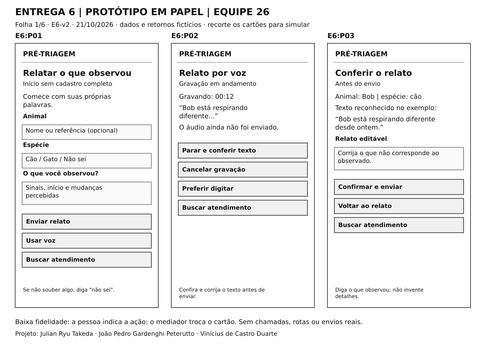
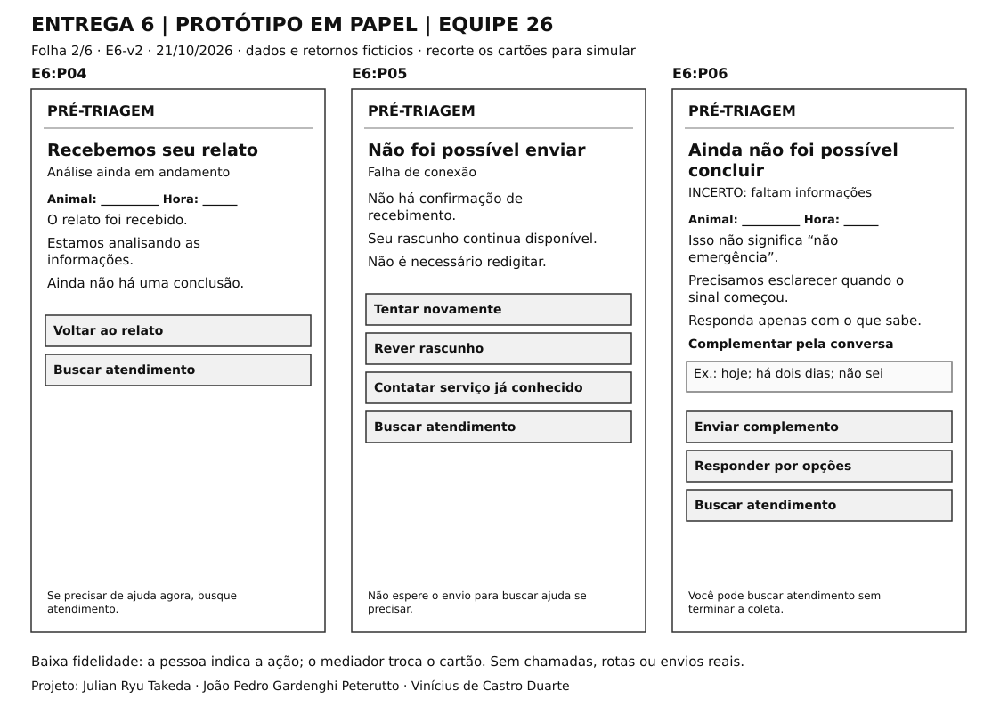
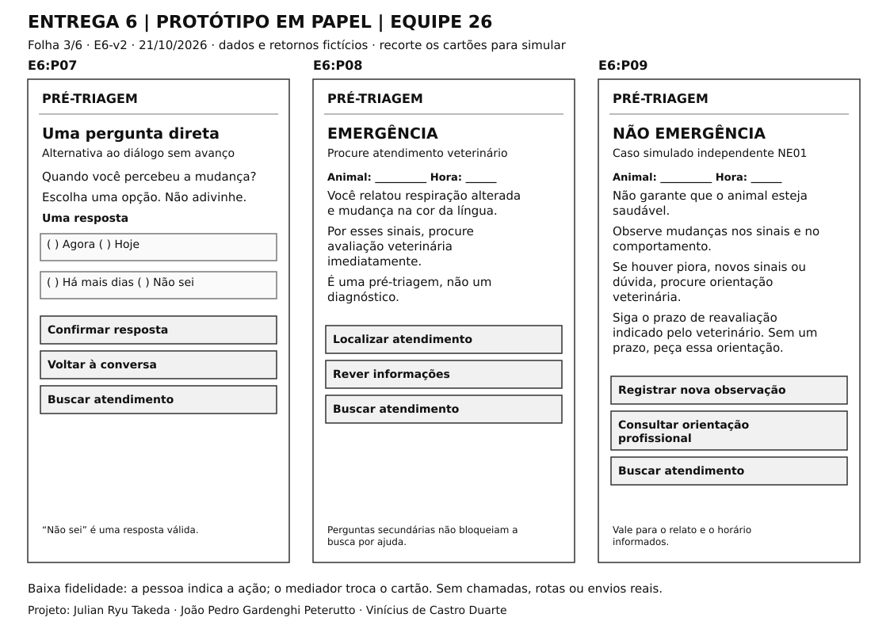
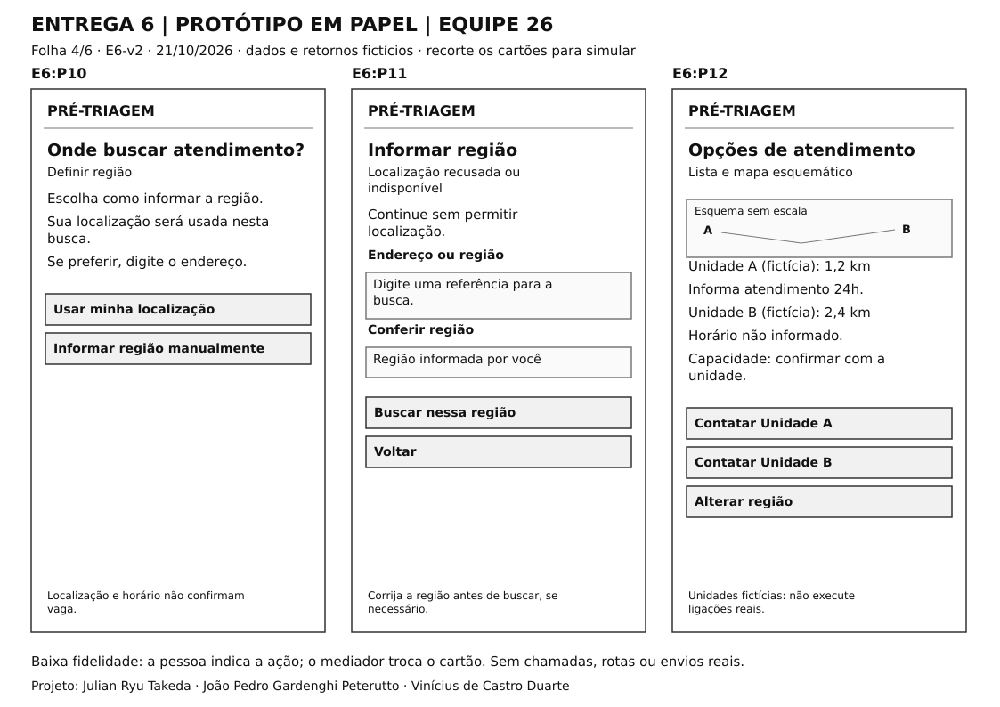
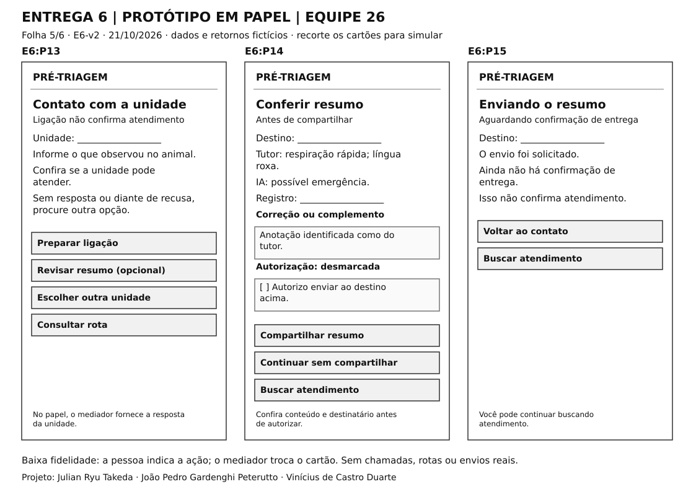
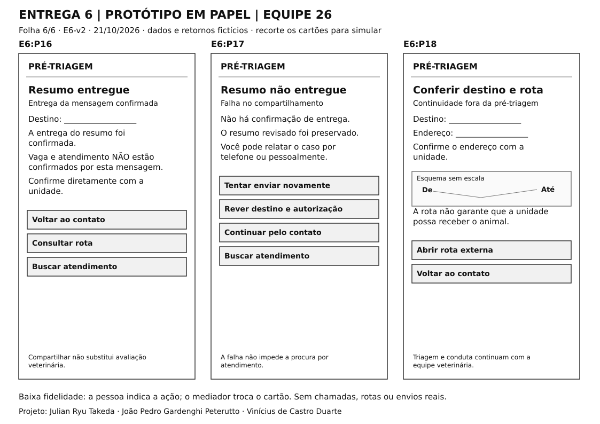

# Entrega 6 — Prototipação em papel

**Data:** 06/10/2026  
**Status:** 🟨 em andamento  
**Responsabilidade:** 1 solução integrada por equipe

## Objetivo da atividade

Externalizar rapidamente ideias de interação em baixa fidelidade para explorar alternativas antes de investir em detalhes visuais. O valor da atividade está no **ciclo construir → simular → observar → revisar**, não na beleza do desenho.

## 1. Escopo do protótipo

**Personas:** E3:P01 — Camila Rocha e E3:P02 — Roberto Nunes (primárias). E3:P03 — Marina Lopes permanece secundária, como possível destinatária; não há tela clínica neste recorte.  
**Cenários/tarefas cobertos:** E4:C01/T01 e T02; E4:C03/T03; continuidade de E4:C02/T02 somente no lado do tutor. Necessidades R01–R05. Estados E6:P01–P18, distintos das personas E3:P01–P03.  
**Objetivos principais:** relatar sinais e corrigir o que foi entendido (T01); esclarecer lacunas sem inventar informação, compreender estado, justificativa, limites e próximo passo (T03); localizar e contatar atendimento, revisar e autorizar o resumo quando desejar e distinguir envio, entrega e capacidade de atendimento (T02). NÃO EMERGÊNCIA inclui observação/reavaliação; INCERTO significa informação insuficiente. O contato profissional permanece acessível.

**Registro da versão:** 06/10/2026 é a data que já constava no arquivo da equipe; esta elaboração ocorreu em 21/10/2026. Base consultada: enunciado original do professor, guias do repositório e Entregas 1–5 revisadas. Conferência agora realizada com as aulas fornecidas: Processos-Parte2, pp. 10–12 (maquete essencial e simulação dupla); Princípios e Diretrizes de Design, pp. 3–16 e 22–26 (clareza, consistência, feedback, erros e baixa fidelidade); Teste de Usabilidade por Observação, pp. 6–12 (preparação, tarefas sem ensinar o caminho e postura do observador); Plano de Execução, pp. 2–4 (materiais e condução). O feedback específico da equipe e o enunciado desta entrega prevalecem sobre exemplos genéricos de outras etapas.

**Delimitação:** cartões estáticos de baixa fidelidade, para impressão, recorte e troca manual pelo mediador. É a simulação dupla da aula: participante representa a pessoa usando a solução; mediador representa as respostas da interface, sem orientar escolhas. A produção computacional do esboço é compatível com a baixa fidelidade mostrada na aula de Princípios (p. 23); o foco continua nos componentes essenciais e na navegação. Smartphone é alternativa de exploração ligada a H08, ainda hipótese. Os dados, clínicas e retornos são fictícios. Voz, transcrição, análise, busca, contato, envio e rota são representados por cartões; não se afirma implementação. Não há login, cadastro completo, dashboard ou prontuário.

O ciclo construir → simular → observar → revisar está preparado, mas **a simulação com uma pessoa que não participou da criação ainda não foi realizada**. Não há achados empíricos, participantes identificados ou revisões atribuídas à simulação. O status permanece em andamento. O roteiro predefine a saída da análise: a atividade avalia interação, não precisão clínica.

## 1.1 Possíveis famílias de interface

Escolha apenas o que for coerente com tarefas e cenários. Para TCCs técnicos, o protótipo pode explorar:

- **dashboard** para monitoramento e tomada de decisão;
- **configuração/parametrização** para preparar algoritmo/modelo/processo;
- **entrada/seleção de dados** com validação;
- **acompanhamento de execução** com progresso, fila, cancelamento e recuperação;
- **relatório/resultados** com explicação, gráficos e exportação;
- **histórico** com busca, filtros, ordenação e detalhes;
- **comparação** entre execuções, versões, algoritmos ou períodos;
- **administração** de usuários, papéis, permissões ou entidades do domínio;
- **auditoria/logs** traduzidos para o perfil;
- **alertas/ocorrências** com ação de resposta.

> Não desenhe todas essas telas por obrigação. O objetivo da baixa fidelidade é experimentar a **estrutura da interação** necessária para as tarefas priorizadas.

## 2. Fluxos escolhidos

| Fluxo | Tarefa/objetivo | Por que foi priorizado |
|---|---|---|
| PF01 | Relatar por texto/voz, revisar e verificar recebimento: T01; E4:C01; R01/R02 | Fidelidade do relato e recuperação; H06/H09/H14. P01–P05. Voz é opcional; sem cadastro completo. |
| PF02 | Resolver lacunas por conversa ou pergunta dirigida: T03; E4:C03; R01/R03 | Evitar repetição sem avanço ou resposta inventada; H12. P06/P07/P04; acesso a atendimento. |
| PF03 | Compreender EMERGÊNCIA, NÃO EMERGÊNCIA e INCERTO: T03; R01/R03 | H02/H11/H13: classificação não é diagnóstico e INCERTO não equivale a baixa gravidade. P06/P08/P09 e próximo passo. |
| PF04 | Localizar e contatar atendimento com alternativa manual: T02; E4:C01; R04 | H10: disponibilidade depende da unidade; tratar recusa e falta de resposta. P10–P13/P18. |
| PF05 | Revisar, autorizar e verificar entrega do resumo, ou continuar sem enviar: T02; continuidade E4:C02; R05 | H03/H05 ainda abertas; não confundir envio com vaga. P14–P17; contato/rota não dependem do resumo. |

## 3. Telas e estados

- Numere as telas/estados (`P01`, `P02`...).
- Indique controles que mudam o estado.
- Mostre pelo menos caminhos principais e estados de erro/retorno relevantes.

**Uso em papel:** [PDF com seis folhas A4](../assets/06_prototipos/Prototipo_E6_para_impressao.pdf); [fonte editável de estados/transições](../assets/06_prototipos/prototipo_estados.json). Recortar os cartões; manter roteiro e destinos apenas com o mediador. O PDF é o protótipo, não evidência de simulação.

| Estado | Informação/decisão representada | Tarefa/necessidade |
|---|---|---|
| E6:P01 | Relatar o que observou: Início sem cadastro completo. | T01/R01–R02 |
| E6:P02 | Relato por voz: Gravação em andamento. | T01/R01–R02 |
| E6:P03 | Conferir o relato: Antes do envio. | T01/R01–R02 |
| E6:P04 | Recebemos seu relato: Análise ainda em andamento. | T01/R01–R02 |
| E6:P05 | Não foi possível enviar: Falha de conexão. | T01/R01–R02 |
| E6:P06 | Ainda não foi possível concluir: INCERTO: faltam informações. | T03/R01–R03 |
| E6:P07 | Uma pergunta direta: Alternativa ao diálogo sem avanço. | T03/R01–R03 |
| E6:P08 | EMERGÊNCIA: Procure atendimento veterinário. | T03/R01–R03 |
| E6:P09 | NÃO EMERGÊNCIA: Caso simulado independente NE01. | T03/R01–R03 |
| E6:P10 | Onde buscar atendimento?: Definir região. | T02/R04–R05 |
| E6:P11 | Informar região: Localização recusada ou indisponível. | T02/R04–R05 |
| E6:P12 | Opções de atendimento: Lista e mapa esquemático. | T02/R04–R05 |
| E6:P13 | Contato com a unidade: Ligação não confirma atendimento. | T02/R04–R05 |
| E6:P14 | Conferir resumo: Antes de compartilhar. | T02/R04–R05 |
| E6:P15 | Enviando o resumo: Aguardando confirmação de entrega. | T02/R04–R05 |
| E6:P16 | Resumo entregue: Entrega da mensagem confirmada. | T02/R04–R05 |
| E6:P17 | Resumo não entregue: Falha no compartilhamento. | T02/R04–R05 |
| E6:P18 | Conferir destino e rota: Continuidade fora da pré-triagem. | T02/R04–R05 |

**Navegação e regras do mediador**

| Origem | Controle/evento | Destino | Regra de preservação/retorno |
|---|---|---|---|
| P01 | Enviar / usar voz | P04 (falha P05) / P02 | Preservar relato; não exigir cadastro completo. |
| P02 | Parar / cancelar / digitar | P03 / P01 / P01 | Não apagar o rascunho textual anterior. |
| P03 | Confirmar / voltar | P04 (falha P05) / P01 | Preservar correções; confirmar texto antes do envio. |
| P04 | Retorno predefinido no roteiro | P06 / P08 / P09 | Mediador não faz classificação clínica; NE01 é caso independente. |
| P04 | Voltar ao relato | P01 | Preservar texto; nova versão exige nova análise. |
| P05 | Tentar novamente / rever / serviço conhecido | P04 / P01 / P13 | Reenviar sem duplicar caso; contato conhecido independe da busca on-line. |
| P06 | Enviar complemento / opções | P04 / P07 | Aceitar “não sei”; sem forçar classificação conclusiva. |
| P06 | Diálogo sem informação nova útil | P07 | Pergunta dirigida à lacuna; sem limiar arbitrário de mensagens. |
| P07 | Confirmar / voltar | P04 / P06 | Nenhuma resposta marcada por padrão; preservar seleção. |
| P08 | Localizar / rever | P10 / P03 | Revisão é opcional; não bloqueia ajuda. |
| P09 | Nova observação / orientação profissional | P01 / P10 | Não reutilizar resultado antigo para sinais novos. |
| P10 | Autorizar localização / manual | P12 / P11 | Conferir região antes de escolher unidade. |
| P10 | Recusa ou falha de localização | P11 | Mesma alternativa manual; não bloquear. |
| P11 | Buscar / voltar | P12 / P10 | Correção do endereço permanece em P11. |
| P12 | Contatar A ou B / alterar região | P13 / P11 | Preservar qual unidade foi selecionada. |
| P13 | Preparar ligação | P13 com cartão de retorno | Mediador informa: pode receber / não pode / não respondeu; tutor decide a continuidade. |
| P13 | Outra unidade / resumo / rota | P12 / P14 / P18 | Resumo é opcional; rota não exige compartilhamento nem garante recepção. |
| P14 | Compartilhar com autorização | P15 | Conferir conteúdo e destinatário. |
| P14 | Compartilhar sem autorização | P14 com aviso junto à opção | Aviso: autorize ou continue sem compartilhar; nenhum envio. |
| P14 | Corrigir / mudar destino | P14 / P12 | Correção vira anotação do tutor; novo destino exige nova conferência e autorização. |
| P14 | Continuar sem compartilhar | P13 | Contato e rota continuam acessíveis. |
| P15 | Confirmação de entrega / falha | P16 / P17 | Retorno controlado pelo roteiro; entrega não comprova vaga. |
| P15 | Voltar ao contato | P13 | Não duplicar solicitação de envio ao retornar. |
| P16 | Contato / rota | P13 / P18 | Capacidade depende de resposta da unidade. |
| P17 | Tentar / rever / contato | P15 / P14 / P13 | Repetir só a versão já autorizada para o mesmo destino. |
| P18 | Abrir rota / voltar | Fora do protótipo / P13 | Sem navegação ou deslocamento real. |
| P01–P09 e P14–P17 | Buscar atendimento | P10 | Atalho persistente; offline, oferecer o contato conhecido de P05. |

**Continuidade dos dados no papel:** antes de mostrar P03/P04/P06/P08/P09/P14/P15/P16/P18, o mediador preenche ou sobrepõe as etiquetas do animal, horário, relato vigente e unidade já escolhida. Os campos sublinhados são áreas de escrita dos cartões, não respostas omitidas do relatório. Se S03 sair de A para B, resumo, status e rota devem mostrar B; a autorização anterior não vale automaticamente para outro destino. As frases de exemplo do relato precisam acompanhar as correções feitas, sem voltar à transcrição antiga. P09 recebe identidade/horário de NE01, nunca os do caso de Bob ou Nina. Se uma alteração do relato exigir nova análise, não reapresentar resultado anterior como atualizado.

**Alternativas em exploração:** texto/voz convergem para relato revisado; conversa/opções esclarecem a mesma lacuna; localização/região manual permitem a mesma busca. O atalho de atendimento pode interromper a coleta. Não foi inventado um limiar de mensagens ou sintomas para disparar formulário.

**Limites dos casos:** Camila/Bob sustenta o caminho de emergência; Roberto/Nina sustenta relato gradual e INCERTO, sem inferir baixa gravidade. P09 é o caso didático independente NE01, não uma reclassificação dos sinais de Bob ou Nina. As mensagens clínicas são rascunhos de interação; conteúdo e prazos específicos exigem revisão veterinária antes de uso real. O protótipo não testa diagnóstico ou tratamento.

**Pranchas complementares**

*Figuras 1–6 — Cartões de baixa fidelidade, com três estados por folha. Fontes editáveis SVG e JSON; caixas e texto representam decisões e estados, sem acabamento de produto final.*

## 4. Simulação / walkthrough

Realize uma simulação com uma pessoa que não participou da elaboração dessas telas. Um colega pode ser usado **para essa iteração formativa**, mas isso não substitui os participantes finais da Entrega 14.

| Observação | Tela/ação | Evidência | Consequência para o design |
|---|---|---|---|
| Ainda não há observação de participante | P01–P18 preparados para o roteiro abaixo | Nenhuma sessão ou evidência coletada nesta versão | Não concluir compreensão, preferência ou validade de hipótese antes da simulação |

**Procedimento preparado — ainda não executado**

Convidar uma pessoa que não elaborou as telas. Se os três integrantes colaboraram no desenho, nenhum deles pode fazer o papel de participante externo. Um integrante troca os cartões; outro registra ações e falas, quando possível. Anotar data, código do participante e perfil pertinente, sem coletar dados pessoais desnecessários. Usar casos fictícios e combinar previamente qualquer registro de áudio/imagem.

Explicar que serão explorados caminhos de interação com cartões. A pessoa indica sua ação apontando, escrevendo ou tocando o controle de papel. O mediador segue a tabela de transições, sem ensinar o caminho e sem deixar os destinos visíveis. Comentários espontâneos podem ser registrados, mas não perguntar o motivo de cada ação, corrigir escolhas ou antecipar o próximo botão durante a execução. Dúvidas sobre o significado da situação podem ser esclarecidas antes da tarefa, sem explicar como resolvê-la. Não executar chamadas, gravações, buscas ou compartilhamentos reais.

Antes da sessão externa, realizar ensaio técnico interno somente para conferir legibilidade, regras de troca, cartões e registros; esse ensaio também ainda não foi realizado e não substitui o participante externo exigido no enunciado. Na sessão formativa, usar uma pessoa externa à criação; os exemplos de amostra de 5–10 de outros materiais não alteram o mínimo específico desta entrega nem o planejamento futuro da Entrega 14.

Os [instrumentos preparados](../assets/06_prototipos/instrumentos_simulacao.md) incluem apresentação, perfil breve, fichas de situação sem caminhos de solução, planilha de observação e perguntas posteriores. O tempo de troca/manuseio do papel é registrado separadamente; não representa latência da aplicação. A concordância com a participação e qualquer registro deve ser combinada antes da observação, usando o modelo de consentimento fornecido pelo professor quando aplicável.

| Caso | Instrução ao participante | Eventos controlados pelo mediador | O que observar |
|---|---|---|---|
| S01 — Relato e recuperação | “Você está preocupado com Bob. Relate o que observou e confira o que foi registrado.” | Oferecer texto/voz. Se escolher voz, usar transcrição com “desde ontem” e conferir se corrige para “há cerca de 20 minutos”. Apresentar falha P05 uma vez, depois P04. | Correção, preservação do rascunho e diferença entre envio/recebimento. Não inferir preferência por voz de um único uso. |
| S02 — Informação insuficiente | “Você não sabe quando a mudança em Nina começou. Use a orientação disponível para decidir o próximo passo.” | Mostrar P06; sem avanço útil, oferecer P07. Aceitar “não sei” e manter INCERTO. | Se entende ausência de conclusão, não inventa resposta e consegue buscar atendimento sem completar a coleta. |
| S03 — Contato e resumo | “Você decidiu procurar atendimento. Não quer usar localização automática e deseja conferir o que será compartilhado.” | Recusar localização; primeira unidade não responde ou recusa; oferecer outra. Falhar o primeiro envio do resumo, entregar a nova tentativa. | Região manual, escolha alternativa, revisão/destino/autorização e distinção entre entrega e vaga. |
| S04 — Não emergência | “Neste outro caso fictício, NE01, você recebeu esta orientação. Explique o que pode concluir e o que faria depois.” | Mostrar P09; depois informar mudança no relato, sem criar nova classificação clínica durante a sessão. | Reconto dos limites; ausência de garantia de saúde; necessidade de reavaliar e procurar orientação quando há mudança ou dúvida. |

Depois do bloco de tarefas, retomar os registros e perguntar “O que aconteceu?”, “O que ainda não está confirmado?” e “Qual seria sua próxima ação?”. Não ensinar as distinções entre envio, entrega e vaga antes de observar a interpretação espontânea; o reconto de S04 faz parte da própria tarefa. Registrar percurso, erros, retornos, pedidos de ajuda, falas efetivas e interrupções. Tempo pode ser referência exploratória, sem meta inventada e sem equivaler à latência real do sistema.

Concluir a tarefa exige atingir a meta e demonstrar compreensão: em S03, mensagem entregue não comprova atendimento; em S04, ler o título não basta, é necessário recontar a orientação e reagir à mudança. Cada observação real deverá substituir a linha de pendência da tabela acima e fundamentar uma decisão na seção 5.

**Fichas de situação para o mediador (dados fictícios):** S01: Camila percebe Bob respirando rapidamente e a língua com cor diferente há cerca de 20 minutos; quer relatar sem conhecer termos clínicos. S02: Roberto percebe alimentação reduzida ao longo de dois dias, mas não sabe quando começou uma mudança específica de comportamento de Nina; deve poder responder “não sei”. S03: a decisão de buscar atendimento já foi tomada; região manual, unidades A/B e respostas são cartões fictícios, sem usar uma clínica real. S04: NE01 é um caso independente com saída predefinida para testar apenas a interpretação de P09, sem declarar adequação clínica de um caso real.

**Registro a completar após a sessão:** data, código/perfil do participante, confirmação de não participação no desenho, mediador/observador, versão usada, percurso, observações, evidência e decisão. Esses dados ainda não existem nesta versão.

## 5. Alterações após a simulação

| Antes | Problema | Depois | Justificativa |
|---|---|---|---|
| Versão inicial E6-v2 com P01–P18 | Ainda não há problema observado em sessão externa | Nenhuma alteração pós-simulação registrada | Preencher após a sessão, ligando cada mudança a observação real da seção 4 |

**Ajustes após a conferência documental — sem participante:** esclarecida a simulação dupla; incluídos instrumentos e ensaio interno ainda pendente; retiradas perguntas de sondagem durante a execução; explicitadas etiquetas mutáveis de animal/horário/destino e a nova autorização ao trocar unidade; removido o atalho redundante de busca nas telas que já são de busca. Essas mudanças decorrem da revisão dos materiais e da consistência entre estados, não de uma simulação realizada.

**Decisões prévias, não achados da simulação:** preservação de rascunho, revisão de transcrição, pergunta dirigida, região manual, atalho de atendimento e distinção de envio/entrega/capacidade derivam da Entrega 5 e integram a versão inicial. H03, H05, H09, H12 e H13 permanecem abertas. Não são apresentadas como resultados de participante.

Depois da sessão, preservar a versão anterior, revisar os cartões afetados e justificar cada mudança. Se uma crítica não motivar alteração, registrar a razão. Só então reavaliar status e itens de simulação/revisão do checklist.

## Checklist

- [x] O protótipo cobre tarefas relevantes da Entrega 5.
- [x] Cada tela/estado pode ser justificado por uma tarefa, decisão ou informação necessária.
- [x] O projeto não criou dashboard/CRUD/login apenas para parecer “completo”.
- [x] Telas/estados estão numerados e navegáveis na documentação.
- [ ] Há pelo menos uma simulação/walkthrough documentado.
- [ ] Críticas não foram apenas listadas: geraram decisão de revisão.
- [x] O protótipo continua em baixa fidelidade; detalhes visuais não mascaram problemas de fluxo.

