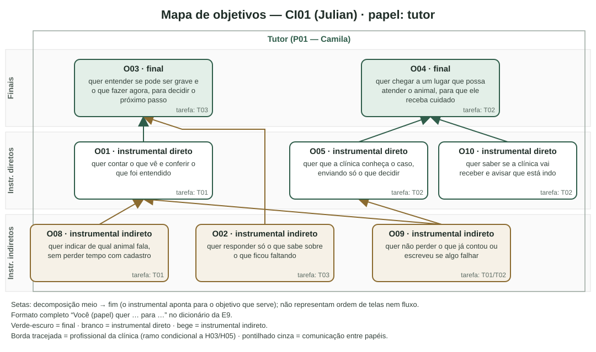
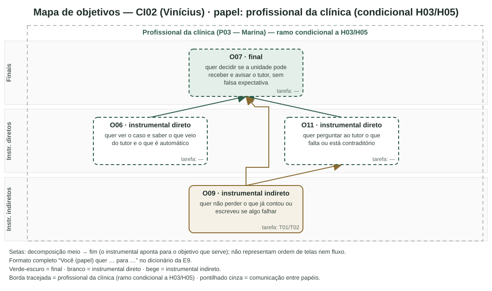
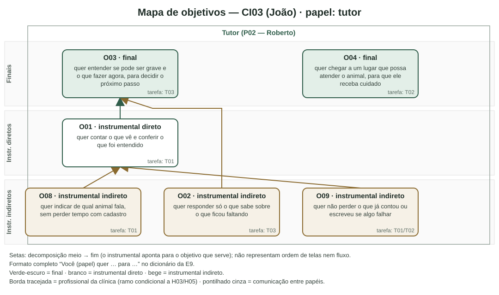
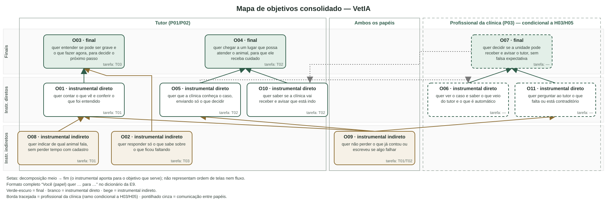

# Entrega 9 — Modelo conceitual e design centrado na comunicação

**Data:** 04/11/2026 (revisada em 16/11/2026 após feedback do professor)  
**Status:** 🟩 concluída  
**Responsabilidade:** soluções individuais, com consolidação da equipe para mapa de objetivos e esquema de signos.

## Objetivo da atividade

Passar do cenário de problema para uma concepção da interação, explicitando objetivos, tópicos de conversa, falas e signos que a interface deverá comunicar/manipular.

## Transformando resultados técnicos em conceitos compreensíveis

Em TCCs algorítmicos ou orientados a dados, esta entrega deve evitar que a interface exponha apenas estruturas internas do código. Identifique os **conceitos e signos que fazem sentido para o usuário**.

Exemplos:

- `query plan`, custo estimado, recomendação e impacto para um DBA;
- modelo, dataset, versão, execução e métrica para engenheiro de IA;
- período, indicador, grupo, tendência e filtro para gestor/analista;
- alerta, severidade, evidência, responsável e status para analista de segurança.

Se um termo técnico for necessário, modele como será comunicado, explicado e relacionado à tarefa.

Dashboards, relatórios, filtros e CRUDs devem aparecer no modelo conceitual por meio dos **objetivos, signos e conversas** que justificam sua existência.

## 1. Cenários de interação

Para cada cenário de problema, produza uma versão em que a solução já pode ser descrita. **Destaque claramente o texto alterado** em relação ao cenário original.

**Convenção de marcação (revisada em 16/11/2026):** a marcação agora é feita **por trecho**, não por parágrafo. Texto **sem marcação** foi mantido do cenário refinado da E4. **[ALTERADO: ...]** substitui um trecho do problema da E4 (ação, ruptura ou contexto que a solução muda). **[NOVO: ...]** acrescenta interação proposta que não existia na E4. Os cenários descrevem o que a pessoa faz e entende; palavras exatas, rótulos e componentes ficam para o esquema de signos, a MoLIC e o protótipo. Os cenários são hipotéticos; H03/H05 continuam abertas, com o lado da clínica condicional.

### CI01 — Relatar os sinais de Bob e buscar atendimento

**Autor(a):** Julian Ryu Takeda — 22.224.030-1  
**Origem:** cenário problema C01, versão refinada da Entrega 4; P01; T01 e T02; R01–R04.

Durante a madrugada, Camila percebe que Bob, seu cão, está ofegante, mais quieto do que o normal e com a língua em uma coloração diferente. Ela está sozinha em casa, precisa continuar observando o animal e não possui conhecimento veterinário para avaliar se os sinais podem esperar até a manhã seguinte ou se exigem deslocamento imediato até um hospital veterinário. Camila descreve o que vê com expressões como “respirando muito rápido”, “sem querer levantar” e “língua meio roxa”, sem saber quais detalhes são clinicamente relevantes.

Sem conseguir contato profissional imediato, **[ALTERADO: em vez de fazer buscas e alternar entre páginas de credibilidade diferente, ela conta à pré-triagem, com essas mesmas palavras cotidianas, o que está vendo em Bob.]** **[NOVO: Diz de que animal se trata; como Bob já foi registrado antes, apenas o indica — se não tivesse sido, poderia deixar o registro para depois sem atrasar o relato.]** **[NOVO: Se preferir falar em vez de digitar, confere o que o sistema entendeu da sua fala e corrige antes de mandar.]** **[NOVO: Enquanto o relato é analisado, Camila sabe que a análise está em andamento e continua observando Bob. Se a análise falhar, o que ela contou não se perde, e ela entende que a falha não quer dizer que o caso não é grave: pode tentar de novo ou procurar atendimento direto.]**

**[ALTERADO: Em vez de encontrar informações alarmantes e outras que sugerem apenas observação, Camila recebe uma orientação de possível emergência que diz quais sinais do relato pesaram, explica brevemente o motivo e deixa claro que não é um diagnóstico.]** **[NOVO: Ela pode ir direto à busca de atendimento, sem antes responder a outras perguntas.]** Camila também precisa decidir para qual clínica poderá ir e se o local está funcionando naquele horário. **[NOVO: Como não quer compartilhar sua localização, informa o bairro; conhece as unidades próximas com o horário de funcionamento informado e o telefone, e entende que estar aberta não garante que a clínica possa receber Bob.]** A primeira chamada não é atendida. **[ALTERADO: Em vez de voltar às buscas, ela tenta a unidade seguinte enquanto pede ajuda ao familiar para o transporte.]**

**[NOVO: Quando uma unidade que recebe casos pela plataforma pede que ela mande as informações antes de sair, Camila confere o resumo que será enviado, acrescenta o que lembrou, decide se manda também toda a conversa e só então autoriza o envio para aquela unidade.]** **[NOVO: Depois, acompanha se a unidade já viu o caso e se aceitou recebê-lo; enquanto não houver aceite, sabe que o atendimento ainda não está garantido. Quando a equipe responde, ela percebe que quem escreveu foi uma pessoa da unidade, não a pré-triagem, e avisa que está a caminho.]** **[ALTERADO: Se perceber agravamento, precisa rever imediatamente a decisão — e a orientação recebida antes não substitui a avaliação veterinária nem vale para o novo estado de Bob.]**

### Diferenças relevantes

| Alteração | Por que foi necessária | Evidência/artefato que justifica |
|---|---|---|
| Relato único, conferido e preservado em falha substitui buscas dispersas. | Preservar as palavras da tutora, permitir correção e não confundir falha com resultado. | E4:C01; E5:T01; RC05–RC07; H09/H16. |
| Orientação com motivos e limites, com acesso direto ao atendimento. | Converter interpretação em próximo passo, sem cadastro ou perguntas secundárias como barreira. | E5:T03; E6:PF01/PF02; E8:MU01/MU04; H14/H18. |
| Busca sem localização automática e tentativa de outra unidade; envio autorizado e acompanhado até o aceite. | Tratar permissão recusada e ausência de resposta sem presumir capacidade; distinguir envio de aceite. | E5:T02; E6:PF03; R04/R05; H17. |

### CI02 — Organizar o caso e responder sobre a capacidade da clínica

**Autor(a):** Vinícius de Castro Duarte — 22.224.020-2  
**Origem:** cenário problema C02, versão refinada da Entrega 4; P03; continuidade de T02; R05; H03/H05.

Marina é médica-veterinária plantonista em um hospital veterinário que atende durante a noite. Enquanto acompanha outros animais, uma atendente recebe a ligação de um tutor preocupado com um cão que apresenta dificuldade para respirar. **[ALTERADO: Desta vez, o tutor já autorizou o compartilhamento do caso com a unidade antes de ligar.]** **[NOVO: A atendente e Marina, como profissionais da unidade, consultam os casos compartilhados com ela e abrem o do cão, sabendo a que horas foi enviado e em que situação está o pedido.]**

**[ALTERADO: Em vez de dados distribuídos entre anotações, uma conversa por telefone e uma mensagem encaminhada, o caso reúne os sinais, o início e a evolução informados pelo tutor, junto com o relato original nas palavras dele.]** Ela tenta identificar quais sinais foram observados diretamente pelo tutor, quando começaram, como evoluíram e quais dados ainda não foram informados. **[ALTERADO: Em vez de não conseguir distinguir o conteúdo original, o resumo e a interpretação de quem recebeu a ligação, Marina sabe o que veio do tutor, o que foi produzido automaticamente pela pré-triagem e o que outros profissionais escreveram.]** Ao encontrar duas versões do início dos sinais, Marina pede confirmação específica em vez de preencher a lacuna por suposição. **[ALTERADO: A pergunta vai direto ao tutor, sem que a atendente precise repetir o relato inteiro, e a resposta chega como uma atualização, sem mudar o que já tinha sido compartilhado.]**

Antes de responder, Marina verifica com a equipe a capacidade de atendimento. **[NOVO: Então informa ao tutor, pela própria plataforma, se a unidade pode receber o animal; o tutor recebe a resposta identificada como vinda da unidade, e o simples fato de a unidade ter recebido o caso não é tomado como aceite.]** Se a unidade não puder receber o animal, a equipe precisa comunicar essa limitação sem criar garantia sobre outra clínica. **[NOVO: Se a mensagem de Marina não for enviada por uma falha, o que ela escreveu não se perde e pode ser reenviado.]** **[NOVO: A plataforma organiza a comunicação; a decisão clínica e a decisão sobre a capacidade continuam sendo da equipe.]**

### Diferenças relevantes

| Alteração | Por que foi necessária | Evidência/artefato que justifica |
|---|---|---|
| Caso autorizado reúne resumo, relato original, horário e origem de cada conteúdo. | Distinguir observação do tutor, síntese automática e fala profissional. | E4:C02; R05; RC06/RC08; H03/H17. |
| Pedido de confirmação direto ao tutor e resposta sobre capacidade. | Apoiar a continuidade descrita em C02 sem presumir recebimento garantido. | E6:PF04; E7:I02; H05/L02. |
| Recusa comunicada e mensagem preservada em falha. | Tratar impossibilidade e falhas sem completar dados por suposição nem criar falso sucesso. | E4:C02 Q4/Q5/Q7; RC05/RC13. |

### CI03 — Complementar o relato de Nina e compreender a orientação

**Autor(a):** João Pedro Gardenghi Peterutto — 22.125.066-5  
**Origem:** cenário problema C03, versão refinada da Entrega 4; P02; T01 e T03; R01/R03.

Roberto percebe, ao longo de dois dias, que Nina, sua gata idosa, está comendo menos, permanecendo escondida por mais tempo e agindo de modo diferente do habitual. Como as mudanças ocorreram gradualmente e não há um evento evidente, ele não sabe se está diante de uma variação passageira de comportamento ou de um problema que exige atendimento.

**[ALTERADO: Em vez de reconstruir a sequência entre papel, memória e mensagens antigas, Roberto indica que o relato é sobre Nina e conta, com suas palavras, as mudanças e quando acha que começaram.]** **[NOVO: Pode reler e corrigir o que contou sem precisar usar termos veterinários.]** **[NOVO: Neste caso fictício, a primeira análise conclui que ainda não há informação suficiente para dizer se é uma emergência, e deixa claro que isso não significa que Nina esteja bem.]**

**[ALTERADO: Em vez de encontrar perguntas muito específicas sem saber se deve responder por suposição, Roberto recebe uma pergunta de cada vez sobre o que ficou faltando, responde só o que observou e pode dizer que não sabe.]** **[NOVO: Dizer que não sabe não é entendido como se o sinal não existisse.]** **[NOVO: Se a conversa não avançar, o sistema passa a sugerir respostas possíveis para a mesma pergunta, sem impedir que ele responda do seu jeito; a qualquer momento, Roberto pode parar e procurar uma clínica.]**

**[NOVO: Se mesmo assim faltar informação, a conversa termina sem conclusão e indica procurar atendimento ou voltar a contar se algo mudar.]** Roberto considera a orientação compreensível quando consegue explicar com suas próprias palavras a possível gravidade, os motivos apresentados, o que ainda é incerto e qual é o próximo passo. **[NOVO: Numa alternativa de não emergência, entende que deve continuar acompanhando Nina e em que situações procurar avaliação — não que ela dispensa cuidado.]** Durante a busca, a pessoa próxima relata que Nina também deixou parte de outra refeição. **[ALTERADO: Roberto acrescenta essa informação à conversa e a orientação anterior é reconsiderada, em vez de ele manter a busca indefinidamente.]** A clínica conhecida não responde à primeira tentativa; **[ALTERADO: ele procura outro contato entre as unidades próximas, confirmando por telefone se podem receber Nina.]**

### Diferenças relevantes

| Alteração | Por que foi necessária | Evidência/artefato que justifica |
|---|---|---|
| Relato reunido e uma pergunta por vez sobre o que falta. | Preservar a sequência observada e reduzir perguntas sem relação com a lacuna. | E4:C03; E5:T01/T03; E6:PF02; H12/H15. |
| Desconhecimento e informação insuficiente explícitos. | Evitar resposta inventada e confusão com não emergência. | E5:T03; RC11/RC14; E8:MU04. |
| Próximo passo, atualização do relato e contato alternativo. | Permitir agir sem falsa segurança quando a dúvida ou os sinais mudarem. | E4:C03 Q5/Q8; H02/H13; R03/R04. |

## 2. Design centrado na comunicação

**Convenção:** `U` = usuário; `D` = preposto do designer/sistema, conforme a abordagem de Engenharia Semiótica adotada na disciplina. `>` indica subtópico e `>>` um subtópico de segundo nível. Linhas marcadas **Ruptura** mostram a sequência completa de ruptura e recuperação: o usuário fala, o designer responde, o usuário reage e o designer ajusta. Os IDs de objetivos seguem o dicionário revisado da seção 3.

**Nome do cenário:** CI01 — Relatar os sinais de Bob e buscar atendimento.

| Tópico > subtópico | Falas e signos envolvidos | Intenção/efeito esperado |
|---|---|---|
| Relatar sinais — O01/O08 | `U: É meu cão Bob; ele está respirando muito rápido.` / `D: Conte o que observou e há quanto tempo.` Signos: animal (S02), relato (S03), início dos sinais (S04). | Identificar o contexto sem exigir vocabulário clínico. |
| > Indicar o animal — O08 | `U: Ainda não cadastrei o Bob.` / `D: Pode contar agora e associar o animal depois; o relato não espera pelo cadastro.` Signos: animal (S02), histórico do animal (S26). | Cadastro não atrasa o relato (H14). |
| > Revisar e enviar — O01 | `U: Quero corrigir o texto.` / `D: Ainda não enviei; corrija e envie quando estiver certo.` Signos: relato (S03), transcrição (S05). | Corrigir antes do envio. |
| >> **Ruptura:** transcrição errada — O01/O09 | `U: [fala] …e a língua está meio roxa.` / `D: Entendi: “a língua está meio rocha”. Confira antes de enviar.` / `U: Não é isso, é roxa, de cor.` / `D: Corrigido para “roxa”. Ainda não enviei; envie quando estiver certo.` Signos: transcrição (S05), relato (S03). | Recuperação apoiada: o erro de reconhecimento é corrigido antes de virar dado da análise. |
| >> **Ruptura:** análise demora ou falha — O01/O09 | `D: Recebi seu relato e estou analisando; pode levar alguns instantes.` / `U: Está demorando e o Bob parece pior.` / `D: Seu relato está guardado. Se achar que não dá para esperar, procure atendimento agora — não precisa aguardar a análise.` / `D (falha): Não consegui concluir a análise. Isso não quer dizer que o caso não é grave. Quer tentar de novo ou procurar atendimento?` / `U: Vou procurar uma clínica.` / `D: Estas são as unidades próximas; seu relato continua aqui se quiser tentar de novo depois.` Signos: estado da análise (S08), relato (S03), próximo passo (S12), provedor da análise (S31). | Falha comunicada como falha (captura de erro), nunca como não emergência; relato preservado; ação urgente não depende da análise. |
| Compreender orientação — O03 | `D: Possível emergência. Pesaram: respiração muito rápida e língua roxa. Isto não é um diagnóstico; procure atendimento agora.` / `U: Quero encontrar uma clínica.` Signos: orientação (S09), sinais considerados (S30), justificativa (S10), limites (S11), próximo passo (S12). | Transformar orientação em ação sem apresentar diagnóstico. |
| > Localizar e contatar — O04 | `U: Quero ver clínicas abertas.` / `D: Estas são as opções próximas, com horário informado e telefone; ligue para confirmar se podem receber.` Signos: região (S13), clínica (S14), horário informado (S15), contato (S16). | Evitar confundir funcionamento com vaga. |
| >> **Ruptura:** localização recusada — O04 | `D: Para mostrar clínicas próximas, posso usar sua localização ou você pode dizer onde está.` / `U: Não quero compartilhar a localização.` / `D: Sem problema. Diga um endereço, bairro ou ponto de referência.` / `U: Perto do Centro Universitário FEI.` / `D: Estas são as unidades próximas desse ponto.` Signos: região (S13), clínica (S14). | Permissão negada não bloqueia a busca (recuperação apoiada). |
| >> **Ruptura:** nenhuma aberta ou clínica não atende — O04 | `D: Não encontrei unidades com horário de funcionamento informado como aberto agora perto desse ponto.` / `U: E agora?` / `D: Algumas unidades não informam horário; ligue para confirmar, ou procure a partir de outro ponto.` / `U: Liguei para a primeira e ninguém atendeu.` / `D: Você pode tentar a próxima. Nenhuma das listadas tem atendimento confirmado até que a própria unidade confirme.` Signos: horário informado (S15), contato (S16), clínica (S14). | Ausência de clínica ou de resposta leva a alternativa, sem prometer vaga. |
| > Compartilhar o caso — O05 | `U: O hospital pediu que eu mande o caso.` / `D: Confira o que será enviado a este hospital. Você decide se manda também a conversa completa.` / `U: Revisei, acrescentei que ele vomitou e autorizo só o resumo.` / `D: Caso enviado a este hospital. Isso ainda não é uma vaga; aguarde a resposta da unidade.` Signos: caso/encaminhamento (S25), resumo (S17), destinatário (S18), autorização (S19). | Controle do que é enviado; envio distinto de aceite. |
| > Acompanhar a resposta — O10 | `U: O hospital já respondeu?` / `D: O hospital viu o caso e aceitou receber o Bob. Mensagem da equipe do hospital: “Podemos receber agora”.` / `U: Estou saindo.` / `D: Avisei a equipe que você está a caminho.` Signos: estado do encaminhamento (S20), origem da informação (S21), resposta da clínica (S23), canal com a clínica (S27). | Distinguir mensagem humana de automática (H17). |
| >> **Ruptura:** a unidade não responde — O10 | `D: A unidade ainda não viu seu caso.` / `U: Já faz dez minutos e nada.` / `D: Enquanto não houver aceite, o atendimento não está garantido. Você pode ligar para a unidade ou procurar outra; se mudar de destino, pode cancelar este envio.` / `U: Vou cancelar e ligar para outra.` / `D: Envio cancelado; a unidade é avisada. Seu relato continua disponível.` Signos: estado do encaminhamento (S20), contato (S16), caso/encaminhamento (S25). | Silêncio não é aceite; saída clara e reversível. |

**Nome do cenário:** CI02 — Organizar o caso e responder sobre a capacidade da clínica.

| Tópico > subtópico | Falas e signos envolvidos | Intenção/efeito esperado |
|---|---|---|
| Consultar o caso — O06 | `U: Quero abrir este encaminhamento.` / `D: Este caso foi compartilhado com sua unidade às 19h51.` Signos: papel (S29), caso/encaminhamento (S25), animal (S02), resumo (S17), horário do registro (S24), estado do encaminhamento (S20). | Localizar o caso autorizado. |
| >> **Ruptura:** o caso esperado não está lá — O06 | `U: O tutor disse que mandou o caso, mas não aparece.` / `D: Nenhum caso novo foi compartilhado com sua unidade. O tutor pode ter escolhido outra unidade ou ainda não ter autorizado.` / `U: Vou pedir que ele confira.` / `D: Quando ele autorizar, o caso aparece aqui com o horário do envio.` Signos: caso/encaminhamento (S25), destinatário (S18), autorização (S19). | Ausência de casos explicada, sem sugerir erro da clínica nem acesso a casos de outra unidade. |
| > Conferir origem e lacunas — O06 | `U: Preciso conferir o relato original.` / `D: Este trecho foi informado pelo tutor; esta orientação é automática.` Signos: relato (S03), origem da informação (S21), justificativa (S10). | Evitar transformar síntese ou lacuna em fato clínico. |
| > Pedir complemento — O11 | `U: Quando os sinais começaram?` / `D: Pergunta enviada ao tutor; a resposta aparecerá como atualização.` Signos: mensagem profissional (S22), início dos sinais (S04), canal com a clínica (S27). | Solicitar dado ausente sem inventá-lo. |
| >> **Ruptura:** informação contraditória — O11 | `U: Aqui diz que começou há 20 minutos, mas o tutor falou em uma hora ao telefone.` / `D: Esse horário veio do relato do tutor; a pré-triagem não o alterou. Quer pedir confirmação a ele?` / `U: Sim: quando a respiração piorou?` / `D: Pergunta enviada. A resposta aparecerá como atualização, sem apagar o relato original.` Signos: início dos sinais (S04), origem da informação (S21), mensagem profissional (S22), horário do registro (S24). | Contradição resolvida com pergunta pontual, preservando a origem. |
| Informar capacidade — O07 | `U: Nossa unidade pode receber o animal.` / `D: Confirma que sua unidade aceita receber o Bob? O tutor será avisado.` / `U: Confirmo.` / `D: Aceite registrado e comunicado ao tutor como resposta da sua unidade.` Signos: resposta da clínica (S23), estado do encaminhamento (S20). | Decisão humana, confirmada antes de ser comunicada (prevenção apoiada). |
| >> **Ruptura:** a unidade não pode receber — O07 | `U: Não temos como receber agora.` / `D: Vou avisar o tutor que sua unidade não pode receber. Quer acrescentar uma orientação para ele?` / `U: Sugira procurar outro hospital 24 h.` / `D: Resposta enviada e identificada como da sua unidade. A plataforma não indica outra clínica em seu nome.` Signos: resposta da clínica (S23), mensagem profissional (S22), estado do encaminhamento (S20). | Recusa explícita, sem criar garantia sobre outra clínica. |
| >> **Ruptura:** a mensagem não foi enviada — O07/O09 | `U: Pode vir direto pela entrada do pronto-atendimento.` / `D: Não foi possível enviar sua mensagem agora; o texto foi mantido.` / `U: Tentar novamente.` / `D: Mensagem enviada às 19h53.` Signos: mensagem profissional (S22), canal com a clínica (S27), horário do registro (S24). | Evitar perda do texto e falso sucesso (captura de erro + recuperação apoiada). |

**Nome do cenário:** CI03 — Complementar o relato de Nina e compreender a orientação.

| Tópico > subtópico | Falas e signos envolvidos | Intenção/efeito esperado |
|---|---|---|
| Organizar o relato — O01/O08 | `U: Nina come menos e se esconde há dois dias.` / `D: Confira o animal e o que foi relatado.` Signos: animal (S02), relato (S03), início dos sinais (S04), histórico do animal (S26). | Reunir o contexto sem exigir diagnóstico. |
| > Resolver informação insuficiente — O02 | `D: Ainda faltam informações para dizer se é uma emergência. Isso não significa que Nina esteja bem. Ela bebeu água hoje?` / `U: Não sei dizer.` Signos: estado da análise (S08), orientação (S09), pergunta complementar (S06), resposta complementar (S07). | Distinguir desconhecimento de ausência do sinal. |
| >> **Ruptura:** o diálogo não avança — O02/O09 | `D: Tudo bem; registrei que você não sabe — isso não conta como “não bebeu”. Ela vomitou nas últimas horas?` / `U: Também não sei, fiquei fora.` / `D: Vou sugerir algumas respostas possíveis sobre o apetite; escolha a mais próxima ou responda do seu jeito.` / `U: Comeu mais ou menos metade.` / `D (sem conclusão): Ainda não há informação suficiente para dizer se é uma emergência. Procure um veterinário, principalmente se ela piorar; você pode voltar e contar algo novo.` / `U: Quero falar com uma clínica.` / `D: Diga onde você está para ver unidades próximas.` Signos: pergunta complementar (S06), resposta complementar (S07), orientação (S09), limites (S11), próximo passo (S12). | Perguntas com limite e saída; inconclusivo não vira “está tudo bem”. |
| Compreender resultado — O03 | `U: O que isso significa e o que faço agora?` / `D: Veja a orientação, os sinais considerados, seus limites e o próximo passo.` Signos: orientação (S09), sinais considerados (S30), justificativa (S10), limites (S11), próximo passo (S12). | Distinguir não emergência, informação insuficiente e acompanhamento. |
| >> **Ruptura:** não emergência e mudança posterior — O03/O01 | `D: Com o que você contou, não identifiquei sinal de emergência. Isto não é um diagnóstico: continue acompanhando e procure um veterinário se ela parar de comer, vomitar ou ficar apática.` / `U: Minha vizinha disse agora que ela deixou outra refeição.` / `D: Obrigado; isso muda o que eu sabia. Vou considerar de novo com essa informação — a orientação anterior não vale para a situação atual.` / `U: Então o que faço?` / `D: [nova orientação, com os sinais considerados e o próximo passo]` Signos: relato (S03), orientação (S09), limites (S11), horário do registro (S24), histórico do animal (S26). | Não emergência não encerra o cuidado; informação nova reabre a análise. |
| > Procurar ajuda — O04 | `U: Prefiro falar com uma clínica.` / `D: Informe sua região ou permita a localização.` Signos: região (S13), clínica (S14), contato (S16). | Dar continuidade mesmo se a análise permanecer inconclusiva. |
| >> **Ruptura:** a clínica conhecida não atende — O04 | `U: Liguei para a clínica que conheço e ninguém atendeu.` / `D: Você pode tentar outra unidade próxima. Ligue antes para confirmar se podem receber Nina.` / `U: Vou tentar a segunda da lista.` / `D: O telefone dela está aqui; se quiser, o relato continua disponível para mostrar ao veterinário.` Signos: clínica (S14), contato (S16), relato (S03). | Ausência de resposta leva a alternativa sem perder o relato. |

## 3. Mapa de objetivos

Cada integrante apresenta seu mapa e a equipe cria um **mapa consolidado**, eliminando duplicidades e resolvendo conflitos de nomenclatura.

**Revisão de 16/11/2026.** Os mapas agora classificam os objetivos como na teoria:

- **Objetivo final** — o que a pessoa, em um papel, quer alcançar em última instância.
- **Objetivo instrumental direto** — o que a pessoa quer fazer agora, por si mesmo, a caminho do final.
- **Objetivo instrumental indireto** — o que a pessoa só quer porque é necessário para chegar ao final (não o desejaria por si).

Cada instrumental aponta para o objetivo que serve. Os objetivos estão escritos como “Você (papel) quer ... para ...”, falando do que a pessoa deseja, e não de como o sistema faz. Os papéis são **tutor** e **profissional da clínica**; o ramo da clínica é **condicional a H03/H05** (borda tracejada). A tarefa da E5 que realiza cada objetivo aparece no mapa. **As setas representam decomposição meio → fim, não ordem de telas nem fluxo.** As linhas pontilhadas indicam comunicação entre papéis, não decomposição.

**Julian — CI01 (tutor):** finais O03 e O04; instrumentais diretos O01, O05 e O10; instrumentais indiretos O02, O08 e O09.

**Vinícius — CI02 (profissional da clínica, condicional):** final O07; instrumentais diretos O06 e O11; instrumental indireto O09.

**João — CI03 (tutor):** finais O03 e O04; instrumental direto O01; instrumentais indiretos O02, O08 e O09.

*Mapas: elaboração para esta entrega, com fontes SVG editáveis. O01–O04, O08 e O09 compartilhados pelos tutores foram unificados. O09 é o único objetivo dos dois papéis. O04 é final quando o próximo passo decidido em O03 é procurar atendimento. O ramo da clínica (O06, O07, O11) permanece condicional a H03/H05. Não foram acrescentados filtros, comparação de resultados ou administração geral sem objetivo neste recorte.*

### Dicionário de objetivos

| ID | Papel | Objetivo | Classificação | Serve a | Tarefa (E5) | Cenário(s) | Prioridade |
|---|---|---|---|---|---|---|---|
| O03 | tutor | Você (tutor) quer entender se o que o animal apresenta pode ser grave e o que fazer agora, para decidir o próximo passo do cuidado dele. | final | — | T03 | CI01/CI03 | alta |
| O04 | tutor | Você (tutor) quer chegar a um lugar que possa atender o animal, para que ele receba cuidado profissional. | final (quando o próximo passo é procurar atendimento) | — | T02 | CI01/CI03 | alta |
| O01 | tutor | Você (tutor) quer contar com suas palavras o que está vendo no animal e conferir o que foi entendido, para que a orientação parta do que você realmente observou. | instrumental direto | O03 | T01 | CI01/CI03 | alta |
| O05 | tutor | Você (tutor) quer que a clínica conheça o caso antes de você chegar, enviando só o que decidir, para não ter de repetir tudo e manter controle sobre o que é compartilhado. | instrumental direto | O04 | T02 | CI01 | alta |
| O10 | tutor | Você (tutor) quer saber se a clínica vai receber o animal e avisar que está a caminho, para sair de casa sabendo para onde vai. | instrumental direto | O04 | T02 | CI01 (respondido por O07 em CI02) | alta |
| O02 | tutor | Você (tutor) quer responder só o que sabe sobre o que ficou faltando, para receber uma orientação sem precisar inventar dados. | instrumental indireto | O03 | T03 (complemento de T01) | CI01/CI03 | alta |
| O08 | tutor | Você (tutor) quer indicar de qual animal está falando, sem perder tempo com cadastro, para que o relato e o histórico fiquem ligados a ele. | instrumental indireto | O01 | T01 | CI01/CI03 | apoio |
| O09 | tutor e profissional da clínica | Você (tutor ou profissional da clínica) quer não perder o que já contou ou escreveu quando algo dá errado, para não ter de recomeçar numa hora difícil. | instrumental indireto | O01 e O05 (tutor); O07 e O11 (clínica) | T01/T02 | CI01/CI02/CI03 | alta |
| O07 | profissional da clínica | Você (profissional da clínica) quer decidir se a unidade pode receber o animal e avisar o tutor, para organizar o plantão sem criar falsa expectativa. | final — condicional H03/H05 | — | — (sem tarefa formal na E5) | CI02 | secundária; H05 |
| O06 | profissional da clínica | Você (profissional da clínica) quer ver o caso que o tutor compartilhou e saber o que veio dele e o que é automático, para avaliar se a unidade consegue receber o animal. | instrumental direto — condicional | O07 | — | CI02 | secundária; H03/H05 |
| O11 | profissional da clínica | Você (profissional da clínica) quer perguntar ao tutor o que falta ou está contraditório no caso, para decidir com base no que ele observou, e não em suposições. | instrumental direto — condicional | O07 | — | CI02 | secundária; H05 |

**Mudanças de identificadores em 16/11/2026:** O09 deixou de ser “Corrigir e recuperar a interação” (preocupação de projeto) e passou a expressar o desejo da pessoa. O02 deixou de ser “Complementar informações insuficientes” e passou a dizer o que o tutor quer. O07 (“Solicitar complemento e informar capacidade”) foi dividido: O07 ficou com a decisão sobre a capacidade (final) e o pedido de complemento passou para o novo **O11**. O10 passou a ser só do tutor; a perspectiva da clínica sobre o mesmo pedido está em O07. Os demais IDs foram mantidos para não quebrar as referências da E10 e da E11.

## 4. Esquema conceitual de signos

Consolide as informações em **uma tabela única**.

S01–S31 são identificadores para referências entre artefatos; os rótulos exibidos usam as palavras após o ID. A origem informa quem fornece/produz o conteúdo. “—” indica ausência de valor inicial; sem dado não significa resposta negativa. As restrições abaixo são decisões do modelo a verificar no protótipo, não comprovação de implementação. S25–S31 foram acrescentados em 16/11/2026 após conferência cruzada com os cenários e os DCCs.

**Siglas das estratégias (nomenclatura da aula):**

- **PP — prevenção passiva:** o designer informa ou explica antes, sem impedir a ação (instrução, aviso, explicação).
- **PA — prevenção ativa:** a interface impede a ação incorreta (restrição, ação indisponível até a condição ser atendida).
- **PAp — prevenção apoiada:** a interface mostra a consequência e o usuário decide (revisão antes de enviar, confirmação).
- **CE — captura de erro:** a interface identifica o erro e informa o que aconteceu.
- **RAp — recuperação apoiada:** a interface oferece meios de corrigir, desfazer ou tentar de novo, e o usuário decide.

**Tipos de conteúdo usados:** texto, senha, número, data/hora, estado (lista fechada de valores), categoria, booleano (sim/não), endereço ou coordenadas, telefone, referência (aponta para outro signo) e registro (conjunto de campos de outros tipos).

| Grupo | Signo | Origem | Observações/semântica | Tipo de conteúdo | Restrição | Valor padrão | Prevenção | Recuperação |
|---|---|---|---|---|---|---|---|---|
| Credenciais | S01 — usuário | domínio; informado pela pessoa | Identificação da conta para acessar dados privados; não impede o relato inicial no modelo proposto. | texto | Não nulo no acesso privado. | — | PP: explicar que a conta não é exigida para relatar. | CE: informar que usuário ou senha não conferem. RAp: nova tentativa. |
| Credenciais | S28 — senha | usuário | Segredo da conta própria; as contas acadêmicas usam acesso rápido sem senha. | senha | Nunca exibida; sem recuperação de senha nesta versão do TCC. | — | PP: regras da senha antes de criar a conta. PA: caracteres ocultos. | CE: credenciais não conferem. RAp: nova tentativa. |
| Credenciais | S29 — papel | domínio; definido pela conta | Tutor ou profissional da clínica; determina o que a pessoa vê e pode fazer. | categoria (tutor / profissional da clínica) | A clínica só acessa casos autorizados para sua unidade; clínica própria só recebe casos após verificação institucional. | Escolhido na entrada. | PP: entradas separadas por papel, com explicação. PA: ações de um papel indisponíveis para o outro. | RAp: sair e entrar com o outro papel. |
| Animal | S02 — animal | domínio; informado pelo tutor | Pet associado ao caso: espécie, nome, idade e peso quando conhecidos. | registro | Espécie cão/gato; desconhecimento explícito; cadastro completo não bloqueia orientação. | Sem animal associado. | PAp: confirmar o animal antes de associar. | RAp: trocar o animal associado mantendo o relato. |
| Animal | S26 — histórico do animal | sistema, a partir de conversas anteriores e documentos conferidos pelo tutor | Conversas anteriores classificadas e resumo de documentos do animal; contexto para mais cautela, nunca para reduzir a urgência de um sinal de hoje. | registro (lista de entradas com data/hora) | Registro antigo não representa o estado atual; documentos não seguem para a clínica. | Vazio. | PP: data de cada entrada visível. PAp: o tutor confere o resumo de um documento antes de guardar. | RAp: corrigir ou apagar o resumo guardado. |
| Relato | S03 — relato | usuário | Observações nas palavras do tutor; preservadas como origem. | texto | Não vazio para analisar; sem exigir diagnóstico. | Vazio. | PP: pedir sinais e contexto em linguagem comum. PA: análise indisponível com relato vazio. | RAp: editar e enviar novamente. |
| Relato | S04 — início dos sinais | usuário | Momento ou duração aproximada observada. | texto | “Não sei” não equivale a zero nem a sinal ausente. | Não informado. | PP: aceitar estimativa e indicar que é aproximada. | RAp: confirmação pontual quando houver contradição (S22). |
| Relato | S05 — transcrição | sistema, a partir da voz do tutor | Texto reconhecido, sujeito a erro; não é orientação. | texto | Revisável antes do envio. | Sem transcrição. | PAp: mostrar que precisa ser conferida antes de enviar. | RAp: corrigir por texto ou gravar novamente. |
| Conversa | S06 — pergunta complementar | sistema | Pedido de um dado relevante ainda ausente; uma observação por pergunta. | texto; estado (lista fechada de respostas sugeridas, incluindo “não sei”) | Uma pergunta por vez; sem repetir sem progresso; limite de perguntas definido no TCC. | Sem pergunta ativa. | PP: explicar o que se pede e que é possível não saber. | RAp: responder com as próprias palavras ou sair para contato profissional. |
| Conversa | S07 — resposta complementar | usuário | Dado observado, negativa explícita ou desconhecimento, ligados à pergunta. | texto ou valor da lista de S06 | “Não sei” não significa “não apresenta”. | Não respondida. | PA: “não sei” registrado como desconhecimento, nunca como negativa. | RAp: corrigir a resposta ou acrescentar observação. |
| Conversa | S08 — estado da análise | sistema | Rascunho, em análise, concluída ou falha; independente da urgência. | estado (rascunho / em análise / concluída / falha) | Falha não pode ser apresentada como não emergência. | Rascunho. | PP: aviso de espera enquanto analisa. | CE: falha comunicada como falha, sem resultado. RAp: relato preservado e nova tentativa. |
| Orientação | S31 — provedor da análise | usuário (escolha); sistema (aviso) | Serviço que processa o relato: nuvem (Gemini) ou servidor local (Ollama); define para onde o relato vai. | categoria (nuvem / local) | Sem troca silenciosa de provedor. | Nuvem. | PP: avisar, antes do envio, para onde o relato vai e orientar a não incluir dados pessoais. | RAp: trocar de provedor antes do próximo envio. |
| Orientação | S09 — orientação | sistema | Possível emergência ou não emergência; “informações insuficientes” comunica INCERTO, não uma terceira urgência. | estado (possível emergência / não emergência / informação insuficiente) | Sem conclusão enquanto faltarem dados; sem diagnóstico. | Sem orientação. | PP: título e ícone além da cor; limites junto do resultado. | RAp: complementar, corrigir o relato ou procurar profissional. |
| Orientação | S30 — sinais considerados | sistema, a partir do relato | Sinais do relato que a análise levou em conta, nas palavras do tutor. | texto (lista de sinais) | Só sinais presentes no relato; nunca acrescentar sinal não informado. | Ausente até a análise. | PP: mostrar junto da orientação. | CE: o tutor percebe um sinal mal entendido. RAp: corrigir o relato e enviar complemento. |
| Orientação | S10 — justificativa | sistema | Motivos e referências apresentados para explicar a orientação. | registro (texto e lista de referências) | Não tratar inferência como observação do tutor. | Ausente até a análise. | PP: linguagem simples e origem identificada. | RAp: abrir a justificativa completa ou enviar novo relato. |
| Orientação | S11 — limites | domínio; comunicado pelo sistema | Pré-triagem não substitui avaliação; informação e situação podem mudar. | texto | Não prometer precisão clínica nem ausência de risco. | Visíveis com a orientação. | PP: aviso curto no contexto da decisão. | RAp: acesso ao contato profissional. |
| Orientação | S12 — próximo passo | sistema; decisão do usuário | Complementar, procurar atendimento agora ou acompanhar e reavaliar, conforme a orientação. | categoria (complementar / procurar atendimento / acompanhar e reavaliar) | Não esconder o contato atrás de perguntas ou cadastro; não emergência não encerra o cuidado. | Conforme o estado, sem ação presumida. | PP: ação principal com significado claro. | RAp: voltar ao relato, atualizar ou buscar ajuda. |
| Busca | S13 — região | usuário ou dispositivo com permissão | Referência para localizar clínicas. | endereço ou coordenadas | Localização automática opcional. | Não informada. | PP: explicar o pedido de permissão. | RAp: informar endereço, bairro ou referência manualmente. |
| Busca | S14 — clínica | domínio; serviço de busca | Unidade identificada por nome e localização; pode não receber casos pela plataforma. | registro (nome, endereço, distância) | Listagem não prova vaga nem vínculo para receber o caso. | Nenhuma selecionada. | PP: separar unidades reais e acadêmicas. | RAp: selecionar outra unidade. |
| Busca | S15 — horário informado | domínio; serviço de busca | Funcionamento publicado, sujeito a ausência ou desatualização. | texto; estado (aberta agora / fechada / não informado) | “Aberta” não significa capacidade confirmada. | Não informado. | PP: mostrar a ausência e orientar confirmação por telefone. | RAp: consultar o contato da unidade. |
| Busca | S16 — contato | domínio; clínica | Telefone da unidade encontrada na busca. | telefone | Não presumir chamada atendida nem comunicação concluída. | Não informado. | PP: identificar a unidade a que o contato pertence. | RAp: tentar outra unidade. |
| Compartilhamento | S25 — caso/encaminhamento | sistema, a partir da autorização do tutor | Entidade que reúne animal, resumo, relato original, análise automática, destinatário, autorizações, estado e eventos; é o que a clínica abre. | registro | Só existe após autorização; cópia do momento do envio; atualizações entram como novos eventos. | Sem caso. | PAp: revisão do conteúdo antes de criar. | RAp: cancelar o envio; atualização posterior registrada como novo evento. |
| Compartilhamento | S17 — resumo | sistema; revisto pelo tutor | Síntese do caso acompanhada do relato original e da origem da orientação. | registro (campos de texto) | Só compartilhar conteúdo revisto e autorizado; não completar lacunas. | Rascunho não enviado. | PAp: pré-visualizar dados e origem antes de enviar. | RAp: corrigir antes do envio; comunicar atualização posterior. |
| Compartilhamento | S18 — destinatário | usuário; unidade selecionada | Clínica habilitada que receberá o caso. | referência (S14) | Seleção no mapa não autoriza envio automático. | Nenhum. | PAp: nome da unidade visível antes de confirmar. PA: só unidades habilitadas podem ser destino. | RAp: trocar antes do envio. |
| Compartilhamento | S19 — autorização | usuário | Permissão explícita para compartilhar o conteúdo indicado com o destinatário. | booleano (uma para o resumo e uma, separada, para a conversa completa) | Sem pré-seleção. | Não autorizada. | PA: envio indisponível sem autorização. PAp: conteúdo e destinatário visíveis ao autorizar. | RAp: cancelar o envio; explicar o alcance do que já foi compartilhado. |
| Continuidade | S20 — estado do encaminhamento | sistema; resposta humana da clínica | Enviado/aguardando resposta, visualizado, aceito, recusado, a caminho, concluído ou cancelado; falha explicitada. | estado; data/hora de cada mudança | Envio não implica leitura nem aceite; silêncio não significa aceite. | Sem encaminhamento. | PP: autor e horário de cada mudança visíveis. | CE: falha de envio explicitada. RAp: reconsultar, tentar de novo ou procurar alternativa. |
| Continuidade | S21 — origem da informação | sistema; autoria registrada | Distingue tutor, conteúdo automático e profissional da unidade. | categoria (tutor / automático / profissional da unidade) | Não rotular automação como avaliação veterinária. | Vinculada ao registro. | PP: autoria junto de cada conteúdo. | RAp: conferir o relato original e as atualizações. |
| Continuidade | S27 — canal com a clínica | sistema; tutor e profissional | Conversa entre o tutor e a equipe da unidade destinatária, aberta após o envio; a pré-triagem automática não responde nele. | registro (lista de mensagens com autor e data/hora) | Só o tutor e a unidade destinatária; existe apenas para casos compartilhados. | Vazio. | PP: avisar que é uma conversa com pessoas e que a automação não responde. | RAp: mensagem não enviada é preservada e pode ser reenviada. |
| Continuidade | S22 — mensagem profissional | usuário profissional | Pedido de complemento ou comunicação de atendimento pela clínica. | texto | Acesso restrito ao caso e à unidade autorizados. | Vazio. | PP: identificar o remetente. | CE: falha de envio informada. RAp: texto preservado e reenviado. |
| Continuidade | S23 — resposta da clínica | usuário profissional | Confirmação ou impossibilidade de receber o caso, com mensagem. | estado (aceito / recusado); texto | Decisão humana; não garante tratamento nem desfecho clínico. | Sem resposta. | PA: recebimento do caso não vira aceite automaticamente. PAp: confirmar antes de registrar a decisão. | RAp: atualizar a decisão explicitamente e avisar o tutor. |
| Continuidade | S24 — horário do registro | sistema | Data e hora do relato, do envio ou da atualização, vinculada ao evento. | data/hora | Registro anterior não representa o estado atual do animal. | Momento do registro. | PP: mostrar junto do evento e de sua origem. | RAp: solicitar atualização ao tutor. |

### Regras para os signos

- Use o vocabulário do domínio do usuário.
- Evite duplicar o mesmo conceito com nomes diferentes.
- Diferencie informação fornecida pelo usuário, produzida pelo sistema e derivada do domínio.
- Registre prevenção e recuperação apenas quando fizer sentido; explique as siglas usadas.

## Síntese

Quais objetivos/tópicos/signos deverão necessariamente aparecer nos diagramas MoLIC?

Na E10, CI01 deve cobrir relato/revisão, orientação, busca de clínica, compartilhamento e acompanhamento (O01–O05, O08–O10); CI02, consulta do caso, pedido de complemento e resposta da unidade (O06, O07, O09, O11), no ramo condicional da clínica; CI03, relato, informação insuficiente e interpretação/contato (O01–O04, O08, O09). Os signos S01–S31 são reutilizados nos tópicos correspondentes, sem transformar a MoLIC em sequência de telas.

As rupturas necessárias agora aparecem **faladas** nos DCCs, cada uma com sequência completa de recuperação: transcrição errada, demora ou falha da análise, localização recusada, ausência de clínica aberta ou de resposta, unidade que não responde ao caso compartilhado, caso que não aparece para a clínica, informação contraditória, recusa de atendimento, falha no envio de mensagem, diálogo que não avança e não emergência seguida de mudança no estado do animal. O conteúdo clínico dos exemplos é fictício; esta modelagem não confirma hipóteses nem resultados de testes.

Base: [cenários refinados da E4](04_cenarios_problema.md), [tarefas da E5](05_analise_tarefas.md), [fluxos da E6](06_prototipacao_papel.md), [instrumentos da E7](07_coleta_dados.md), [metas da E8](08_engenharia_usabilidade.md), [referência interna do TCC](referencias/tcc_documentacao_funcional.md), [rastreabilidade](../RASTREABILIDADE.md) e [bibliografia da disciplina](../BIBLIOGRAFIA.md), especialmente Engenharia Semiótica e design como conversação. Os registros D01–D42 do repositório apoiam a relação com cadastro, chat, mapa, autorização e resposta; não constituem validação com usuários.

## Checklist

- [x] Cenários de interação mostram alterações em relação aos cenários de problema.
- [x] Cada solução individual identifica autor e cenário de origem.
- [x] Tópicos/falas/signos são coerentes com objetivos do usuário.
- [x] Mapas individuais foram consolidados.
- [x] O esquema de signos está em uma tabela única e sem duplicações conceituais.
- [x] Nomes de objetivos/signos serão reutilizados na Entrega 10.
- [x] Em TCC técnico, signos representam conceitos do domínio compreensíveis ao usuário, não apenas variáveis/estruturas internas.
- [x] Padrões como dashboard, relatório, filtros, administração e CRUD possuem objetivos e signos correspondentes.
- [x] A interface comunica não só o resultado técnico, mas também seu significado para a tarefa.
