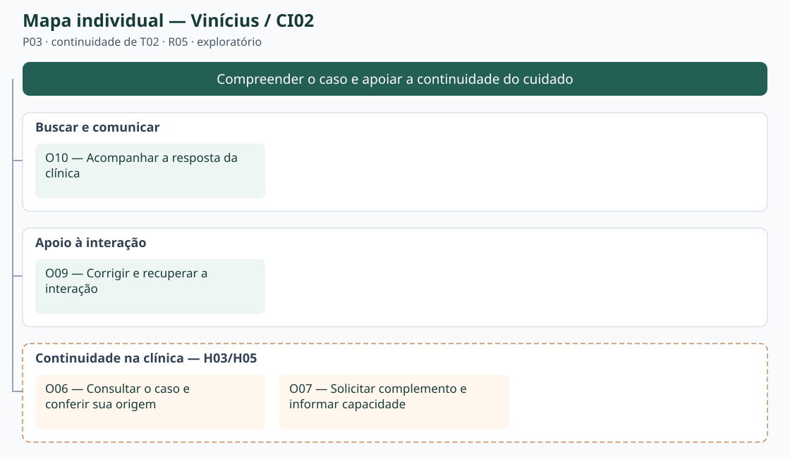
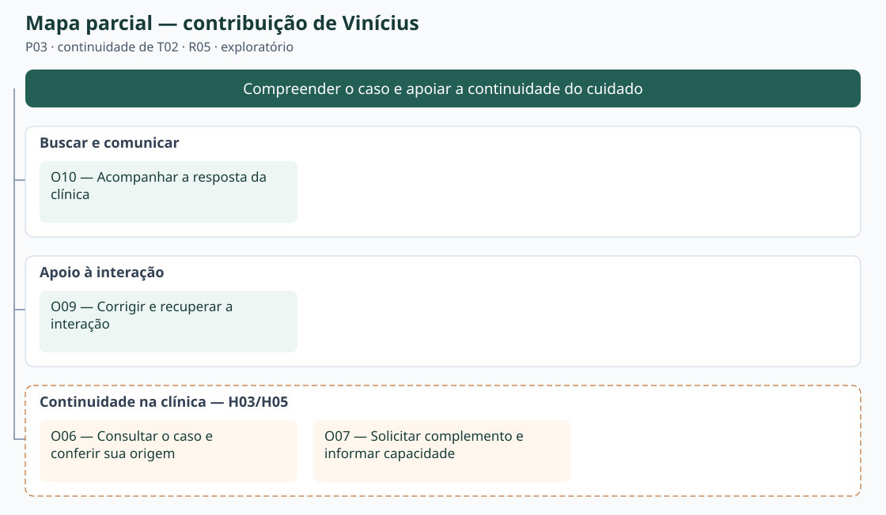

# Entrega 9 — Modelo conceitual e design centrado na comunicação

**Data:** 04/11/2026  
**Status:** 🟨 em andamento  
**Responsabilidade:** soluções individuais, com consolidação da equipe para mapa de objetivos e esquema de signos.

## Objetivo da atividade

Passar do cenário de problema para uma concepção da interação, explicitando objetivos, tópicos de conversa, falas e signos que a interface deverá comunicar/manipular.

## Transformando resultados técnicos em conceitos compreensíveis

Em TCCs algorítmicos ou orientados a dados, esta entrega deve evitar que a interface exponha apenas estruturas internas do código. Identifique os **conceitos e signos que fazem sentido para o usuário**.

Exemplos:

- `query plan`, custo estimado, recomendação e impacto para um DBA;
- modelo, dataset, versão, execução e métrica para engenheiro de IA;
- período, indicador, grupo, tendência e filtro para gestor/analista;
- alerta, severidade, evidência, responsável e status para analista de segurança.

Se um termo técnico for necessário, modele como será comunicado, explicado e relacionado à tarefa.

Dashboards, relatórios, filtros e CRUDs devem aparecer no modelo conceitual por meio dos **objetivos, signos e conversas** que justificam sua existência.

## 1. Cenários de interação

Para cada cenário de problema, produza uma versão em que a solução já pode ser descrita. **Destaque claramente o texto alterado** em relação ao cenário original.

Os trechos em **[ALTERADO: ...]** substituem ações/rupturas do cenário de problema; **[NOVO: ...]** acrescentam a interação proposta. O contexto não marcado foi mantido da E4. Os cenários são hipotéticos; H03/H05 continuam abertas, com o painel da clínica exploratório conforme E6/E7.

### CI02 — Organizar o caso e responder sobre a capacidade da clínica

**Autor(a):** Vinícius de Castro Duarte — 22.224.020-2  
**Origem:** cenário problema C02, versão refinada da Entrega 4; P03; continuidade de T02; R05; H03/H05.

Marina é médica-veterinária plantonista em um hospital veterinário que atende durante a noite. Enquanto acompanha outros animais, uma atendente recebe a ligação de um tutor preocupado com um cão que apresenta dificuldade para respirar.

**[ALTERADO: Na solução proposta, se o tutor tiver autorizado o compartilhamento com essa unidade, a atendente e Marina consultam o caso em uma área restrita à clínica. A lista de encaminhamentos permite abrir o animal, o horário e o estado do pedido. O resumo reúne os sinais, início e evolução informados, preservando o relato original e identificando separadamente a orientação automática e as mensagens profissionais.]**

**[ALTERADO: Em vez de tratar uma informação ausente como negativa, Marina identifica a lacuna e solicita confirmação ao tutor. Uma resposta nova é apresentada como atualização, sem alterar silenciosamente o registro já compartilhado. A profissional confere com a equipe a capacidade real da unidade e informa se pode ou não receber o animal. O tutor vê a resposta vinculada à clínica; o simples recebimento do resumo não equivale a aceite.]**

**[NOVO: Se a unidade não puder receber, a resposta comunica a limitação para que o tutor procure outra opção, sem prometer vaga em outro local. Se houver falha no envio de uma mensagem, o texto é preservado e pode ser reenviado. A tela organiza a comunicação e não toma a decisão clínica por Marina.]**

### Diferenças relevantes

| Alteração | Por que foi necessária | Evidência/artefato que justifica |
|---|---|---|
| Caso autorizado reúne resumo, relato original, horário e origem. | Distinguir observação, síntese automática e fala profissional. | E4:C02; R05; RC06/RC08; H03/H17. |
| Consulta do painel e resposta sobre capacidade. | Apoiar a continuidade descrita em C02, sem presumir recebimento garantido. | E6:PF04; E7:I02; H05/L02. |
| Complemento explícito, recusa e retentativa. | Tratar lacunas e falhas sem completar dados por suposição. | E4:C02 Q4/Q5/Q7; RC05/RC13. |

## 2. Design centrado na comunicação

**Nome do cenário:** CI02 — Organizar o caso e responder sobre a capacidade da clínica.

| Tópico > subtópico | Falas e signos envolvidos | Intenção/efeito esperado |
|---|---|---|
| Consultar o caso — O06 | `U: Quero abrir este encaminhamento.` / `D: Este caso foi compartilhado com sua unidade.` Signos: animal, resumo, horário do registro, estado do encaminhamento. | Localizar o caso autorizado; se a lista estiver vazia, informar ausência de pedidos. |
| > Conferir origem e lacunas — O06 | `U: Preciso conferir o relato original.` / `D: Este trecho foi informado pelo tutor; esta orientação é automática.` Signos: relato, origem da informação, justificativa. | Evitar transformar síntese ou lacuna em fato clínico. |
| > Pedir complemento — O07 | `U: Quando os sinais começaram?` / `D: Mensagem enviada ao tutor.` Signos: mensagem profissional, início dos sinais. | Solicitar dado ausente sem inventá-lo; falha permite reenviar. |
| Informar capacidade — O07/O10 | `U: Nossa unidade pode receber o animal.` / `D: Resposta da clínica registrada e comunicada ao tutor.` Signos: resposta da clínica, estado do encaminhamento. | Registrar decisão humana; impossibilidade de receber deve ser comunicada explicitamente. |
| > Recuperar falha — O09 | `D: Não foi possível enviar sua resposta; o texto foi mantido.` / `U: Tentar novamente.` Signos: mensagem profissional, estado do encaminhamento. | Evitar perda do texto e falso sucesso. |

**Convenção:** `U` = usuário; `D` = preposto do designer/sistema, conforme a abordagem de Engenharia Semiótica adotada na disciplina.

## 3. Mapa de objetivos

Cada integrante apresenta seu mapa e a equipe cria um **mapa consolidado**, eliminando duplicidades e resolvendo conflitos de nomenclatura.

**Vinícius — CI02:** O06, O07, O09 e O10.

*Consolidação parcial das contribuições presentes; falta incorporar o mapa de João. SVGs editáveis; ligações representam decomposição de objetivos.*

### Dicionário de objetivos

| ID | Objetivo | Persona(s) | Cenário(s) | Prioridade |
|---|---|---|---|---|
| O06 | Consultar o caso e conferir sua origem | P03 | CI02 | secundária; H03/H05 |
| O07 | Solicitar complemento e informar capacidade | P03 | CI02 | secundária; H05 |
| O09 | Corrigir e recuperar a interação | P01/P02/P03 | CI01/CI02 | alta |
| O10 | Acompanhar a resposta da clínica | P01/P03 | CI01/CI02 | alta no tutor; H05 na clínica |

## 4. Esquema conceitual de signos

Consolide as informações em **uma tabela única**.

Os IDs S preservados na tabela são identificadores para referências entre artefatos; os rótulos exibidos usam as palavras após o ID. A origem informa quem fornece/produz o conteúdo. “—” indica ausência de valor inicial; sem dado não significa resposta negativa. As restrições abaixo são decisões do modelo a verificar no protótipo, não comprovação de implementação.

| Grupo | Signo | Origem | Observações/semântica | Tipo de conteúdo | Restrição | Valor padrão | Prevenção | Recuperação |
|---|---|---|---|---|---|---|---|---|
| Credenciais | S01 — usuário | domínio; informado pela pessoa | Conta para acessar dados privados; não impede o relato inicial no modelo proposto. | texto | Não nulo no acesso privado. | — | Distinguir tutor/clínica; não mostrar senha. | Explicar falha; permitir nova tentativa. |
| Animal | S02 — animal | domínio; informado pelo tutor | Pet associado ao caso: espécie, nome e idade quando conhecidos. | registro | Espécie cão/gato; desconhecimento explícito; cadastro completo não bloqueia orientação. | Sem animal associado. | Confirmar animal antes de associar. | Corrigir/selecionar outro; manter o relato. |
| Relato | S03 — relato | usuário | Observações nas palavras do tutor; preservadas como origem. | texto | Não vazio para analisar; sem exigir diagnóstico. | Vazio. | Pedir sinais e contexto em linguagem comum. | Editar e enviar novamente. |
| Relato | S04 — início dos sinais | usuário | Momento ou duração aproximada observada. | texto/tempo | “Não sei” não equivale a zero ou sinal ausente. | Não informado. | Distinguir estimativa de horário exato. | Pedir confirmação pontual. |
| Conversa | S08 — estado da análise | sistema | Rascunho, em análise, concluída ou falha; independente da urgência. | estado | Falha não pode ser apresentada como não emergência. | Rascunho. | Feedback de espera e de falha. | Preservar relato e oferecer retentativa. |
| Orientação | S09 — orientação | sistema | Possível emergência ou não emergência; “informações insuficientes” comunica INCERTO, não terceira urgência. | categoria/estado | Sem conclusão enquanto faltarem dados; sem diagnóstico. | Sem orientação. | Texto e ícone além da cor; limites próximos. | Complementar, corrigir relato ou procurar profissional. |
| Orientação | S10 — justificativa | sistema | Motivos e referências apresentados para explicar a orientação. | texto e referências | Não tratar inferência como observação do tutor. | Ausente até análise. | Linguagem simples e origem identificada. | Explicar termo ou permitir novo relato. |
| Orientação | S11 — limites | domínio; comunicado pelo sistema | Pré-triagem não substitui avaliação; informação e situação podem mudar. | texto | Não prometer precisão clínica ou ausência de risco. | Visíveis com a orientação. | Aviso curto no contexto da decisão. | Acesso ao contato profissional. |
| Compartilhamento | S17 — resumo | sistema; revisto pelo tutor | Síntese do caso acompanhada do relato original e origem da orientação. | texto estruturado | Só compartilhar conteúdo revisto/autorizado; não completar lacunas. | Rascunho não enviado. | Pré-visualizar dados e origem. | Corrigir antes do envio; comunicar atualização posterior. |
| Compartilhamento | S18 — destinatário | usuário; unidade selecionada | Clínica habilitada que receberá o caso. | referência à clínica | Seleção de mapa não autoriza envio automático. | Nenhum. | Mostrar nome da unidade antes de confirmar. | Trocar antes do envio. |
| Compartilhamento | S19 — autorização | usuário | Permissão explícita para compartilhar o conteúdo indicado com o destinatário. | sim/não | Sem pré-seleção; conversa completa exige escolha específica. | Não autorizada. | Exibir conteúdo e destinatário. | Cancelar antes do envio; explicar alcance do que já foi compartilhado. |
| Continuidade | S20 — estado do encaminhamento | sistema; resposta humana da clínica | Enviado/aguardando resposta, visualizado, aceito, recusado, a caminho, concluído ou cancelado; falha explicitada. | estado e horário | Envio não implica leitura/aceite; sem resposta não significa aceite. | Sem encaminhamento. | Identificar autor/horário de mudança. | Reconsultar estado, retentar falha ou procurar alternativa. |
| Continuidade | S21 — origem da informação | sistema; autoria registrada | Distingue tutor, conteúdo automático e profissional da unidade. | rótulo e horário | Não rotular automação como avaliação veterinária. | Vinculada ao registro. | Mostrar autoria junto ao conteúdo. | Conferir relato original e atualizações. |
| Continuidade | S22 — mensagem profissional | usuário profissional | Pedido de complemento ou comunicação de atendimento pela clínica. | texto | Acesso restrito ao caso/unidade autorizados. | Vazio. | Identificar remetente e confirmar envio. | Preservar texto em falha e reenviar. |
| Continuidade | S23 — resposta da clínica | usuário profissional | Confirmação ou impossibilidade de receber o caso, com mensagem. | decisão e texto | Decisão humana; não garante tratamento ou desfecho clínico. | Sem resposta. | Não converter recebimento em aceite. | Atualizar a decisão explicitamente e comunicar ao tutor. |
| Continuidade | S24 — horário do registro | sistema | Data/hora do relato, envio ou atualização, vinculada ao evento. | data e hora | Registro anterior não representa estado atual do animal. | Momento do registro. | Mostrar com o evento e sua origem. | Solicitar atualização ao tutor. |

### Regras para os signos

- Use o vocabulário do domínio do usuário.
- Evite duplicar o mesmo conceito com nomes diferentes.
- Diferencie informação fornecida pelo usuário, produzida pelo sistema e derivada do domínio.
- Registre prevenção e recuperação apenas quando fizer sentido; explique as siglas usadas.

## Síntese

Quais objetivos/tópicos/signos deverão necessariamente aparecer nos diagramas MoLIC?

Nesta versão cumulativa, estão presentes a contribuição de Vinícius (CI02 e seu mapa). Os objetivos e signos correspondentes foram reunidos para continuidade na E10. A consolidação final depende das contribuições restantes. H03/H05 continuam abertas.

## Checklist

- [x] Cenários de interação mostram alterações em relação aos cenários de problema.
- [x] Cada solução individual identifica autor e cenário de origem.
- [x] Tópicos/falas/signos são coerentes com objetivos do usuário.
- [ ] Mapas individuais foram consolidados.
- [x] O esquema de signos está em uma tabela única e sem duplicações conceituais.
- [x] Nomes de objetivos/signos serão reutilizados na Entrega 10.
- [x] Em TCC técnico, signos representam conceitos do domínio compreensíveis ao usuário, não apenas variáveis/estruturas internas.
- [x] Padrões como dashboard, relatório, filtros, administração e CRUD possuem objetivos e signos correspondentes.
- [x] A interface comunica não só o resultado técnico, mas também seu significado para a tarefa.

