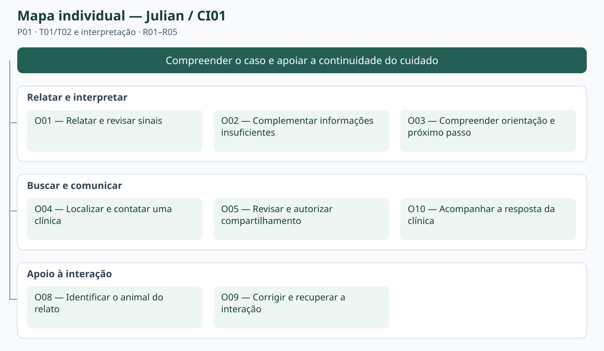
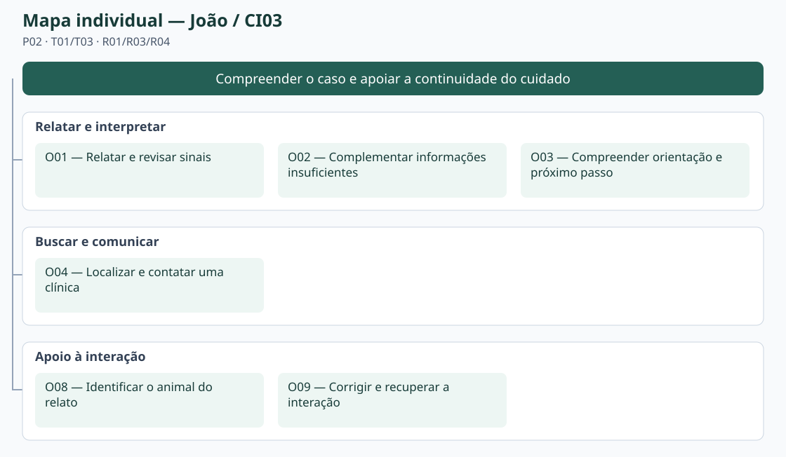

# Entrega 9 — Modelo conceitual e design centrado na comunicação

**Data:** 04/11/2026  
**Status:** 🟩 concluída  
**Responsabilidade:** soluções individuais, com consolidação da equipe para mapa de objetivos e esquema de signos.

## Objetivo da atividade

Passar do cenário de problema para uma concepção da interação, explicitando objetivos, tópicos de conversa, falas e signos que a interface deverá comunicar/manipular.

## Transformando resultados técnicos em conceitos compreensíveis

Em TCCs algorítmicos ou orientados a dados, esta entrega deve evitar que a interface exponha apenas estruturas internas do código. Identifique os **conceitos e signos que fazem sentido para o usuário**.

Exemplos:

- `query plan`, custo estimado, recomendação e impacto para um DBA;
- modelo, dataset, versão, execução e métrica para engenheiro de IA;
- período, indicador, grupo, tendência e filtro para gestor/analista;
- alerta, severidade, evidência, responsável e status para analista de segurança.

Se um termo técnico for necessário, modele como será comunicado, explicado e relacionado à tarefa.

Dashboards, relatórios, filtros e CRUDs devem aparecer no modelo conceitual por meio dos **objetivos, signos e conversas** que justificam sua existência.

## 1. Cenários de interação

Para cada cenário de problema, produza uma versão em que a solução já pode ser descrita. **Destaque claramente o texto alterado** em relação ao cenário original.

Os trechos em **[ALTERADO: ...]** substituem ações/rupturas do cenário de problema; **[NOVO: ...]** acrescentam a interação proposta. O contexto não marcado foi mantido da E4. Os cenários são hipotéticos; H03/H05 continuam abertas, com o painel da clínica exploratório conforme E6/E7.

### CI01 — Relatar os sinais de Bob e buscar atendimento

**Autor(a):** Julian Ryu Takeda — 22.224.030-1  
**Origem:** cenário problema C01, versão refinada da Entrega 4; P01; T01 e T02; R01–R04.

Durante a madrugada, Camila percebe que Bob, seu cão, está ofegante, mais quieto do que o normal e com a língua em uma coloração diferente. Ela está sozinha em casa, precisa continuar observando o animal e não possui conhecimento veterinário para avaliar se os sinais podem esperar até a manhã seguinte ou se exigem deslocamento imediato até um hospital veterinário.

**[ALTERADO: Em vez de alternar buscas e páginas conflitantes, Camila abre a pré-triagem e descreve “respirando muito rápido”, “sem querer levantar” e “língua meio roxa”. Identifica a espécie e pode associar o pet já cadastrado ou completar o cadastro depois. Se usar voz, confere e corrige a transcrição antes de enviar. O sistema informa que está analisando; uma falha mantém o relato disponível para retentativa.]**

**[ALTERADO: Neste caso fictício, recebe uma orientação de possível emergência, com os sinais considerados, justificativa breve e limites. O contato profissional permanece acessível sem exigir perguntas secundárias. Camila abre a busca de clínicas, informa a região caso não permita localização e consulta lista, horário informado e contato. A primeira unidade não responde; ela procura outra enquanto pede ajuda ao familiar para o transporte.]**

**[NOVO: Se decidir compartilhar o caso com uma unidade habilitada, revisa o resumo e o destinatário e autoriza o envio. O sistema distingue “enviado”, “aguardando resposta” e “aceito pela clínica”; sem aceite, ela não presume atendimento garantido. A situação de Bob pode mudar, e uma orientação anterior não substitui a avaliação veterinária.]**

### Diferenças relevantes

| Alteração | Por que foi necessária | Evidência/artefato que justifica |
|---|---|---|
| Relato único, revisão e retomada substituem buscas dispersas. | Preservar as palavras da tutora e permitir correção. | E4:C01; E5:T01; RC05–RC07; H09/H16. |
| Orientação com limites e acesso ao contato. | Converter interpretação em próximo passo, sem cadastro extenso como barreira. | E5:T03; E6:PF01/PF02; E8:MU01/MU04; H14/H18. |
| Busca manual e contato alternativo; envio autorizado com estado explícito. | Tratar permissão recusada e ausência de resposta sem presumir capacidade. | E5:T02; E6:PF03; R04/R05. |

### CI02 — Organizar o caso e responder sobre a capacidade da clínica

**Autor(a):** Vinícius de Castro Duarte — 22.224.020-2  
**Origem:** cenário problema C02, versão refinada da Entrega 4; P03; continuidade de T02; R05; H03/H05.

Marina é médica-veterinária plantonista em um hospital veterinário que atende durante a noite. Enquanto acompanha outros animais, uma atendente recebe a ligação de um tutor preocupado com um cão que apresenta dificuldade para respirar.

**[ALTERADO: Na solução proposta, se o tutor tiver autorizado o compartilhamento com essa unidade, a atendente e Marina consultam o caso em uma área restrita à clínica. A lista de encaminhamentos permite abrir o animal, o horário e o estado do pedido. O resumo reúne os sinais, início e evolução informados, preservando o relato original e identificando separadamente a orientação automática e as mensagens profissionais.]**

**[ALTERADO: Em vez de tratar uma informação ausente como negativa, Marina identifica a lacuna e solicita confirmação ao tutor. Uma resposta nova é apresentada como atualização, sem alterar silenciosamente o registro já compartilhado. A profissional confere com a equipe a capacidade real da unidade e informa se pode ou não receber o animal. O tutor vê a resposta vinculada à clínica; o simples recebimento do resumo não equivale a aceite.]**

**[NOVO: Se a unidade não puder receber, a resposta comunica a limitação para que o tutor procure outra opção, sem prometer vaga em outro local. Se houver falha no envio de uma mensagem, o texto é preservado e pode ser reenviado. A tela organiza a comunicação e não toma a decisão clínica por Marina.]**

### Diferenças relevantes

| Alteração | Por que foi necessária | Evidência/artefato que justifica |
|---|---|---|
| Caso autorizado reúne resumo, relato original, horário e origem. | Distinguir observação, síntese automática e fala profissional. | E4:C02; R05; RC06/RC08; H03/H17. |
| Consulta do painel e resposta sobre capacidade. | Apoiar a continuidade descrita em C02, sem presumir recebimento garantido. | E6:PF04; E7:I02; H05/L02. |
| Complemento explícito, recusa e retentativa. | Tratar lacunas e falhas sem completar dados por suposição. | E4:C02 Q4/Q5/Q7; RC05/RC13. |

### CI03 — Complementar o relato de Nina e compreender a orientação

**Autor(a):** João Pedro Gardenghi Peterutto — 22.125.066-5  
**Origem:** cenário problema C03, versão refinada da Entrega 4; P02; T01 e T03; R01/R03.

Roberto percebe, ao longo de dois dias, que Nina, sua gata idosa, está comendo menos, permanecendo escondida por mais tempo e agindo de modo diferente do habitual. Como as mudanças ocorreram gradualmente e não há um evento evidente, ele não sabe se está diante de uma variação passageira de comportamento ou de um problema que exige atendimento.

**[ALTERADO: Em vez de manter o relato disperso entre buscas, papel e mensagens, Roberto associa Nina à conversa e informa as mudanças e quando começaram. A interface permite revisar o relato sem exigir termos clínicos. Neste cenário fictício, a primeira análise fica em “informações insuficientes”, explicando que ainda não é possível concluir se há emergência.]**

**[ALTERADO: Roberto recebe uma pergunta sobre a informação faltante, responde apenas o que observou e pode escolher “não sei”. Se o diálogo não avançar, recebe opções de resposta para uma pergunta dirigida, além de complemento livre. Não saber não é registrado como ausência do sinal. O contato profissional continua disponível e ele pode interromper a coleta.]**

**[NOVO: Se ainda faltarem dados, a conversa permanece inconclusiva e oferece complemento ou busca de atendimento. Se houver orientação, Roberto lê os motivos, limites e próximo passo. Em uma alternativa de não emergência, o texto comunica acompanhamento e quando buscar avaliação, sem significar “não precisa de cuidado”. Uma mudança posterior em Nina pode ser relatada e exige reconsiderar a orientação anterior. Se a primeira clínica não responder, ele procura outro contato.]**

### Diferenças relevantes

| Alteração | Por que foi necessária | Evidência/artefato que justifica |
|---|---|---|
| Relato reunido e complemento dirigido. | Preservar a sequência observada e reduzir perguntas sem relação com a lacuna. | E4:C03; E5:T01/T03; E6:PF02; H12/H15. |
| “Não sei” e informação insuficiente explícitos. | Evitar resposta inventada e confusão com não emergência. | E5:T03; RC11/RC14; E8:MU04. |
| Próximo passo, atualização e contato alternativo. | Permitir agir sem falsa segurança quando a dúvida ou os sinais mudarem. | E4:C03 Q5/Q8; H02/H13; R03/R04. |

## 2. Design centrado na comunicação

**Nome do cenário:** CI01 — Relatar os sinais de Bob e buscar atendimento.

| Tópico > subtópico | Falas e signos envolvidos | Intenção/efeito esperado |
|---|---|---|
| Relatar sinais — O01/O08 | `U: É meu cão Bob; ele está respirando muito rápido.` / `D: Conte o que observou e quando começou.` Signos: animal, relato, início dos sinais. | Identificar o contexto sem exigir vocabulário clínico. |
| > Revisar e enviar — O01/O09 | `U: Quero corrigir o texto.` / `D: Confira a transcrição; não foi enviada ainda.` Signos: transcrição, estado da análise. | Corrigir antes do envio; em falha, preservar o relato e permitir retentar. |
| Compreender orientação — O03 | `D: Possível emergência; veja os motivos e procure atendimento.` / `U: Quero encontrar uma clínica.` Signos: orientação, justificativa, limites, próximo passo. | Transformar orientação em ação sem apresentar diagnóstico. |
| > Localizar e contatar — O04 | `U: Vou informar minha região.` / `D: Estas são as opções; confirme atendimento com a unidade.` Signos: região, clínica, horário informado, contato. | Tratar permissão negada e evitar confundir mapa com vaga. |
| > Compartilhar e acompanhar — O05/O10 | `U: Revisei e autorizo enviar a esta clínica.` / `D: Pedido enviado; aguarde a resposta da unidade.` Signos: resumo, destinatário, autorização, estado do encaminhamento. | Permitir controle do envio; sem resposta, buscar outra unidade. |

**Nome do cenário:** CI02 — Organizar o caso e responder sobre a capacidade da clínica.

| Tópico > subtópico | Falas e signos envolvidos | Intenção/efeito esperado |
|---|---|---|
| Consultar o caso — O06 | `U: Quero abrir este encaminhamento.` / `D: Este caso foi compartilhado com sua unidade.` Signos: animal, resumo, horário do registro, estado do encaminhamento. | Localizar o caso autorizado; se a lista estiver vazia, informar ausência de pedidos. |
| > Conferir origem e lacunas — O06 | `U: Preciso conferir o relato original.` / `D: Este trecho foi informado pelo tutor; esta orientação é automática.` Signos: relato, origem da informação, justificativa. | Evitar transformar síntese ou lacuna em fato clínico. |
| > Pedir complemento — O07 | `U: Quando os sinais começaram?` / `D: Mensagem enviada ao tutor.` Signos: mensagem profissional, início dos sinais. | Solicitar dado ausente sem inventá-lo; falha permite reenviar. |
| Informar capacidade — O07/O10 | `U: Nossa unidade pode receber o animal.` / `D: Resposta da clínica registrada e comunicada ao tutor.` Signos: resposta da clínica, estado do encaminhamento. | Registrar decisão humana; impossibilidade de receber deve ser comunicada explicitamente. |
| > Recuperar falha — O09 | `D: Não foi possível enviar sua resposta; o texto foi mantido.` / `U: Tentar novamente.` Signos: mensagem profissional, estado do encaminhamento. | Evitar perda do texto e falso sucesso. |

**Nome do cenário:** CI03 — Complementar o relato de Nina e compreender a orientação.

| Tópico > subtópico | Falas e signos envolvidos | Intenção/efeito esperado |
|---|---|---|
| Organizar o relato — O01/O08 | `U: Nina come menos e se esconde há dois dias.` / `D: Confira o animal e o que foi relatado.` Signos: animal, relato, início dos sinais. | Reunir o contexto sem exigir diagnóstico. |
| > Resolver informação insuficiente — O02 | `D: Ainda faltam informações; responda apenas o que observou.` / `U: Não sei dizer.` Signos: pergunta complementar, resposta complementar, orientação. | Distinguir desconhecimento de ausência do sinal. |
| > Complemento dirigido — O02/O09 | `D: Escolha uma opção ou descreva com suas palavras.` / `U: Quero acrescentar uma observação.` Signos: pergunta complementar, resposta complementar, relato. | Recuperar a conversa sem repetir indefinidamente; permitir sair para contato. |
| Compreender resultado — O03 | `U: O que isso significa e o que faço agora?` / `D: Veja a orientação, seus limites e o próximo passo.` Signos: orientação, justificativa, limites, próximo passo. | Distinguir não emergência, informação insuficiente e acompanhamento. |
| > Procurar ajuda — O04 | `U: Prefiro falar com uma clínica.` / `D: Informe sua região ou permita a localização.` Signos: região, clínica, contato. | Dar continuidade mesmo se a análise permanecer inconclusiva. |

**Convenção:** `U` = usuário; `D` = preposto do designer/sistema, conforme a abordagem de Engenharia Semiótica adotada na disciplina.

## 3. Mapa de objetivos

Cada integrante apresenta seu mapa e a equipe cria um **mapa consolidado**, eliminando duplicidades e resolvendo conflitos de nomenclatura.

**Julian — CI01:** O01–O05 e O08–O10.

**Vinícius — CI02:** O06, O07, O09 e O10.

**João — CI03:** O01–O04, O08 e O09.

*Mapas: elaboração para esta entrega, com fontes SVG editáveis. As ligações representam decomposição de objetivos, não ordem de telas. O01–O04 e O08/O09 compartilhados pelos tutores foram unificados; O10 conecta envio e resposta sem confundir seus estados. O06/O07 permanecem no ramo exploratório da clínica. O cadastro é apoio de O08; o painel apoia O06/O07; o resumo apoia O05/O06; o histórico apoia O10. Não foram acrescentados filtros, comparação de resultados ou administração geral sem objetivo neste recorte.*

### Dicionário de objetivos

| ID | Objetivo | Persona(s) | Cenário(s) | Prioridade |
|---|---|---|---|---|
| O01 | Relatar e revisar sinais | P01/P02 | CI01/CI03 | alta |
| O02 | Complementar informações insuficientes | P01/P02 | CI01/CI03 | alta |
| O03 | Compreender orientação e próximo passo | P01/P02 | CI01/CI03 | alta |
| O04 | Localizar e contatar uma clínica | P01/P02 | CI01/CI03 | alta |
| O05 | Revisar e autorizar compartilhamento | P01 | CI01 | alta |
| O06 | Consultar o caso e conferir sua origem | P03 | CI02 | secundária; H03/H05 |
| O07 | Solicitar complemento e informar capacidade | P03 | CI02 | secundária; H05 |
| O08 | Identificar o animal do relato | P01/P02 | CI01/CI03 | apoio |
| O09 | Corrigir e recuperar a interação | P01/P02/P03 | CI01/CI02/CI03 | alta |
| O10 | Acompanhar a resposta da clínica | P01/P03 | CI01/CI02 | alta no tutor; H05 na clínica |

## 4. Esquema conceitual de signos

Consolide as informações em **uma tabela única**.

S01–S24 são identificadores para referências entre artefatos; os rótulos exibidos usam as palavras após o ID. A origem informa quem fornece/produz o conteúdo. “—” indica ausência de valor inicial; sem dado não significa resposta negativa. As restrições abaixo são decisões do modelo a verificar no protótipo, não comprovação de implementação.

| Grupo | Signo | Origem | Observações/semântica | Tipo de conteúdo | Restrição | Valor padrão | Prevenção | Recuperação |
|---|---|---|---|---|---|---|---|---|
| Credenciais | S01 — usuário | domínio; informado pela pessoa | Conta para acessar dados privados; não impede o relato inicial no modelo proposto. | texto | Não nulo no acesso privado. | — | Distinguir tutor/clínica; não mostrar senha. | Explicar falha; permitir nova tentativa. |
| Animal | S02 — animal | domínio; informado pelo tutor | Pet associado ao caso: espécie, nome e idade quando conhecidos. | registro | Espécie cão/gato; desconhecimento explícito; cadastro completo não bloqueia orientação. | Sem animal associado. | Confirmar animal antes de associar. | Corrigir/selecionar outro; manter o relato. |
| Relato | S03 — relato | usuário | Observações nas palavras do tutor; preservadas como origem. | texto | Não vazio para analisar; sem exigir diagnóstico. | Vazio. | Pedir sinais e contexto em linguagem comum. | Editar e enviar novamente. |
| Relato | S04 — início dos sinais | usuário | Momento ou duração aproximada observada. | texto/tempo | “Não sei” não equivale a zero ou sinal ausente. | Não informado. | Distinguir estimativa de horário exato. | Pedir confirmação pontual. |
| Relato | S05 — transcrição | sistema a partir de voz do tutor | Texto reconhecido, sujeito a erro; não é orientação. | texto | Revisável antes do envio. | Sem transcrição. | Mostrar que ainda precisa ser conferida. | Corrigir por texto ou gravar novamente. |
| Conversa | S06 — pergunta complementar | sistema | Pedido de dado relevante ainda ausente; uma observação por pergunta. | texto e opções | Não exigir resposta inventada ou repetir sem progresso. | Sem pergunta ativa. | Explicar o que se pede; permitir não saber. | Complemento livre ou contato profissional. |
| Conversa | S07 — resposta complementar | usuário | Dado observado, negativa explícita ou desconhecimento, ligados à pergunta. | texto/opção | “Não sei” não significa “não apresenta”. | Não respondida. | Separar desconhecimento e ausência. | Corrigir resposta ou acrescentar observação. |
| Conversa | S08 — estado da análise | sistema | Rascunho, em análise, concluída ou falha; independente da urgência. | estado | Falha não pode ser apresentada como não emergência. | Rascunho. | Feedback de espera e de falha. | Preservar relato e oferecer retentativa. |
| Orientação | S09 — orientação | sistema | Possível emergência ou não emergência; “informações insuficientes” comunica INCERTO, não terceira urgência. | categoria/estado | Sem conclusão enquanto faltarem dados; sem diagnóstico. | Sem orientação. | Texto e ícone além da cor; limites próximos. | Complementar, corrigir relato ou procurar profissional. |
| Orientação | S10 — justificativa | sistema | Motivos e referências apresentados para explicar a orientação. | texto e referências | Não tratar inferência como observação do tutor. | Ausente até análise. | Linguagem simples e origem identificada. | Explicar termo ou permitir novo relato. |
| Orientação | S11 — limites | domínio; comunicado pelo sistema | Pré-triagem não substitui avaliação; informação e situação podem mudar. | texto | Não prometer precisão clínica ou ausência de risco. | Visíveis com a orientação. | Aviso curto no contexto da decisão. | Acesso ao contato profissional. |
| Orientação | S12 — próximo passo | sistema; decisão do usuário | Complementar, procurar atendimento ou acompanhar conforme orientação. | texto e ação | Não esconder contato em perguntas/cadastro; não emergência não encerra cuidado. | Conforme estado, sem ação presumida. | Ação contextual com significado claro. | Voltar, atualizar relato ou buscar ajuda. |
| Busca | S13 — região | usuário ou dispositivo com permissão | Referência para localizar clínicas. | endereço/região/coordenadas | Localização automática opcional. | Não informada. | Explicar solicitação de permissão. | Informar região manualmente. |
| Busca | S14 — clínica | domínio; serviço de busca | Unidade identificada por nome e localização; pode não integrar a plataforma. | registro | Listagem não prova vaga nem vínculo para receber resumo. | Nenhuma selecionada. | Distinguir unidade real e acadêmica. | Selecionar outra unidade. |
| Busca | S15 — horário informado | domínio; serviço de busca | Funcionamento publicado, sujeito a ausência/desatualização. | texto/horário | “Aberta” não significa capacidade confirmada. | Não informado. | Exibir ausência e orientar confirmação. | Consultar contato da unidade. |
| Busca | S16 — contato | domínio; clínica | Telefone ou canal da unidade. | telefone/canal | Não presumir chamada atendida ou comunicação concluída. | Não informado. | Identificar a unidade do contato. | Tentar outro canal/unidade. |
| Compartilhamento | S17 — resumo | sistema; revisto pelo tutor | Síntese do caso acompanhada do relato original e origem da orientação. | texto estruturado | Só compartilhar conteúdo revisto/autorizado; não completar lacunas. | Rascunho não enviado. | Pré-visualizar dados e origem. | Corrigir antes do envio; comunicar atualização posterior. |
| Compartilhamento | S18 — destinatário | usuário; unidade selecionada | Clínica habilitada que receberá o caso. | referência à clínica | Seleção de mapa não autoriza envio automático. | Nenhum. | Mostrar nome da unidade antes de confirmar. | Trocar antes do envio. |
| Compartilhamento | S19 — autorização | usuário | Permissão explícita para compartilhar o conteúdo indicado com o destinatário. | sim/não | Sem pré-seleção; conversa completa exige escolha específica. | Não autorizada. | Exibir conteúdo e destinatário. | Cancelar antes do envio; explicar alcance do que já foi compartilhado. |
| Continuidade | S20 — estado do encaminhamento | sistema; resposta humana da clínica | Enviado/aguardando resposta, visualizado, aceito, recusado, a caminho, concluído ou cancelado; falha explicitada. | estado e horário | Envio não implica leitura/aceite; sem resposta não significa aceite. | Sem encaminhamento. | Identificar autor/horário de mudança. | Reconsultar estado, retentar falha ou procurar alternativa. |
| Continuidade | S21 — origem da informação | sistema; autoria registrada | Distingue tutor, conteúdo automático e profissional da unidade. | rótulo e horário | Não rotular automação como avaliação veterinária. | Vinculada ao registro. | Mostrar autoria junto ao conteúdo. | Conferir relato original e atualizações. |
| Continuidade | S22 — mensagem profissional | usuário profissional | Pedido de complemento ou comunicação de atendimento pela clínica. | texto | Acesso restrito ao caso/unidade autorizados. | Vazio. | Identificar remetente e confirmar envio. | Preservar texto em falha e reenviar. |
| Continuidade | S23 — resposta da clínica | usuário profissional | Confirmação ou impossibilidade de receber o caso, com mensagem. | decisão e texto | Decisão humana; não garante tratamento ou desfecho clínico. | Sem resposta. | Não converter recebimento em aceite. | Atualizar a decisão explicitamente e comunicar ao tutor. |
| Continuidade | S24 — horário do registro | sistema | Data/hora do relato, envio ou atualização, vinculada ao evento. | data e hora | Registro anterior não representa estado atual do animal. | Momento do registro. | Mostrar com o evento e sua origem. | Solicitar atualização ao tutor. |

### Regras para os signos

- Use o vocabulário do domínio do usuário.
- Evite duplicar o mesmo conceito com nomes diferentes.
- Diferencie informação fornecida pelo usuário, produzida pelo sistema e derivada do domínio.
- Registre prevenção e recuperação apenas quando fizer sentido; explique as siglas usadas.

## Síntese

Quais objetivos/tópicos/signos deverão necessariamente aparecer nos diagramas MoLIC?

Na E10, CI01 deve cobrir relato/revisão, orientação, busca de clínica e compartilhamento (O01–O05, O08–O10); CI02, consulta do caso, complemento e resposta da unidade (O06/O07/O09/O10); CI03, relato, informação insuficiente e interpretação/contato (O01–O04/O08/O09). Os signos S01–S24 serão reutilizados nos tópicos correspondentes, sem transformar o MoLIC em sequência de telas.

São rupturas necessárias: dado desconhecido, transcrição incorreta, falha de análise/envio, localização recusada, ausência de clínica/resposta e recusa de atendimento. O usuário deve compreender a saída ou recuperação. O conteúdo clínico dos exemplos é fictício; esta modelagem não confirma hipóteses nem resultados de testes.

Base: [cenários refinados da E4](04_cenarios_problema.md), [tarefas da E5](05_analise_tarefas.md), [fluxos da E6](06_prototipacao_papel.md), [instrumentos da E7](07_coleta_dados.md), [metas da E8](08_engenharia_usabilidade.md), [rastreabilidade](../RASTREABILIDADE.md) e [bibliografia da disciplina](../BIBLIOGRAFIA.md), especialmente Engenharia Semiótica e design como conversação. Os registros D01–D42 do repositório apoiam a relação com cadastro, chat, mapa, autorização e resposta; não constituem validação com usuários.

## Checklist

- [x] Cenários de interação mostram alterações em relação aos cenários de problema.
- [x] Cada solução individual identifica autor e cenário de origem.
- [x] Tópicos/falas/signos são coerentes com objetivos do usuário.
- [x] Mapas individuais foram consolidados.
- [x] O esquema de signos está em uma tabela única e sem duplicações conceituais.
- [x] Nomes de objetivos/signos serão reutilizados na Entrega 10.
- [x] Em TCC técnico, signos representam conceitos do domínio compreensíveis ao usuário, não apenas variáveis/estruturas internas.
- [x] Padrões como dashboard, relatório, filtros, administração e CRUD possuem objetivos e signos correspondentes.
- [x] A interface comunica não só o resultado técnico, mas também seu significado para a tarefa.

