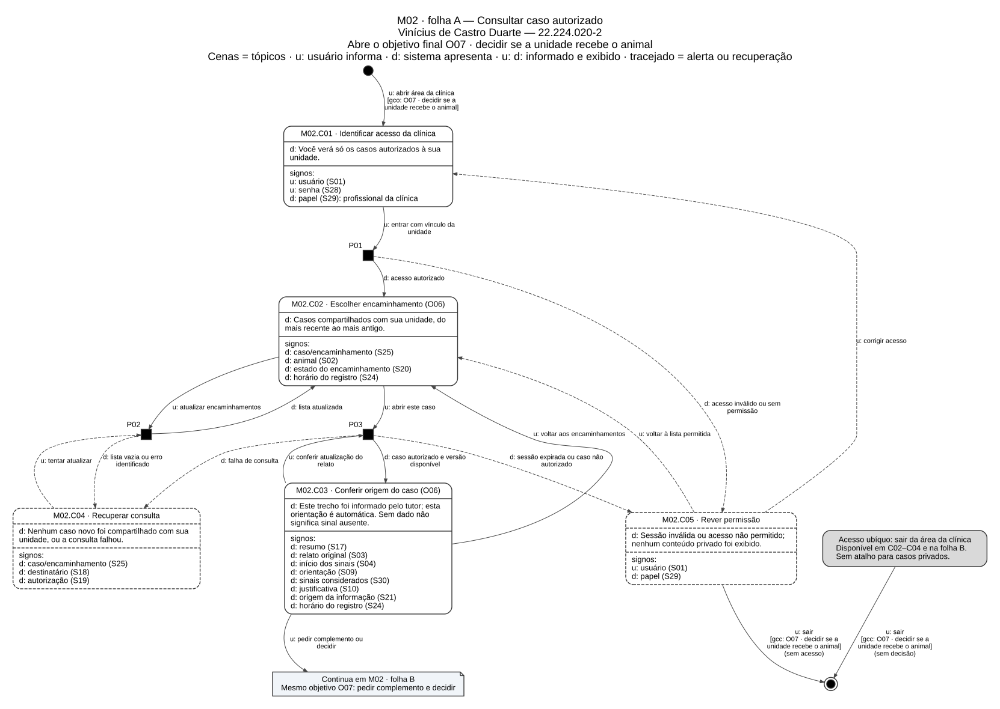
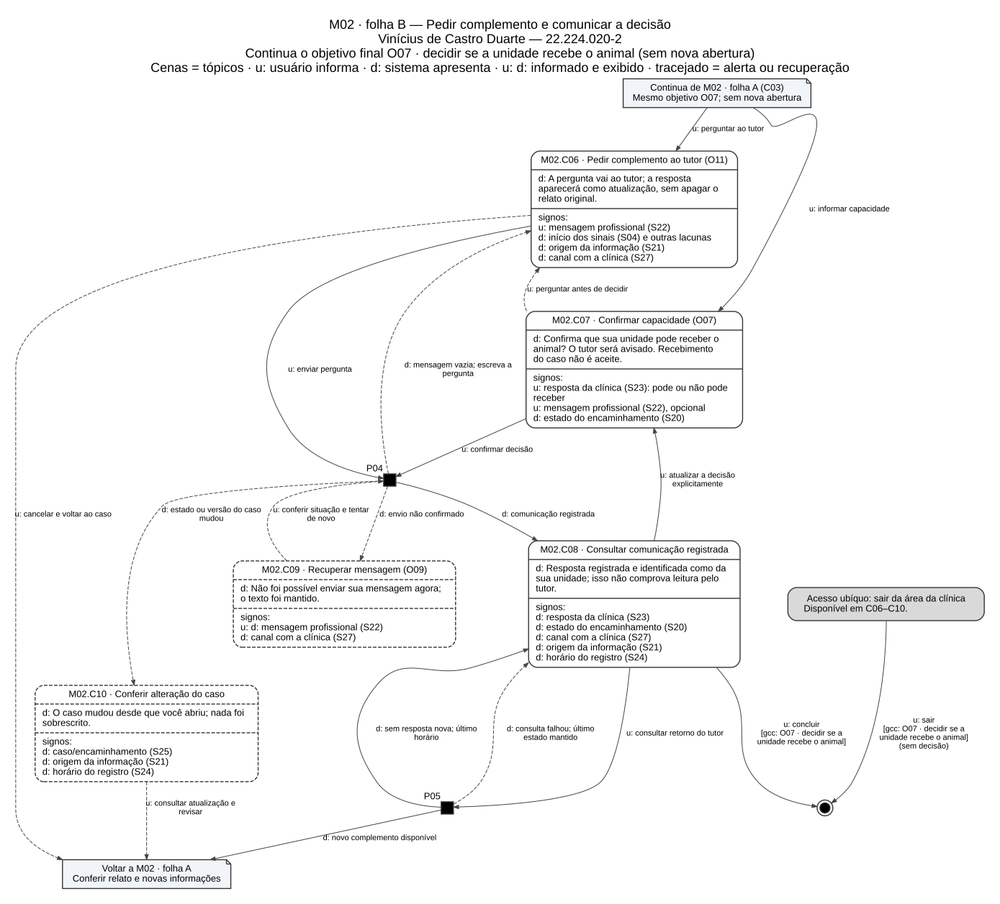
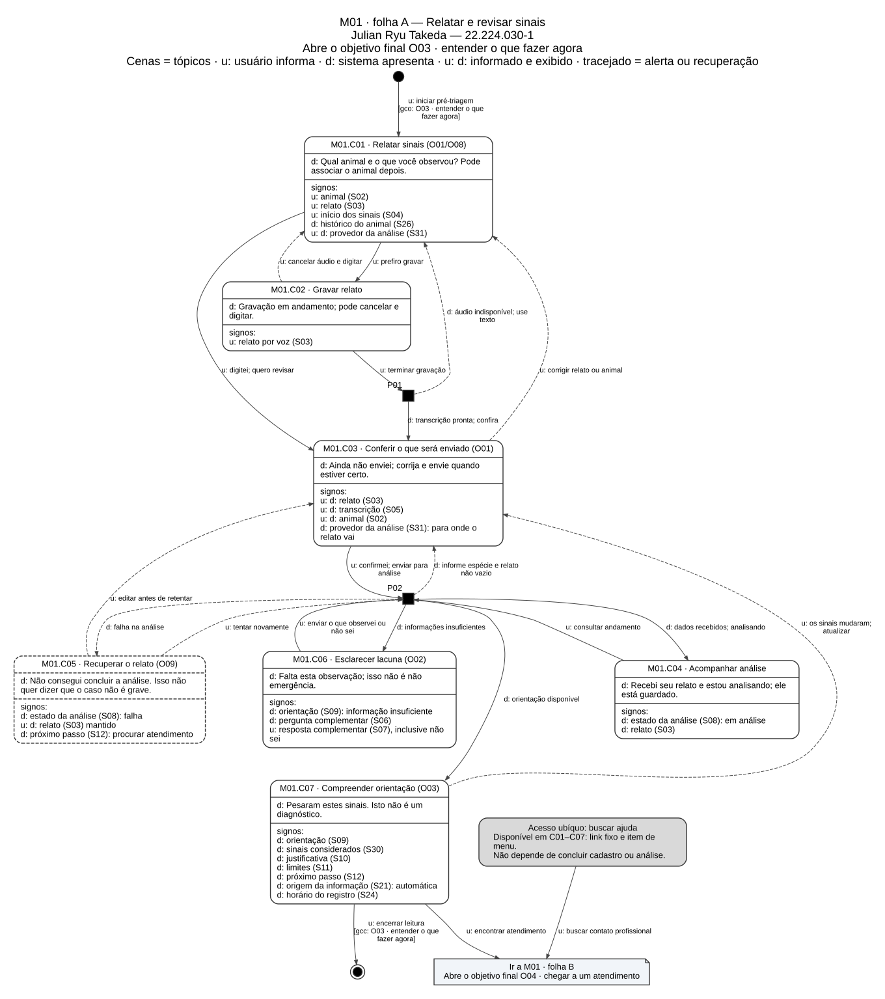
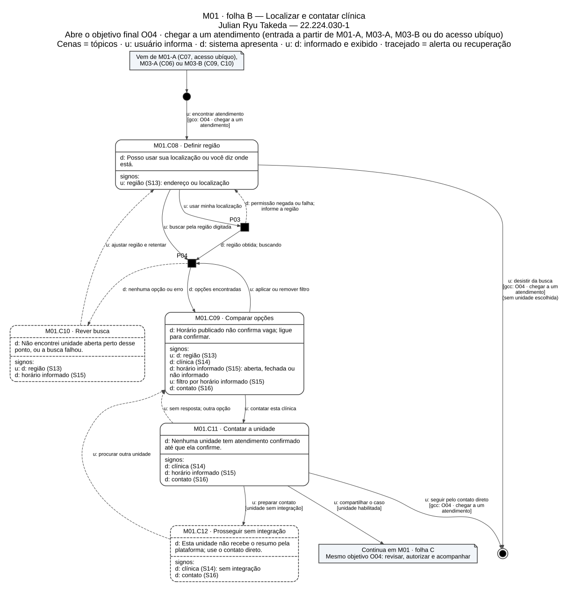
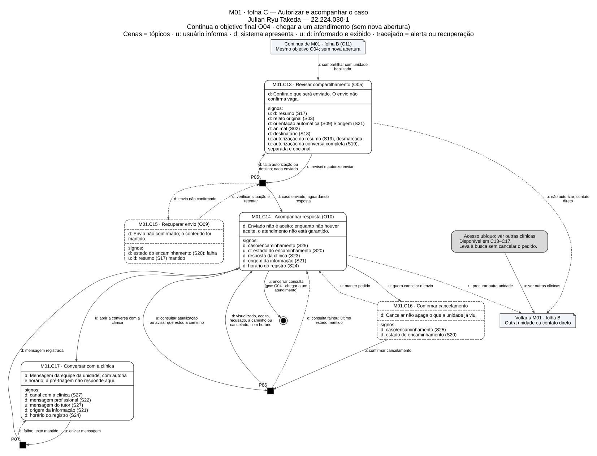
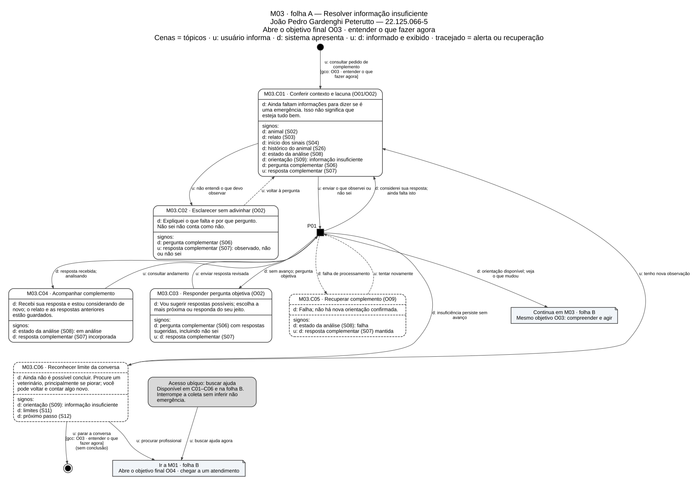
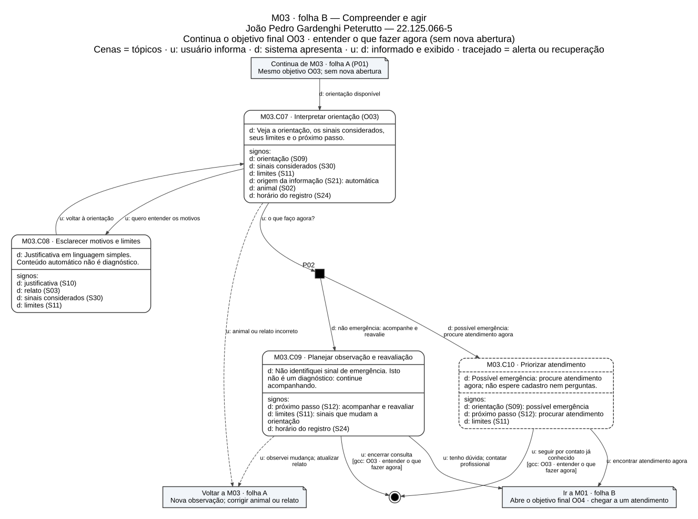

# Entrega 10 — MoLIC

**Data:** 04/11/2026  
**Revisão após o feedback do professor:** 22/11/2026 (incorpora também a revisão da E9 de 16/11/2026)  
**Status:** 🟩 concluída  
**Responsabilidade:** 1 solução completa por integrante e consolidação da equipe. M01 = Julian (CI01); M02 = Vinícius (CI02); M03 = João (CI03).

## Objetivo da atividade

Modelar a interação como uma conversa entre usuário e preposto do designer, explicitando tópicos, signos, alternativas, processamentos e recuperação de rupturas. As cenas representam assuntos da conversa, não páginas nem etapas internas do RAG.

**O que mudou nesta revisão:** (1) cada objetivo **final** da E9 tem um `gco` e pelo menos um `gcc` com o mesmo nome, e as folhas que continuam um objetivo não o abrem de novo; (2) cada cena lista os signos pelo nome, marcados com `u:` (o usuário informa) ou `d:` (o sistema apresenta); (3) os signos S25–S31 da revisão da E9 entraram nas cenas, e cada modelo tem um mapeamento cena → tópico do DCC; (4) cenas de alerta padronizadas com contorno tracejado e a classificação da orientação passou a sair de uma caixa preta; (5) diagramas redesenhados para reduzir cruzamentos e acesso ubíquo revisto.

## Entradas e delimitação

Base: [E4](04_cenarios_problema.md), [E5](05_analise_tarefas.md), [E6](06_prototipacao_papel.md), [E8](08_engenharia_usabilidade.md) e [E9](09_modelo_conceitual.md) (cenários CI01–CI03, DCCs, mapa de objetivos e esquema de signos S01–S31, revisados em 16/11), além dos slides de MoLIC da disciplina.

Os modelos descrevem a interação proposta para a POC acadêmica; modelagem não comprova compreensão, precisão clínica nem benefício do resumo. Casos e unidades são fictícios. O ramo da clínica (M02) continua condicionado a H03/H05 e é exploratório. Não há encaminhamento automático por especialidade.

### Objetivos finais e conversas

A E9 classifica os objetivos em finais e instrumentais. Só os **finais** abrem (`gco`) e fecham (`gcc`) uma conversa; os instrumentais aparecem como mudanças de tópico dentro dela (o código do objetivo aparece no título da cena).

| Objetivo final (E9) | Papel | gco em | gcc em | Instrumentais que aparecem como tópicos |
|---|---|---|---|---|
| O03 · entender o que fazer agora | tutor | M01-A (abertura); M03-A (abertura) | M01-A (C07); M03-A (C06, sem conclusão); M03-B (C09, C10) | O01, O02, O08, O09 |
| O04 · chegar a um atendimento | tutor | M01-B (abertura) | M01-B (C11, C08); M01-C (C14) | O05, O10, O09 |
| O07 · decidir se a unidade recebe o animal | profissional da clínica | M02-A (abertura) | M02-A (C05, acesso ubíquo); M02-B (C08, acesso ubíquo) | O06, O11, O09 |

**Uma abertura por objetivo final.** M01-C, M02-B e M03-B continuam a conversa da folha anterior: começam por uma nota de continuação, sem círculo de abertura. M01-B tem círculo próprio porque abre outro objetivo final (O04), que pode começar em M01-A, M03-A, M03-B ou no acesso ubíquo. M01 e M03 abrem O03 cada um porque modelam cenários diferentes (CI01 e CI03) do mesmo objetivo.

### Notação e organização dos diagramas

| Elemento | Representação e significado |
|---|---|
| Abertura | Círculo preto com a fala de entrada; `[gco: Oxx · nome]` abre a conversa sobre um objetivo final. |
| Cena | Retângulo arredondado em três partes: tópico (com o objetivo instrumental entre parênteses); falas do preposto (`d:`); **signos** da cena, um por linha, com nome e ID da E9. |
| Signos | `u:` = dado de entrada do usuário; `d:` = conteúdo apresentado pelo sistema; `u: d:` = o mesmo signo é informado e exibido (ex.: relato que o tutor digita e depois confere). Valor relevante após dois-pontos (ex.: `d: orientação (S09): informação insuficiente`). |
| Transição | Seta com a fala de quem conduz: `u:` saindo de cena, `d:` saindo de caixa preta. Condições entre colchetes só quando são escolhas ou dados visíveis ao usuário, nunca decisões do sistema. |
| Processo | Quadrado preto: o sistema decide a continuação; todas as saídas são falas `d:`. Toda decisão tomada pelo sistema (validação, falha, classificação da orientação) passa por um processo. `P01` etc. são IDs locais à folha. |
| Alerta | Cena de contorno tracejado: o conteúdo principal é um aviso que o usuário precisa notar (erro, falha, limite ou urgência). |
| Recuperação | Seta tracejada: volta ou recuperação de ruptura. |
| Acesso ubíquo | Célula cinza de laterais arredondadas, sem setas de entrada; diz em quais cenas está disponível. |
| Encerramento | Círculo preto com anel externo; `[gcc: Oxx · nome]` fecha a conversa sobre o mesmo objetivo aberto; um qualificador entre parênteses indica como terminou (ex.: sem conclusão). |
| Referência entre folhas | Nota retangular: recurso editorial que diz de onde a conversa vem ou para onde vai, e se é o mesmo objetivo ou outro. Não é cena nem tela. |

Notação baseada nos slides CC8122 — MoLIC, Parte A, pp. 3–15, e Parte B, pp. 2–5; a Parte C, pp. 14–18, fundamenta a passagem para a interface. [Índice e fontes editáveis](../assets/10_molic/README.md).

## M02 — Organizar o caso e responder sobre a capacidade da clínica

**Autor:** Vinícius de Castro Duarte — 22.224.020-2  
**Cenário de interação de origem:** CI02; E4:C02; P03.  
**Objetivo final:** O07 · decidir se a unidade recebe o animal. **Instrumentais:** O06 (ver o caso e a origem), O11 (perguntar ao tutor o que falta), O09 (não perder o que escreveu). A resposta registrada é o que o tutor acompanha em O10 (M01-C).  
**Tarefa relacionada:** continuidade de T02 e cenário CI02 da E9; não se cria uma tarefa formal T04 inexistente na E5.  
**Signos:** S01, S02, S03, S04, S09, S10, S17, S18, S19, S20–S25, S27–S30. R05; RC05/RC08/RC13; H03/H05/H17; L02/L03.

### Diagrama

*Figura M02-A — Consultar caso autorizado. [Fonte editável](../assets/10_molic/molic_m02.dot).*

*Figura M02-B — Pedir complemento e comunicar a decisão. [Fonte editável](../assets/10_molic/molic_m02_resposta.dot). Fluxo exploratório, H03/H05.*

### Leitura do diagrama

#### Caminho principal

1. Marina abre a área da clínica (`gco: O07`). Em C01 informa usuário e senha; P01 verifica o vínculo e o papel (S29) e mostra só os casos autorizados à unidade.
2. Em C02 escolhe o caso (S25, animal, estado e horário). P03 confere o acesso antes de C03 mostrar resumo, relato original, sinais considerados e orientação automática, cada um com a origem (S21). Visualizar não aceita o caso.
3. Se faltar informação, pergunta ao tutor em C06 (O11) e envia por P04; a resposta do tutor volta como atualização (P05 → folha A), sem reescrever o registro original.
4. Confere a capacidade com a equipe fora do sistema. Em C07 informa se a unidade pode ou não receber e confirma a decisão humana.
5. P04 registra a comunicação; C08 mostra a resposta com origem e horário, sem presumir leitura pelo tutor. A conversa fecha em C08 (`gcc: O07`). O tutor consulta o mesmo estado em M01-C.

#### Alternativas e rupturas

| Situação | Onde ocorre | Como o usuário percebe | Recuperação/saída |
|---|---|---|---|
| Credencial inválida, sessão expirada ou caso não autorizado | P01/P03 → C05 (alerta) | Mensagem de acesso sem exibir conteúdo privado. | Corrigir acesso, voltar à lista permitida ou sair (`gcc: O07`, sem acesso). |
| Nenhum caso novo ou falha | P02/P03 → C04 (alerta) | "Nenhum caso novo foi compartilhado com sua unidade", diferente de erro. | Atualizar; falha não implica casos apagados. |
| Dado ausente, antigo ou contraditório | C03 → C06 | Relato, origem e horários separados; lacuna identificada. | Pedir confirmação ao tutor; não informado não vira negativa clínica. |
| Mensagem vazia ou envio não confirmado | P04 → C06 / C09 (alerta) | Validação ou erro, com texto mantido. | Corrigir ou conferir o registro antes de tentar de novo; não duplicar. |
| Unidade não pode receber | C07 | Decisão "não pode receber" explícita, com mensagem opcional. | Tutor procura outra unidade em M01-B, sem promessa de vaga externa. |
| Caso mudou antes da decisão | P04 → C10 (alerta) | Atualização sinalizada; nada sobrescrito. | Conferir a folha A e revisar a decisão. |
| Tutor ainda não respondeu | P05 → C08 | Último estado e horário. | Consultar depois ou atualizar a decisão explicitamente. |
| Sair sem decidir | Acesso ubíquo "sair da área da clínica" | Disponível de C02 a C10. | `gcc: O07` (sem decisão); o pedido do tutor continua pendente. |

#### Cenas ↔ tópicos do DCC (CI02, E9)

| Cena | Tópico ou subtópico do DCC | Signos trazidos do DCC |
|---|---|---|
| M02.C01 | — (pré-condição de acesso; o DCC começa em "Consultar o caso") | papel (S29), mais usuário (S01) e senha (S28) do esquema |
| M02.C02 | Consultar o caso — O06 | papel (S29), caso/encaminhamento (S25), animal (S02), resumo (S17), horário (S24), estado (S20) |
| M02.C03 | > Conferir origem e lacunas — O06 | relato (S03), origem da informação (S21), justificativa (S10); sinais considerados (S30) do esquema |
| M02.C04 | >> Ruptura: o caso esperado não está lá | caso/encaminhamento (S25), destinatário (S18), autorização (S19) |
| M02.C05 | — | usuário (S01), papel (S29) |
| M02.C06 | > Pedir complemento — O11; >> Ruptura: informação contraditória | mensagem profissional (S22), início dos sinais (S04), canal com a clínica (S27), origem (S21), horário (S24) |
| M02.C07 | Informar capacidade — O07; >> Ruptura: a unidade não pode receber | resposta da clínica (S23), estado (S20), mensagem profissional (S22) |
| M02.C08 | Informar capacidade — O07 (fala final: "aceite registrado e comunicado") | resposta da clínica (S23), estado (S20) |
| M02.C09 | >> Ruptura: a mensagem não foi enviada — O07/O09 | mensagem profissional (S22), canal (S27), horário (S24) |
| M02.C10 | — | caso/encaminhamento (S25), origem (S21), horário (S24) |

**Diferenças justificadas.** C01 e C05 (acesso e permissão) não têm tópico no DCC porque são pré-condição de segurança (L03, LGPD), não assunto da conversa sobre o caso. C10 (caso alterado durante a decisão) não está no DCC; vem da regra de S25 de que atualizações entram como novos eventos e não podem ser sobrescritas. Todas as rupturas do DCC de CI02 têm cena de recuperação.

### Checklist específico de modelagem

- [x] Abertura identifica perfil e protege acesso ao caso; `gco` e `gcc` de O07 com o mesmo nome.
- [x] Cenas representam consultar origem, complementar e informar capacidade, com signos `u:`/`d:` nomeados.
- [x] Falas distinguem profissional, preposto e dados do tutor.
- [x] Encerramentos por conclusão, saída sem acesso e saída sem decisão.
- [x] Processos de acesso, consulta e registro têm saídas `d:`.
- [x] Permissão, vazio, falha, conflito e cancelamento têm recuperação.
- [x] Acesso ubíquo só para sair; sem atalho para casos privados.
- [x] Aceite, recusa e pedido de complemento são alternativas.
- [x] Terminologia da E9 (incluindo S25, S27–S30) e H03/H05 abertas preservadas.
- [x] Folhas vetoriais com fontes, legenda e explicação textual.

## M01 — Relatar os sinais de Bob e buscar atendimento

**Autor:** Julian Ryu Takeda — 22.224.030-1  
**Cenário de interação de origem:** CI01; E4:C01; P01.  
**Objetivos finais:** O03 · entender o que fazer agora (folha A) e O04 · chegar a um atendimento (folhas B e C). **Instrumentais:** O01, O02, O08, O09 (para O03); O05, O10, O09 (para O04).  
**Tarefas relacionadas:** T01 e T02; T03 na interpretação da orientação.  
**Signos:** S02–S27, S30 e S31; credenciais não bloqueiam a orientação inicial. R01–R05; RC01–RC11/RC13/RC14; H09/H12/H14/H16–H18.

### Diagrama

*Figura M01-A — Relatar e revisar sinais. [Fonte editável](../assets/10_molic/molic_m01.dot).*

*Figura M01-B — Localizar e contatar clínica. [Fonte editável](../assets/10_molic/molic_m01_busca.dot).*

*Figura M01-C — Autorizar e acompanhar o caso. [Fonte editável](../assets/10_molic/molic_m01_envio.dot).*

### Leitura do diagrama

#### Caminho principal

1. A abertura (`gco: O03`) leva a C01: Camila informa animal, relato e início dos sinais; o provedor da análise (S31) aparece e pode ser trocado. O cadastro completo é opcional; o histórico do animal (S26) aparece só se houver animal associado. Nova conversa não herda o animal anterior sem confirmação.
2. Por texto, segue à revisão em C03. Por voz, passa por C02/P01 e confere a transcrição (S05) antes de enviar. Confirmar o relato não autoriza compartilhar com a clínica.
3. P02 valida o mínimo e comunica a análise em C04. Se faltar informação útil, C06 mostra a pergunta complementar e aceita "não sei".
4. C07 mostra a orientação, os sinais considerados (S30), a justificativa, os limites e o próximo passo. A conversa sobre O03 pode fechar aí (`gcc: O03`) ou seguir para a busca, que abre O04 na folha B. O acesso ubíquo leva à busca a qualquer momento.
5. Na folha B (`gco: O04`), define a região em C08, compara opções em C09 (horário informado como aberta, fechada ou não informado) e contata a unidade em C11. Horário publicado não confirma capacidade; abrir a ligação não comprova atendimento. Unidades sem integração levam a C12 (alerta), com contato direto.
6. Se a unidade for habilitada, a folha C continua O04: em C13 revisa resumo, relato original, destinatário e as duas autorizações separadas e desmarcadas.
7. Após o envio, acompanha C14: caso (S25), estado (S20), autoria e horário distinguem enviado, visualizado, aceito, recusado e a caminho; o tutor avisa que está a caminho pelo mesmo P06. A conversa com a equipe acontece em C17 (S27). A conversa fecha em C14 (`gcc: O04`); encerrar a consulta não cancela o pedido.

#### Alternativas e rupturas

| Situação | Onde ocorre | Como o usuário percebe | Recuperação/saída |
|---|---|---|---|
| Áudio cancelado, microfone negado ou transcrição indisponível | C02/P01 | Gravação e indisponibilidade explícitas. | Texto em C01; revisar a transcrição quando existir. |
| Animal incorreto ou relato vazio | C03/P02 | Animal visível e pedido de dados mínimos. | Corrigir em C01/C03, sem cadastro completo obrigatório. |
| Demora ou falha da análise | C04, C05 (alerta) | "Analisando" ou "não consegui concluir"; falha não vira não emergência. | Consultar andamento, tentar de novo com o relato mantido ou buscar ajuda pelo acesso ubíquo. |
| Informação insuficiente | C06 | Lacuna explícita e "não sei" permitido. | Complementar; sem avanço, contato profissional. |
| Localização negada, região inválida, falha ou nenhuma opção | P03/P04 → C08, C10 (alerta) | Permissão, falha e ausência de opções diferenciadas. | Corrigir a região, remover o filtro e tentar de novo. |
| Unidade sem resposta ou sem integração | C11, C12 (alerta) | Sem confirmação; unidade sem integração não recebe resumo. | Outra unidade ou contato direto. |
| Falta autorização, destino ou envio não confirmado | P05 → C13, C15 (alerta) | Falta indicada, conteúdo preservado, sem falso sucesso. | Corrigir; conferir o estado antes de tentar de novo. |
| Pendência, recusa ou mensagem da clínica | P06 → C14; C17 | Estado com autor e horário; mensagem da unidade identificada. | Outra unidade (acesso ubíquo ou seta para a folha B); responder no canal. |
| Cancelamento acidental | C16 (alerta) | Cancelar não apaga o que a unidade já viu. | Manter o pedido ou confirmar o cancelamento. |

#### Cenas ↔ tópicos do DCC (CI01, E9)

| Cena | Tópico ou subtópico do DCC | Signos trazidos do DCC |
|---|---|---|
| M01.C01 | Relatar sinais — O01/O08; > Indicar o animal — O08 | animal (S02), relato (S03), início dos sinais (S04), histórico do animal (S26) |
| M01.C02, P01 | >> Ruptura: transcrição errada — O01/O09 | transcrição (S05), relato (S03) |
| M01.C03 | > Revisar e enviar — O01 | relato (S03), transcrição (S05) |
| M01.C04 | >> Ruptura: análise demora ou falha (parte da demora) | estado da análise (S08), relato (S03), provedor da análise (S31) |
| M01.C05 | >> Ruptura: análise demora ou falha (parte da falha) | estado da análise (S08), relato (S03), próximo passo (S12) |
| M01.C06 | — no CI01; vem de CI03 > Resolver informação insuficiente — O02 | estado da análise (S08), orientação (S09), pergunta e resposta complementar (S06, S07) |
| M01.C07 | Compreender orientação — O03 | orientação (S09), sinais considerados (S30), justificativa (S10), limites (S11), próximo passo (S12) |
| Acesso ubíquo | >> Ruptura: análise demora ou falha ("procure atendimento agora — não precisa aguardar a análise") | próximo passo (S12) |
| M01.C08 | >> Ruptura: localização recusada — O04 | região (S13), clínica (S14) |
| M01.C09 | > Localizar e contatar — O04 | região (S13), clínica (S14), horário informado (S15), contato (S16) |
| M01.C10 | >> Ruptura: nenhuma aberta ou clínica não atende (primeira parte) | horário informado (S15), clínica (S14) |
| M01.C11 | > Localizar e contatar; >> Ruptura: nenhuma aberta ou clínica não atende ("liguei e ninguém atendeu") | contato (S16), clínica (S14) |
| M01.C12 | — | clínica (S14), contato (S16) |
| M01.C13 | > Compartilhar o caso — O05 | caso/encaminhamento (S25), resumo (S17), destinatário (S18), autorização (S19) |
| M01.C14 | > Acompanhar a resposta — O10; >> Ruptura: a unidade não responde | estado (S20), origem (S21), resposta da clínica (S23), canal (S27), caso (S25), contato (S16) |
| M01.C15 | — | estado (S20), resumo (S17) |
| M01.C16 | >> Ruptura: a unidade não responde (fala final: cancelar o envio) | estado (S20), caso/encaminhamento (S25) |
| M01.C17 | > Acompanhar a resposta — O10 (mensagem da equipe) | canal com a clínica (S27), resposta da clínica (S23), origem (S21) |

**Diferenças justificadas.** C06 não tem tópico no DCC de CI01 porque o caso do Bob é de emergência; a cena reaproveita o tópico de CI03, já que qualquer relato pode cair em informação insuficiente. C12 (unidade sem integração) vem da distinção da E6/E11 entre clínicas públicas e unidades habilitadas; no DCC ela aparece só na fala "ligue para confirmar". C15 (envio do tutor não confirmado) não está no DCC de CI01; é a mesma ruptura que o DCC de CI02 descreve para a mensagem da clínica, aplicada ao envio do tutor pelo O09. Todas as rupturas do DCC de CI01 têm cena ou seta de recuperação.

### Checklist específico de modelagem

- [x] Abertura coerente e cadastro completo não bloqueante.
- [x] `gco`/`gcc` de O03 (folha A) e de O04 (folhas B e C) com o mesmo nome; folha C sem nova abertura.
- [x] Cenas representam tópicos, com signos `u:`/`d:` nomeados, incluindo S25, S26, S27, S30 e S31.
- [x] Transições distinguem falas do tutor e do preposto.
- [x] Processos possuem saídas comunicadas pelo preposto.
- [x] Rupturas têm feedback e recuperação; cenas de alerta tracejadas (C05, C10, C12, C15, C16).
- [x] Acesso ubíquo justificado pela possível urgência (folha A) e para buscar outra unidade sem cancelar o pedido (folha C).
- [x] Texto/voz, busca manual, contato direto e compartilhamento opcional são alternativas.
- [x] Folhas vetoriais legíveis, com fontes e leitura textual.

## M03 — Compreender a orientação e resolver informações insuficientes

**Autor:** João Pedro Gardenghi Peterutto — 22.125.066-5  
**Cenário de interação de origem:** CI03 — Complementar o relato de Nina e compreender a orientação; E4:C03; P02.  
**Objetivo final:** O03 · entender o que fazer agora. **Instrumentais:** O01, O02, O09. A saída para atendimento abre O04 em M01-B.  
**Tarefas relacionadas:** T03; T01 no complemento e na correção; T02 na busca.  
**Signos:** S02–S04, S06–S12, S21, S24, S26 e S30; S13–S16 na continuidade em M01-B. R01/R03; RC02–RC06/RC10/RC11/RC13/RC14; H02/H06/H11/H12/H13/H15/H18.

### Continuidade do cenário CI03

O cenário CI03 da E9 parte das mudanças graduais em Nina: menos apetite, mais tempo escondida e comportamento diferente ao longo de dois dias. Roberto reúne o relato, confere animal e início dos sinais, responde apenas o observado ou "não sei" e pode usar complemento dirigido ou procurar ajuda. Se a insuficiência persistir, não há conclusão presumida; se houver orientação, compreende motivos, limites e próximo passo, podendo atualizar o caso quando os sinais mudarem. M03 transforma essa conversa em cenas, falas e recuperações, sem atribuir antecipadamente um resultado clínico a Nina.

### Diagrama

*Figura M03-A — Resolver informação insuficiente. [Fonte editável](../assets/10_molic/molic_m03.dot).*

*Figura M03-B — Compreender e agir. [Fonte editável](../assets/10_molic/molic_m03_orientacao.dot).*

### Leitura do diagrama

#### Caminho principal

1. A abertura (`gco: O03`) leva a C01, que mostra o contexto (animal, relato, início dos sinais, histórico do animal), a orientação de informação insuficiente e a pergunta complementar.
2. Roberto responde livremente ou pede esclarecimento em C02. "Não apresenta" é diferente de "não sei"; não precisa inventar observações.
3. P01 comunica o processamento em C04. Volta a C01 quando há nova lacuna útil, dizendo o que foi considerado. Sem avanço, C03 oferece pergunta objetiva com respostas sugeridas; o critério é ganho de informação, sem número máximo de perguntas não validado.
4. Persistindo a insuficiência, C06 (alerta) comunica o limite e oferece contato ou nova observação. Encerrar aí fecha O03 sem conclusão, o que não representa alta nem não emergência.
5. Com orientação disponível, a folha B continua O03: C07 mostra orientação, sinais considerados, limites, animal e horário; C08 explica os motivos.
6. Quando o tutor pergunta o que fazer, **P02** (o sistema) indica o rumo conforme a orientação: possível emergência leva a C10 (alerta), com saída para atendimento (M01-B); não emergência leva a C09, com o que observar e quando reavaliar. O tutor não escolhe a classificação; ele segue o que recebeu. A compreensão é verificada na avaliação (reconto de MU04), não presumida.

#### Alternativas e rupturas

| Situação | Onde ocorre | Como o usuário percebe | Recuperação/saída |
|---|---|---|---|
| Pergunta incompreensível ou dado desconhecido | C01/C02 | Explicação contextual e "não sei". | Voltar, responder o observado ou contatar profissional. |
| Resposta não gera avanço | P01 → C03 | Pergunta objetiva explicita a lacuna; respostas anteriores preservadas. | Escolher ou corrigir a resposta; persistindo, C06. |
| Falha após complemento | P01 → C05 (alerta) | Não há nova orientação confirmada; texto mantido. | Tentar de novo ou contatar profissional; erro não vira resultado. |
| Informação insuficiente persiste | C06 (alerta) | Ainda não é possível concluir; não significa tudo bem. | Nova observação, contato ou encerramento sem conclusão. |
| Animal ou relato incorreto, ou sinais mudaram | C07/C09 | Contexto e horário visíveis. | Voltar à folha A, corrigir e reanalisar sem reescrever o registro anterior. |
| Justificativa difícil | C08 | Motivo ligado ao relato, com origem e limites. | Voltar à orientação ou buscar ajuda. |
| Não emergência lida como ausência de cuidado | C09 | Limites, observação e reavaliação explícitos. | Atualizar o relato ou contatar profissional. |
| Possível emergência ou desejo de ajuda durante a coleta | C10 / acesso ubíquo | Atendimento acessível. | M01-B, sem perguntas, cadastro ou compartilhamento obrigatórios. |

#### Cenas ↔ tópicos do DCC (CI03, E9)

| Cena | Tópico ou subtópico do DCC | Signos trazidos do DCC |
|---|---|---|
| M03.C01 | Organizar o relato — O01/O08; > Resolver informação insuficiente — O02 | animal (S02), relato (S03), início dos sinais (S04), histórico do animal (S26), estado da análise (S08), orientação (S09), pergunta e resposta complementar (S06, S07) |
| M03.C02 | > Resolver informação insuficiente — O02 ("não sei dizer") | pergunta complementar (S06), resposta complementar (S07) |
| M03.C03 | >> Ruptura: o diálogo não avança ("vou sugerir respostas possíveis") | pergunta complementar (S06), resposta complementar (S07) |
| M03.C04 | — no CI03; vem de CI01 >> Ruptura: análise demora ou falha | estado da análise (S08) |
| M03.C05 | — idem | estado da análise (S08) |
| M03.C06 | >> Ruptura: o diálogo não avança (fala final, sem conclusão) | orientação (S09), limites (S11), próximo passo (S12) |
| M03.C07 | Compreender resultado — O03 | orientação (S09), sinais considerados (S30), limites (S11) |
| M03.C08 | Compreender resultado — O03 (motivos) | justificativa (S10), sinais considerados (S30) |
| M03.C09 | >> Ruptura: não emergência e mudança posterior | relato (S03), orientação (S09), limites (S11), horário (S24), histórico do animal (S26) |
| M03.C10 | — no CI03; vem de CI01 Compreender orientação | orientação (S09), próximo passo (S12) |
| Acesso ubíquo e nota "Ir a M01-B" | > Procurar ajuda — O04; >> Ruptura: a clínica conhecida não atende | região (S13), clínica (S14), contato (S16) — tratados em M01.C08–C11 |

**Diferenças justificadas.** C04 e C05 (processamento e falha do complemento) não aparecem no DCC de CI03, mas a mesma ruptura está no DCC de CI01; o complemento passa pelo mesmo processamento. C10 não está no DCC de CI03 porque o caso da Nina não leva a emergência no cenário, mas a MoLIC não presume o resultado clínico e precisa prever esse desfecho. A ruptura "a clínica conhecida não atende" é tratada em M01-B (C11 → C09), compartilhada.

### Checklist específico de modelagem

- [x] Abertura contextualiza caso e complemento; `gco`/`gcc` de O03 com o mesmo nome, folha B sem nova abertura.
- [x] Cenas representam esclarecer, complementar, interpretar e decidir, com signos `u:`/`d:` nomeados.
- [x] A classificação da orientação passa pela caixa preta P02; o usuário não escolhe o resultado.
- [x] Encerramento sem conclusão difere de orientação consultada e de atendimento.
- [x] Falha, dúvida, desconhecimento e ausência de avanço têm recuperação; alertas tracejados (C05, C06, C10).
- [x] Contato ubíquo justificado por insuficiência ou possível urgência.
- [x] Objetivos e signos da E9 (incluindo S26 e S30) e cenário CI03 reutilizados, com origem explícita.
- [x] Duas folhas vetoriais com fontes e interpretação textual.

## Consolidação da equipe

### Cobertura dos objetivos

| Objetivo da E9 | Tipo | MoLIC que cobre | Lacunas/duplicidades | Decisão |
|---|---|---|---|---|
| O03 — entender o que fazer agora | final | M01-A (gco/gcc); M03-A/B (gco/gcc) | M03 detalha os desfechos | Informação insuficiente não é terceira urgência. |
| O04 — chegar a um atendimento | final | M01-B (gco/gcc); M01-C (gcc) | Busca compartilhada por M01 e M03 | Região manual ou automática; sem vaga presumida. |
| O07 — decidir se a unidade recebe o animal | final | M02-A (gco/gcc); M02-B (gcc) | Sem tarefa formal na E5 | Aceite e recusa são decisões humanas. |
| O01 — contar o que vê e conferir | instrumental | M01.C01–C03; M03.C01 | Mesmos dados na complementação | Preservar texto, animal e origem. |
| O02 — responder só o que sabe | instrumental | M01.C06; M03.C01–C03 | M03 detalha | Desconhecimento não vira negativa. |
| O05 — clínica conhece o caso antes | instrumental | M01.C13 | Unidade pública pode não integrar | Contato direto continua possível. |
| O06 — ver o caso e a origem | instrumental | M02.C02–C03 | H03/H05 abertas | Exploratório. |
| O08 — indicar o animal | instrumental | M01.C01/C03; M03.C01 | Cadastro completo é secundário | Não herdar associação sem confirmação. |
| O09 — não perder o que escreveu | instrumental | M01.C05/C15; M02.C09; M03.C05 | Mesma semântica de falha | Preservar conteúdo e conferir estado antes de tentar de novo. |
| O10 — saber se a clínica recebe e avisar que está indo | instrumental | M01.C14/C17 | Responde a O07 de M02 | Estado, origem e horário comuns. |
| O11 — perguntar ao tutor o que falta | instrumental | M02.C06 | Sem tarefa formal na E5 | Pergunta pontual; resposta como atualização. |

### Cenas como base para a interface

A correspondência entre cenas e telas do protótipo navegável está na [E11](11_figma.md#cobertura-molic--telas-por-cena), cena por cena, com as cenas que ainda não têm tela. Os signos marcados com `u:` viraram campos de entrada (relato, região, autorizações, resposta complementar, mensagem) e os marcados com `d:` viraram mensagens, selos de estado e conteúdo exibido. As cenas e setas tracejadas formam a lista de telas e mensagens de erro que o protótipo precisa ter.

| Cenas | Estados e apresentações | Feedback, erro e recuperação | Meta da E8 |
|---|---|---|---|
| M01.C01–C03 | Relato, animal, gravação, transcrição e revisão | Vazio, associação incorreta, gravação cancelada, microfone negado, alternativa textual | MU01/MU03 |
| M01.C04–C07; M03.C01–C06 | Processamento, informação insuficiente, pergunta livre e objetiva, resposta incorporada | Espera, falha, nova tentativa, não sei, falta de avanço e contato | MU01/MU03/MU04 |
| M03.C07–C10 | Orientação, motivos, limites e ação por desfecho | Texto além da cor; atualização dos sinais; observação e reavaliação | MU04 |
| M01.C08–C12 | Região, mapa e lista, filtro e contato | Permissão negada, região inválida, nenhuma opção, falha, unidade sem integração | MU02/MU03/MU04 |
| M01.C13–C17 | Resumo, destinatário, autorizações, estado do pedido e conversa | Não autorizado, envio não confirmado, pendente, visualizado, aceito, recusado, cancelamento confirmado | MU03/MU04 (em especial "enviado", "aguardando", "aceito") |
| M02.C01–C05 | Acesso, lista e caso autorizado | Sessão expirada, permissão insuficiente, vazio, falha, origem e horário | Exploratório; sem MU própria |
| M02.C06–C10 | Pergunta profissional, capacidade e registro | Mensagem vazia, erro com texto mantido, alteração concorrente | Exploratório (R05/H05) |

### Decisões e limites da consolidação

O filtro "abertas agora" é uma escolha a avaliar no cenário urgente, com indicação de horário ausente ou desatualizado e remoção do filtro. Conteúdo de orientação e observação precisa de revisão veterinária; não se criam aqui doses, diagnósticos, sinais de corte ou prazos clínicos. H12 não recebeu um limite numérico inventado.

Novas tentativas em M01-C e M02-B consultam a mesma operação: um registro já existente é recuperado em vez de duplicado. Falha de consulta não apaga o último estado nem confirma aceite ou cancelamento. O ramo da clínica (M02) continua dependente de H03 e H05 e deve aparecer assim no protótipo e na avaliação.

### Checklist da consolidação

- [x] Três soluções completas, com nome e matrícula.
- [x] Cada objetivo final (O03, O04, O07) tem `gco` e `gcc` com o mesmo nome; instrumentais como tópicos.
- [x] O01–O11 cobertos com alternativas e rupturas.
- [x] Signos nomeados e marcados com `u:`/`d:` em todas as cenas, incluindo S25–S31.
- [x] Mapeamento cena → tópico do DCC em cada modelo, com diferenças justificadas.
- [x] Cenas de alerta tracejadas e decisões do sistema em caixas pretas.
- [x] Fontes editáveis e SVGs disponíveis.
- [x] H03/H05 continuam abertas, sem validação presumida.

## Referências

- **CC8122 — MoLIC, Partes A, B e C**, material da disciplina, baseado em Barbosa e Silva (2010). Notação: A, pp. 3–15; abertura e fechamento de objetivos: B, pp. 3–5; passagem para a interface: C, pp. 14–18.
- BARBOSA, Simone D. J.; SILVA, Bruno S. **Interação Humano-Computador**. Elsevier/Campus, 2010. Ver a [bibliografia do projeto](../BIBLIOGRAFIA.md).
- E4, E5, E8, E9 e [matriz de rastreabilidade](../RASTREABILIDADE.md).
