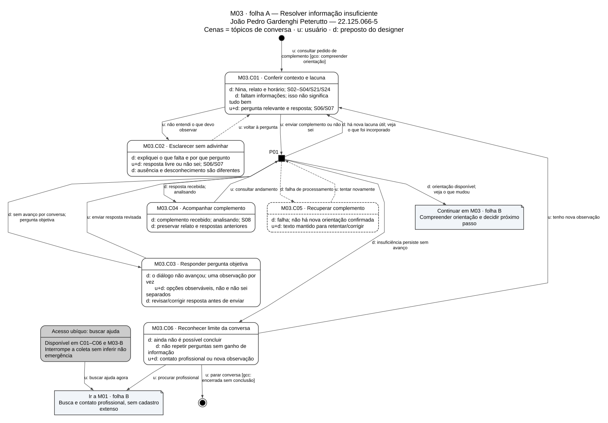
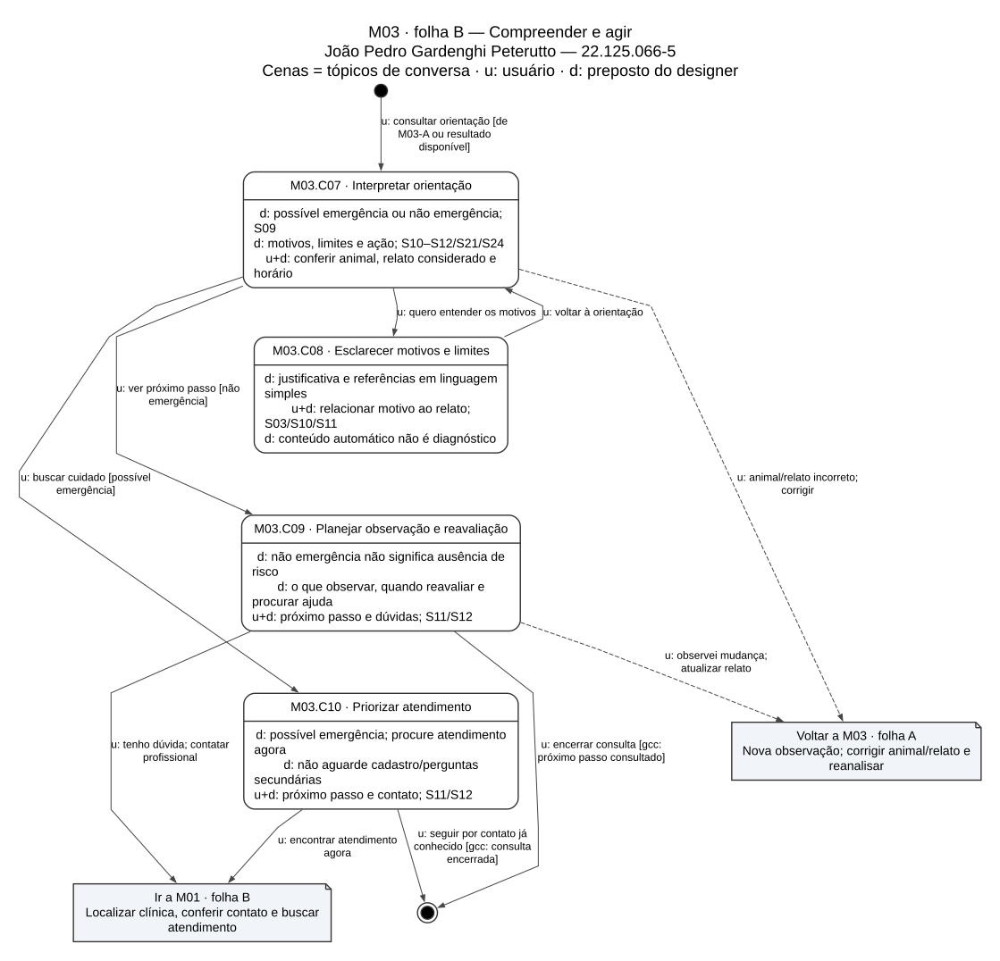

# Entrega 10 — MoLIC

**Data:** 04/11/2026

**Status:** 🟩 concluída — modelagem documental

**Responsabilidade:** 1 solução completa por integrante e consolidação da equipe.

**Versão cumulativa 3/3:** Vinícius + Julian + João. Entrega 10 integralmente consolidada. Os IDs são estáveis: M02 = Vinícius; M01 = Julian; M03 = João. A ordem de commit não altera esses vínculos com CI02/CI01/CI03.

## Objetivo da atividade

Modelar a interação como uma conversa entre usuário e preposto do designer, explicitando tópicos, signos, alternativas, processamentos e recuperação de rupturas. As cenas representam assuntos da conversa, não apenas páginas nem etapas internas do RAG.

## Entradas e delimitação

Base: `main`, revisão `ef16972f7582b482494a0827304caa1c57244e82`, consultada em 04/11/2026. Considerados README, guias, bibliografia, checklist, matriz, entregas, instrumentos e fontes dos assets do repositório. Referências diretas: [E4](04_cenarios_problema.md), [E5](05_analise_tarefas.md), [E6](06_prototipacao_papel.md), [E8](08_engenharia_usabilidade.md) e [E9](09_modelo_conceitual.md), além dos três PDFs de MoLIC fornecidos.

Os modelos descrevem a interação proposta para a POC acadêmica. Modelagem não comprova implementação, compreensão, precisão clínica ou benefício do resumo. Casos e unidades da prototipação são fictícios. H03/H05 e as demais hipóteses continuam abertas; a clínica permanece exploratória e secundária. Não há encaminhamento automático por especialidade.

**Recorte da E6 atual:** esta iteração cobre o caminho de possível emergência de P01: relato no chat, compreensão da orientação, mapa e envio autorizado do caso (PF02/PF03; T01/T03/T02). A E6 relata uma simulação com o orientador e distingue clínicas públicas para contato das unidades acadêmicas habilitadas para envio. Cadastro completo, informação insuficiente e painel da clínica ficam fora dessa iteração. M01 articula o caminho do tutor; M02 e M03 mantêm origem conceitual em CI02/CI03 da E9 e não são apresentados como avaliados pela simulação atual. H03/H05 continuam abertas. A E10 preserva os três cenários da E9.

**Continuidade da E9:** a revisão-base contém CI01, CI02 e CI03, os três mapas individuais, o mapa consolidado e o esquema único de signos. M01 deriva de CI01 (Julian), M02 de CI02 (Vinícius) e M03 de CI03 (João). O01–O10 e S01–S24 mantêm seus nomes e significados; os documentos já concluídos são preservados.

### Notação e organização dos diagramas

| Elemento | Representação e significado |
|---|---|
| Abertura | Círculo preto e fala de entrada; `gco` indica abertura da conversa sobre a meta. |
| Cena | Retângulo arredondado com tópico separado dos diálogos/signos. `M01.C01` identifica cena, sem reutilizar E4:C01. |
| Diálogo | `u:` = usuário; `d:` = preposto do designer; `u+d:` = diálogo sobre os signos indicados. Em M02, o usuário é o profissional; nos demais, o tutor. |
| Transição | Seta com fala do usuário ou preposto; condições entre colchetes. |
| Processo | Quadrado preto: o sistema determina a continuação após a solicitação; saídas são falas `d:`. `P01` etc. são IDs locais à folha, não personas. |
| Alerta e recuperação | Cena de contorno tracejado para alerta/erro; setas tracejadas destacam recuperação/volta. Não significam ação automática. |
| Acesso ubíquo | Cena cinza informa em quais cenas pode ser acionada. Busca de ajuda não depende de concluir coleta/cadastro. |
| Encerramento | Círculo preto com anel externo; `gcc` fecha a conversa sobre a meta, sem afirmar desfecho clínico. |
| Referência entre folhas | Nota com destino: recurso editorial, não novo símbolo de cena ou nova tela. As aberturas das folhas seguintes continuam a mesma conversa. |

Notação baseada nos slides CC8122 — MoLIC, Parte A, pp. 3–15, e Parte B, pp. 2–5. Parte C, pp. 14–18, fundamenta a passagem para interface: uma cena pode corresponder a uma ou mais apresentações. Os desenhos foram divididos em folhas para preservar os textos; os SVGs permitem ampliar sem perda. [Índice e fontes editáveis](../assets/10_molic/README.md).

## M02 — Organizar o caso e responder sobre a capacidade da clínica

**Autor(a):** Vinícius de Castro Duarte — 22.224.020-2

**Cenário de interação de origem:** CI02; E4:C02; P03.

**Objetivo(s):** O06 — Consultar o caso e conferir sua origem; O07 — Solicitar complemento e informar capacidade; O09 — Corrigir e recuperar a interação; O10 — Acompanhar a resposta da clínica, pelo lado profissional que a registra.

**Tarefa(s) relacionada(s):** continuidade de T02 e cenário CI02 da E9. Não se cria uma tarefa formal T04 inexistente na E5.

**Signos relevantes:** S01–S04, S09/S10, S17 e S20–S24. R05; RC05/RC08/RC13; H03/H05/H17; L02/L03.

### Diagrama

*Figura M02-A — Consultar caso autorizado. [Fonte editável](../assets/10_molic/molic_m02.dot).*

*Figura M02-B — Comunicar decisão humana. [Fonte editável](../assets/10_molic/molic_m02_resposta.dot). Fonte: elaboração para esta entrega sob a responsabilidade individual indicada. Fluxo exploratório, H03/H05.*

### Leitura do diagrama

#### Caminho principal

1. Marina acessa a área da unidade em C01; P01 verifica o vínculo e apresenta os encaminhamentos autorizados àquela clínica.
2. Seleciona caso em C02. P03 confere acesso antes de C03 mostrar resumo, relato original, orientação automática, lacunas e horários. Visualização/recebimento não aceita o caso automaticamente.
3. Se faltar informação, prepara pergunta em C06 e envia por P04. A resposta do tutor aparece como atualização identificada, sem reescrever silenciosamente o registro original.
4. Confere a capacidade com a equipe fora do sistema. Em C07, informa se a unidade pode ou não receber, revisa destinatário e confirma a decisão humana.
5. P04 registra a comunicação; C08 mostra origem e horário, sem presumir leitura pelo tutor. O tutor consulta esse mesmo estado no fluxo CI01, preservando a distinção entre envio, leitura e aceite. Nova informação ou alteração de capacidade exige atualização explícita e comunicação.

#### Alternativas e rupturas

| Situação | Onde ocorre | Como o usuário percebe | Recuperação/saída |
|---|---|---|---|
| Credencial inválida, sessão expirada ou caso não autorizado | P01/P03/C05 | Mensagem de acesso sem exibir conteúdo privado. | Corrigir acesso, reautenticar, voltar à lista permitida ou sair. |
| Lista vazia ou falha | P02/C04 | Ausência de pedidos diferenciada de erro. | Atualizar; falha não implica desaparecimento de casos. |
| Dado ausente, antigo ou contraditório | C03/C06 | Relato, origem e horários separados; lacuna identificada. | Solicitar confirmação; não informado não vira negativa clínica. |
| Mensagem vazia ou envio não confirmado | P04/C09 | Validação ou erro, com texto mantido. | Corrigir ou consultar o registro antes de retentar; não duplicar comunicação já registrada. |
| Unidade não pode receber | C07/C08 | Recusa e mensagem explícitas. | Comunicar limitação; tutor procura outra unidade pelo fluxo CI01, sem promessa de vaga externa. |
| Estado/versão mudou antes da decisão | P04/C10 | Atualização sinalizada; nada sobrescrito silenciosamente. | Conferir M02-A e revisar resposta. |
| Tutor ainda não respondeu | P05/C08 | Último estado e horário. | Consultar depois, voltar ao caso ou atualizar comunicação conforme decisão profissional. |
| Desistência da edição | C06 | Volta sem confirmação de envio. | Cancelar edição; sair da consulta não apaga o pedido. |

### Checklist específico de modelagem

- [x] Abertura identifica perfil e protege acesso ao caso.
- [x] Cenas representam consultar origem, complementar e informar capacidade.
- [x] Falas distinguem profissional, preposto e dados do tutor.
- [x] Há encerramentos por saída e conclusão da consulta.
- [x] Processos de acesso, consulta e registro têm feedback.
- [x] Permissão, vazio, falha, conflito e cancelamento têm recuperação.
- [x] Sem atalho ubíquo a casos privados; vínculo autorizado é obrigatório.
- [x] Aceite, recusa e pedido de complemento são alternativas.
- [x] Terminologia da E9 e H03/H05 abertas foram preservadas.
- [x] Folhas vetoriais com fontes, legenda e explicação textual.
- [x] Capacidade é decisão humana; algoritmo não é modelado internamente.
- [x] Lista, histórico e comunicação incluem os estados pertinentes.

## M01 — Relatar os sinais de Bob e buscar atendimento

**Autor(a):** Julian Ryu Takeda — 22.224.030-1

**Cenário de interação de origem:** CI01; E4:C01; P01.

**Objetivo(s):** O01–O05 e O08–O10, conforme o dicionário da E9.

**Tarefa(s) relacionada(s):** T01 e T02; T03 na interpretação da orientação.

**Signos relevantes:** S02–S24 conforme a etapa; credenciais não bloqueiam a orientação inicial. R01–R05; RC01–RC11/RC13/RC14; H09/H12/H14/H16–H18.

### Diagrama

*Figura M01-A — Relatar e revisar sinais. [Fonte editável](../assets/10_molic/molic_m01.dot).*

*Figura M01-B — Localizar e contatar clínica. [Fonte editável](../assets/10_molic/molic_m01_busca.dot).*

*Figura M01-C — Autorizar e acompanhar o caso. [Fonte editável](../assets/10_molic/molic_m01_envio.dot). Fonte das três figuras: elaboração para esta entrega sob a responsabilidade individual indicada.*

### Leitura do diagrama

#### Caminho principal

1. A abertura leva a M01.C01: Camila informa espécie, animal e sinais observados. Pode completar o cadastro depois; nova conversa não herda silenciosamente o animal anterior.
2. Por texto, segue à revisão em C03. Por voz, passa por C02/P01, confere a transcrição e corrige antes de enviar. Confirmar o relato não autoriza compartilhamento com a clínica.
3. P02 valida o mínimo e comunica recebimento/análise em C04. Se faltar informação útil, C06 recebe o complemento; a pergunta e seu efeito ficam explícitos. Sem avanço, a interação oferece pergunta objetiva, aceita “não sei” e mantém o contato disponível, conforme CI03/O02/O09.
4. C07 comunica orientação, motivos, limites e próximo passo. No caso fictício de Bob, segue à busca de atendimento; o contato fica acessível sem concluir perguntas secundárias. Na não emergência, C07 comunica observação e reavaliação; na insuficiência, C06 mantém a conversa inconclusiva.
5. Na folha B, define a região em C08, compara opções em C09 e confere contato/funcionamento em C11. Localização automática é opcional. Horário publicado não confirma capacidade; abrir uma ligação/rota não comprova atendimento.
6. Se a unidade for habilitada e quiser compartilhar, passa à folha C: em C13 revisa resumo, relato original, destinatário e autorização inicialmente desmarcada. Pode corrigir os dados dentro dessa cena; selecionar uma clínica não autoriza envio.
7. Após registro, acompanha C14. Estado, autor e horário distinguem enviado/aguardando, visualizado, aceito e recusado. A clínica registra a decisão humana em M02. Encerrar a consulta não cancela o pedido nem significa atendimento concluído.

#### Alternativas e rupturas

| Situação | Onde ocorre | Como o usuário percebe | Recuperação/saída |
|---|---|---|---|
| Áudio cancelado, microfone negado ou transcrição indisponível | C02/P01 | Gravação e indisponibilidade explícitas. | Texto em C01; preservar texto já digitado e revisar transcrição quando existir. |
| Animal incorreto ou relato vazio | C03/P02 | Animal visível e solicitação de dados mínimos. | Corrigir C01/C03, sem cadastro completo obrigatório. |
| Demora/falha de análise | C04/C05 | Analisando ou falha; erro não vira não emergência. | Consultar andamento, retentar com relato mantido ou buscar ajuda pelo acesso ubíquo. |
| Informação insuficiente/repetição | C06 | Lacuna explícita e “não sei” permitido. | Complementar; pergunta objetiva prevista em CI03; sem avanço, contato profissional. |
| Localização negada, região inválida, falha ou lista vazia | C08/P03/P04/C10 | Permissão, falha e ausência de opções diferenciadas. | Corrigir região, remover filtro/ampliar busca e retentar. |
| Unidade sem resposta/capacidade ou sem integração | C11/C12 | Não há confirmação; unidade sem integração não recebe resumo pela plataforma. | Outra unidade ou contato direto, sem envio obrigatório. |
| Falta autorização/destinatário ou envio não confirmado | C13/P05/C15 | Falta indicada, rascunho preservado, sem falso sucesso. | Corrigir; conferir o estado do mesmo pedido antes de retentar, evitando duplicação. |
| Pendência, recusa ou pergunta profissional | C14/C17 | Mensagem da unidade identificada, estado e horário. | Outra unidade; resposta observada ou “não sei”; falha mantém texto. |
| Cancelamento acidental | C16/P06 | Confirmação explica que conteúdo já compartilhado não será apagado. | Manter pedido ou confirmar cancelamento; só apresentar cancelado após registro. |

### Checklist específico de modelagem

- [x] Abertura coerente e cadastro completo não bloqueante.
- [x] Cenas representam tópicos, com diálogos/signos.
- [x] Transições distinguem falas do tutor e do preposto.
- [x] Encerramentos distinguem consulta, abandono e continuidade entre folhas.
- [x] Processos possuem saídas comunicadas pelo preposto.
- [x] Rupturas têm feedback e recuperação, sem erro convertido em resultado.
- [x] Contato ubíquo é justificado pela possível urgência.
- [x] Texto/voz, busca manual, contato direto e compartilhamento opcional são alternativas.
- [x] Nomes de objetivos/signos são coerentes com E9.
- [x] Folhas vetoriais legíveis, com fontes e leitura textual.
- [x] Conversa usuário–sistema, sem detalhamento do algoritmo.
- [x] Busca/filtros, processamento e histórico do pedido incluem retornos pertinentes.

## M03 — Compreender a orientação e resolver informações insuficientes

**Autor(a):** João Pedro Gardenghi Peterutto — 22.125.066-5

**Cenário de interação de origem:** CI03 — Complementar o relato de Nina e compreender a orientação; E4:C03; P02.

**Objetivo(s):** O02/O03/O09; O01/O08 na correção e O04 na saída para contato.

**Tarefa(s) relacionada(s):** T03; T01 no complemento/correção e T02 na busca.

**Signos relevantes:** S02–S12/S21/S24; S13–S16 na continuidade. R01/R03; RC02–RC06/RC10/RC11/RC13/RC14; H02/H06/H11/H12/H13/H15/H18.

### Continuidade do cenário CI03

O cenário CI03 da E9 parte das mudanças graduais em Nina: menos apetite, mais tempo escondida e comportamento diferente ao longo de dois dias. Roberto reúne o relato, confere animal e início dos sinais, responde apenas o observado ou “não sei” e pode usar complemento dirigido ou procurar ajuda. Se a insuficiência persistir, não há conclusão presumida; se houver orientação, compreende motivos, limites e próximo passo, podendo atualizar o caso quando os sinais mudarem.

M03 transforma essa conversa já definida na E9 em cenas, falas e recuperações. Não atribui antecipadamente um resultado clínico a Nina e não cria outro cenário paralelo.

### Diagrama

*Figura M03-A — Resolver informação insuficiente. [Fonte editável](../assets/10_molic/molic_m03.dot).*

*Figura M03-B — Compreender e agir. [Fonte editável](../assets/10_molic/molic_m03_orientacao.dot). Fonte: elaboração para esta entrega sob a responsabilidade individual indicada.*

### Leitura do diagrama

#### Caminho principal

1. C01 abre a conversa sobre a lacuna do caso correto. Animal/horário contextualizam orientação e pergunta.
2. Roberto responde livremente ou pede esclarecimento em C02. “Não apresenta” é diferente de “não sei”; não precisa inventar observações.
3. P01 comunica recebimento/processamento em C04. Só volta a C01 para nova lacuna útil e mostra o dado incorporado. Sem avanço pela conversa, C03 oferece pergunta objetiva; o critério é ganho de informação, sem número máximo de perguntas não validado.
4. Persistindo insuficiência sem avanço, C06 comunica o limite e oferece contato ou nova observação voluntária. Encerrar essa conversa não representa alta nem não emergência.
5. Com orientação disponível, segue à folha B: C07 mostra resultado, motivos, limites, animal, horário e próximo passo. C08 explica os motivos sem bloquear contato.
6. Em possível emergência, C10 leva a atendimento ou contato já conhecido. Em não emergência, C09 comunica observação/reavaliação; mudança retorna ao relato. A compreensão será verificada em avaliação, por exemplo pelo reconto de MU04, não presumida ao exibir a mensagem.

#### Alternativas e rupturas

| Situação | Onde ocorre | Como o usuário percebe | Recuperação/saída |
|---|---|---|---|
| Pergunta incompreensível ou dado desconhecido | C01/C02 | Explicação contextual e “não sei”. | Voltar, responder o observado ou contatar profissional. |
| Resposta não gera avanço | P01/C03 | Pergunta objetiva explicita a lacuna; respostas anteriores preservadas. | Selecionar/corrigir resposta; persistindo insuficiência, C06. |
| Falha após complemento | C04/C05 | Não há nova orientação confirmada; texto mantido. | Retentar ou contatar profissional; erro não vira resultado. |
| INCERTO persiste | C06 | Ainda não é possível concluir; não significa tudo bem. | Nova observação, contato ou encerramento sem conclusão. |
| Animal/relato incorreto ou sinais mudaram | C07/C09 | Contexto e horário visíveis. | Voltar à folha A, corrigir e reanalisar sem reescrever registro anterior. |
| Justificativa difícil | C08 | Motivo relacionado ao relato, origem e limites. | Pedir explicação ou buscar ajuda sem leitura obrigatória de referência extensa. |
| Não emergência interpretada como ausência de cuidado | C09 | Limites, observação e reavaliação explícitos. | Atualizar relato/contatar profissional; conteúdo clínico final requer revisão veterinária. |
| Possível emergência ou desejo de ajuda durante a coleta | C10/acesso ubíquo | Atendimento acessível. | M01-B ou contato conhecido, sem perguntas/cadastro/compartilhamento obrigatórios. |

### Checklist específico de modelagem

- [x] Abertura contextualiza caso e complemento.
- [x] Cenas representam esclarecer, complementar, interpretar e decidir.
- [x] Falas distinguem tutor e preposto.
- [x] Encerramento inconclusivo difere de orientação consultada e atendimento.
- [x] Processamento é comunicado sem expor algoritmo.
- [x] Falha, dúvida, desconhecimento e ausência de avanço têm recuperação.
- [x] Contato ubíquo é justificado por insuficiência/possível urgência.
- [x] Alternativas livres/estruturadas e desfechos pertinentes estão cobertos.
- [x] Objetivos/signos da E9 e cenário CI03 são reutilizados, com origem explícita.
- [x] Duas folhas vetoriais com fontes e interpretação textual.
- [x] Modelo trata interação humana, sem criar regras clínicas.
- [x] Processamento e resultado anterior incluem retorno, falha e correção.

## Consolidação da equipe

### Cobertura dos objetivos

| Objetivo da E9 | MoLIC que cobre | Lacunas/duplicidades | Decisão |
|---|---|---|---|
| O01 — Relatar e revisar sinais | M01-A; M03-A na correção | Mesmos dados na complementação. | Preservar texto, animal e origem. |
| O02 — Complementar informações insuficientes | M01.C06; M03-A | M03 detalha a mesma conversa. | Reusar pergunta/resposta; desconhecimento não vira negativa. |
| O03 — Compreender orientação e próximo passo | M01.C07; M03-B | M03 detalha os desfechos. | INCERTO não é terceira urgência. |
| O04 — Localizar e contatar uma clínica | M01-B; saída de M03 | Busca compartilhada. | Região manual/automática; sem especialidade automática ou vaga presumida. |
| O05 — Revisar e autorizar compartilhamento | M01-C | Unidade pública pode não integrar o envio. | Contato direto continua possível; consentimento específico. |
| O06 — Consultar o caso e conferir sua origem | M02-A | H03/H05 abertas. | Exploratório; unidade autorizada. |
| O07 — Solicitar complemento e informar capacidade | M02-B | Não cria nova tarefa formal da E5. | Aceite/recusa são decisões humanas. |
| O08 — Identificar o animal do relato | M01.C01/C03; M03.C01/C07 | Cadastro completo é secundário. | Não herdar associação silenciosamente. |
| O09 — Corrigir e recuperar a interação | M01–M03 | Mesma semântica de falha. | Preservar rascunho e conferir estado antes de retentar. |
| O10 — Acompanhar a resposta da clínica | M01.C14/C17; M02-B | Perspectivas do mesmo pedido. | Estado, origem e horário comuns; envio não equivale a aceite. |

### Preparação para o Figma

As referências abaixo são **cenas de origem**, não telas Figma já implementadas. A E11 continua não iniciada. Uma cena pode gerar uma ou mais apresentações; várias cenas podem compartilhar componentes.

| Conversas de origem | Estados/apresentações necessários | Feedback, erro e recuperação | Meta da E8 |
|---|---|---|---|
| M01.C01–C03 | Relato, animal, gravação, transcrição e revisão | Vazio, associação incorreta, gravação/cancelamento, microfone negado e alternativa textual. | MU01/MU03 |
| M01.C04–C07; M03.C01–C06 | Processamento, insuficiência, pergunta livre/objetiva, resposta incorporada | Espera, falha, retentativa, não sei, falta de avanço e contato. | MU01/MU03/MU04 |
| M03.C07–C10 | Resultado, motivos, limites e ação por desfecho | Texto além da cor; atualização dos sinais; observação/reavaliação na não emergência. | MU04 |
| M01.C08–C12 | Região manual/localização, mapa/lista, filtro e contato | Permissão negada, região inválida, filtro vazio, falha e unidade sem integração. | MU02/MU03/MU04 |
| M01.C13–C17 | Resumo, destinatário, autorização e histórico do pedido | Não autorizado, enviando, envio não confirmado, pendente, visualizado, aceito, recusado e cancelamento confirmado. | MU03/MU04 |
| M02.C01–C05 | Acesso, lista e caso autorizado | Sessão expirada, permissão insuficiente, vazio/falha, origem e horário. | Complemento exploratório; sem inventar MU05. |
| M02.C06–C10 | Pergunta profissional, capacidade e registro | Mensagem vazia, erro com texto mantido, atualização concorrente e retorno ao caso. | Complemento exploratório de R05/H05. |

### Decisões e limites da consolidação

A E6 atual documenta o caminho de emergência, do relato ao mapa e ao envio autorizado, em simulação relatada com o orientador. M01 incorpora as decisões de manter a ação urgente visível (D10–D11), permitir filtrar clínicas por funcionamento (D15/D17), revisar e autorizar antes do envio (D18–D21), distinguir envio de vaga confirmada (D20–D23) e usar o mesmo rótulo “Possível emergência” no chat e no resumo (D19). A conclusão desse percurso por um participante não comprova precisão clínica, utilidade do painel, nem compreensão por todo o público. A E6 atual não avalia o estado INCERTO de M03 nem a interação profissional de M02. Pergunta dirigida, “não sei”, efeito do complemento, correção do animal, aceite explícito e confirmação de cancelamento continuam como decisões de modelagem derivadas de E5/E9 e dos signos pertinentes. Não se atribuem à E6 atual observações D36–D42 ou avaliação do painel. As correções de interface são propostas, sem implementação presumida.

O filtro “abertas agora” é uma escolha a avaliar no cenário urgente, com indicação de horário ausente/desatualizado e remoção do filtro. Conteúdo de orientação/observação precisa de revisão veterinária antes de avaliação; não se criam aqui doses, diagnósticos, sinais de corte ou prazos clínicos arbitrários. H12 não recebeu um limite numérico inventado.

Retentativas em M01-C/M02-B devem consultar a mesma operação: registro já existente é recuperado em vez de duplicado. Falha de consulta não apaga o último estado nem confirma aceite/cancelamento. Em protótipo, esses retornos podem ser simulados e devem ser declarados como tal.

**Rastreabilidade aplicada:** coluna MoLIC de R01–R05 preenchida e padrões vinculados às cenas, preservando CI03 e as atualizações já publicadas da E9. Figma, inspeção e teste permanecem pendentes. No README, muda somente o estado da E10. O checklist global e as entregas anteriores não são declarados concluídos por esta modelagem.

### Checklist da consolidação

- [x] Três soluções completas, com nome e matrícula.
- [x] O01–O10 cobertos com alternativas/rupturas.
- [x] Duplicidades resolvidas por conversas compartilhadas.
- [x] Signos e cenários CI01–CI03 da E9 reutilizados sem redefinir categorias clínicas.
- [x] Fontes editáveis e SVGs disponíveis.
- [x] Rastreabilidade e README atualizados no conjunto entregue.
- [x] Estados da E11 derivados das conversas, sem afirmar Figma pronto.
- [x] E9 concluída foi preservada; H03/H05 continuam abertas, sem validação presumida.

## Referências e histórico

- **CC8122 — MoLIC, Partes A, B e C**, material fornecido, baseado em Barbosa e Silva (2010). Notação: A, pp. 3–15; abertura/fechamento de metas: B, pp. 3–5; passagem para interface: C, pp. 14–18.
- BARBOSA, Simone D. J.; SILVA, Bruno S. **Interação Humano-Computador**. Elsevier/Campus, 2010. Referência indicada nos slides e na [bibliografia do projeto](../BIBLIOGRAFIA.md).
- E1–E9 e [matriz](../RASTREABILIDADE.md), na revisão indicada. Templates E11–E14/instrumentos orientam a continuidade, sem avaliações fictícias preenchidas.

**Histórico cumulativo — 04/11/2026:**

- Etapa 1: Vinícius adiciona M02-A/B, leitura, rupturas, fontes e vínculos de R05.
- Etapa 2: Julian acrescenta M01-A/B/C e vínculos R01–R05, preservando M02.
- Etapa 3: João acrescenta M03-A/B, a partir de CI03 já publicado; consolida O01–O10, completa todos os checklists da E10 e muda a E10 para verde.

Base: `ef16972f7582b482494a0827304caa1c57244e82`. Referências à E6 ajustadas ao percurso de emergência, mapa e envio; INCERTO e painel continuam como modelagem de E5/E9. E7/E9 já concluídas foram preservadas; não há alteração nos seus arquivos. Este conjunto prepara commits; não representa envio remoto nem validação com o professor.
