# Entrega 11 — Protótipo navegável (implementado fora do Figma)

**Data:** 11/11/2026  
**Revisão após o feedback do professor:** 22/11/2026  
**Status:** 🟩 concluída  
**Responsabilidade:** 1 protótipo integrado por equipe cobrindo os fluxos MoLIC; responsável por fluxo indicado na cobertura.

## Objetivo da atividade

Materializar o modelo de interação em um protótipo navegável, preservando a lógica dos objetivos, tópicos, signos, feedbacks, alternativas e recuperações definidos na E9 e na E10.

**Caminho adotado: (b) — protótipo implementado fora do Figma.** Em vez de telas no Figma, a equipe apresenta a própria aplicação do TCC (VetIA), já navegável, com contas de demonstração. Não há arquivo Figma. As telas apresentadas aqui são capturas dessa aplicação, organizadas em seis fluxos.

**O que mudou nesta revisão:** caminho (b) declarado; campos do modelo removidos; cobertura refeita por **cena** da MoLIC, com as cenas sem tela e a decisão sobre cada uma; legenda dos selos "problema"; signos S25–S31 no catálogo; telas críticas em tamanho maior e links para cada captura; contraste estimado; checklist alinhado ao texto.

## Acesso ao protótipo

**Protótipo:** <https://vetia.chilecentral.cloudapp.azure.com/> (contas acadêmicas `Ana (demo)` para o tutor e `Plantão Aurora (demo)` para a clínica, com acesso rápido sem senha).  
**Arquivo editável:** não se aplica (caminho b; o protótipo é o código da aplicação do TCC).  
**Última verificação de acesso sem login, em janela anônima:** ⚠️ PREENCHER (dd/mm/2026).

Casos (Bob e Nina) e unidades (Hospital Veterinário Aurora, Centro Vet Horizonte) são fictícios. As clínicas do mapa são dados públicos e não recebem casos pela plataforma. O relato digitado é enviado a um serviço externo de IA (Google Gemini) ou a um servidor local (Ollama), conforme a escolha "Análise por" mostrada na tela.

## Fluxos no protótipo

Cada seta indica o controle que leva à próxima tela. As capturas individuais, em tamanho legível, estão em [`assets/06_prototipos/`](../assets/06_prototipos/) e são linkadas abaixo de cada fluxo.

**Legenda do selo vermelho "problema":** problema de interação que a própria equipe observou ao montar os fluxos, em 11/11. Os selos foram graduados na [E13](13_avaliacao_heuristica.md#9-consolidação-da-equipe) e, quando houve tarefa, verificados no teste da [E14](14_observacao_usuario.md#e-achados-e-recomendações):

| Tela | Problema observado | Tratamento | O que implica para o protótipo |
|---|---|---|---|
| D06 | Lista continua vazia depois de salvar o animal | E13 · HC11 (grau 3) | Atualizar a lista e confirmar o cadastro antes da próxima rodada |
| D10 | Cartão da orientação cortado quando o resultado chega | E13 · HC12 (grau 3) | Rolar até a orientação e compactar a faixa do provedor |
| D15 | Mapa e lista sem filtro; primeira unidade fechada; dica de "Ctrl" no celular | E13 · HC13 (grau 3) · E14 · AU05 | Selo aberto/fechado no topo do cartão; abertas primeiro |
| D26 | Resumo do caso cortado no painel | E13 · HC14 (grau 2) | Indicar rolagem e manter ações visíveis; rechecar em 1366 × 768 |
| D32 | "Aceito", mas o texto da tela não muda | E13 · HC05; relacionado a HC04 | Texto da tela coerente com o selo de estado |
| D33 | "Cancelar envio" no mesmo lugar depois de "A caminho" | E13 · HC05 (grau 2) | Explicar o efeito do cancelamento por estado |
| D36 | Nova conversa herda o Bob | E13 · HC07 (grau 3) | Pedir a escolha do animal ao iniciar outro caso |
| D39 | Pergunta usa "ele" para a Nina (texto gerado) | E13 · HC09 (grau 2) | Nome do animal acima da pergunta; ajuste no texto gerado |
| D41 | Resposta após o complemento repete a anterior | E13 · HC15 (grau 3) · E14 · AU04 | Mostrar o que foi incorporado do complemento |

Os selos **não foram corrigidos antes do teste de 18/11**; a E14 avaliou a versão com esses problemas.

### F1 — Cadastrar o animal

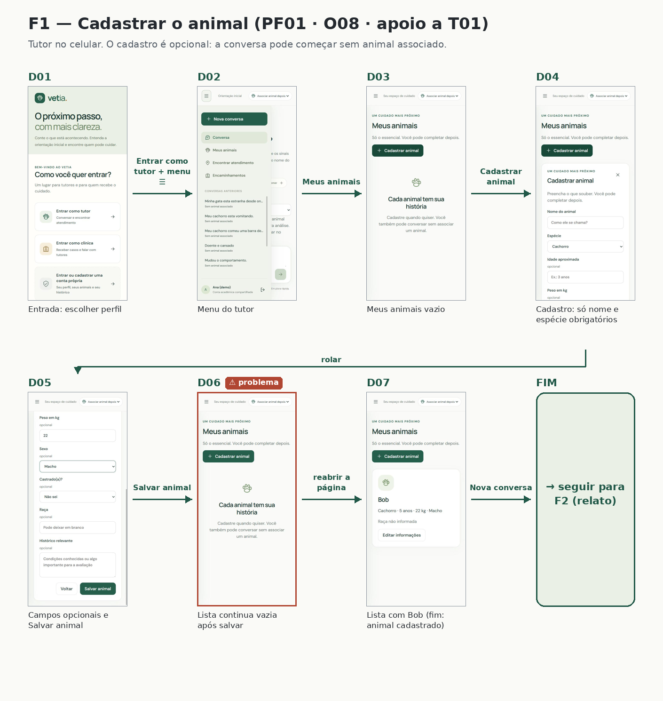

Telas: [D01](../assets/06_prototipos/D01_inicio.jpg) · [D02](../assets/06_prototipos/D02_menu_tutor.jpg) · [D03](../assets/06_prototipos/D03_meus_animais_vazio.jpg) · [D04](../assets/06_prototipos/D04_cadastro_animal.jpg) · [D05](../assets/06_prototipos/D05_cadastro_salvar.jpg) · [D06](../assets/06_prototipos/D06_lista_apos_salvar.jpg) · [D07](../assets/06_prototipos/D07_lista_com_bob.jpg)

### F2 — Relatar sinais e entender a orientação de emergência

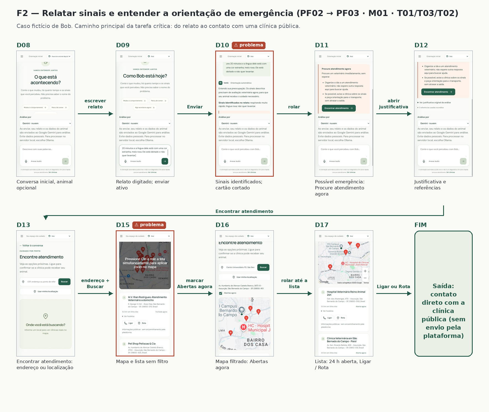

Telas: [D08](../assets/06_prototipos/D08_chat_inicial.jpg) · [D09](../assets/06_prototipos/D09_relato_digitado.jpg) · [D10](../assets/06_prototipos/D10_resultado_topo.jpg) · [D11](../assets/06_prototipos/D11_resultado_emergencia.jpg) · [D12](../assets/06_prototipos/D12_resultado_justificativa.jpg) · [D13](../assets/06_prototipos/D13_encontrar_atendimento.jpg) · [D15](../assets/06_prototipos/D15_mapa_todas.jpg) · [D16](../assets/06_prototipos/D16_mapa_abertas_agora.jpg) · [D17](../assets/06_prototipos/D17_lista_abertas_agora.jpg)

Tela crítica — resultado de possível emergência (D11):

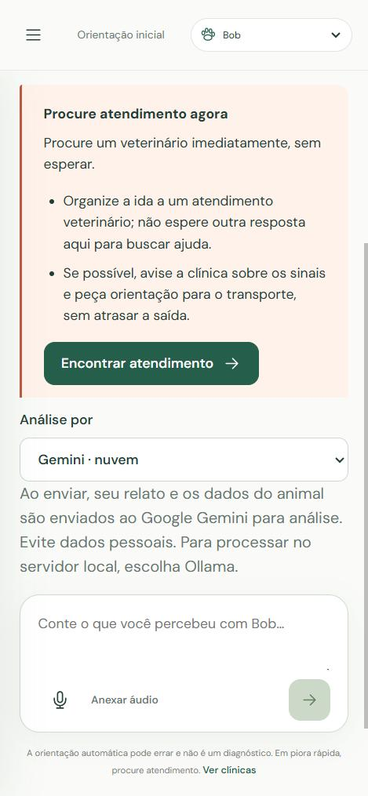

### F3 — Compartilhar o caso

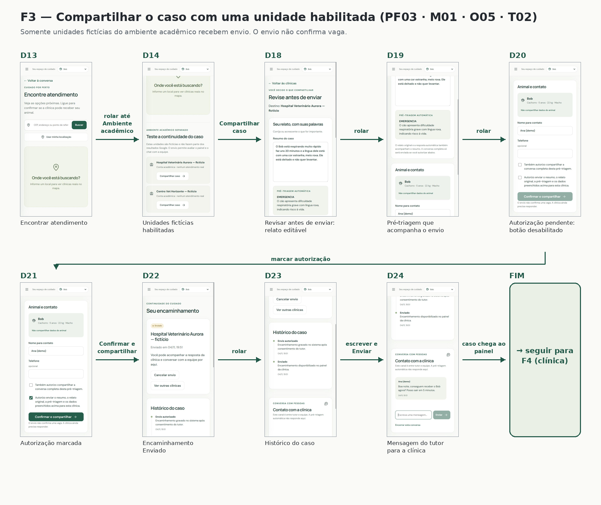

Telas: [D14](../assets/06_prototipos/D14_unidades_ficticias.jpg) · [D18](../assets/06_prototipos/D18_revisar_envio.jpg) · [D19](../assets/06_prototipos/D19_revisar_pretriagem.jpg) · [D20](../assets/06_prototipos/D20_autorizacao_pendente.jpg) · [D21](../assets/06_prototipos/D21_autorizacao_marcada.jpg) · [D22](../assets/06_prototipos/D22_encaminhamento_enviado.jpg) · [D23](../assets/06_prototipos/D23_historico_caso.jpg) · [D24](../assets/06_prototipos/D24_mensagem_tutor.jpg)

Telas críticas — revisão do envio (D18) e autorização pendente/marcada (D20 → D21):

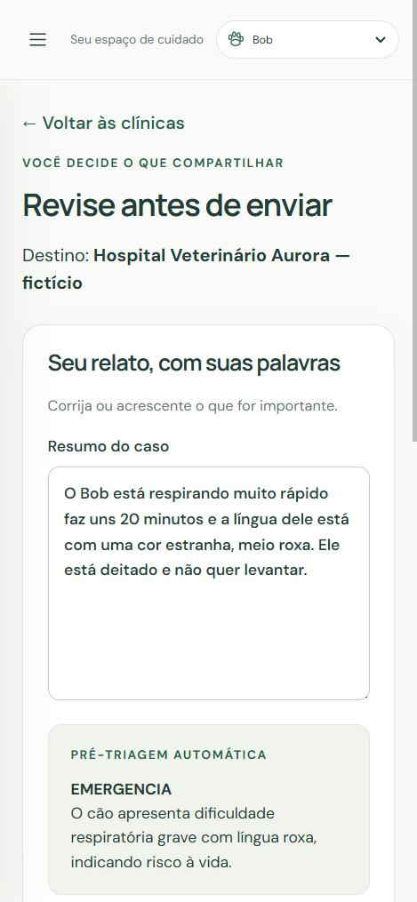 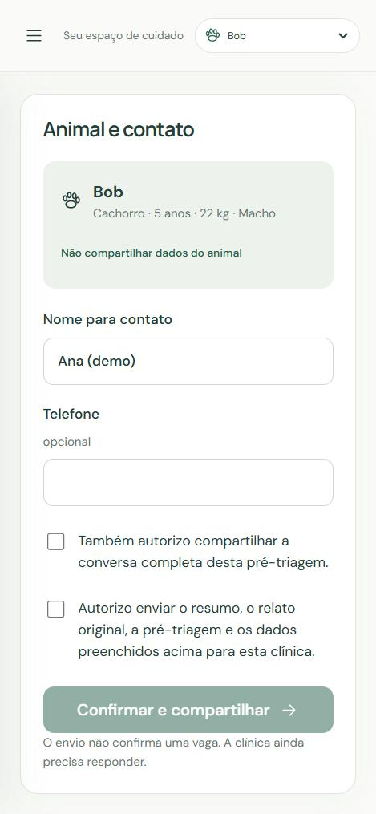 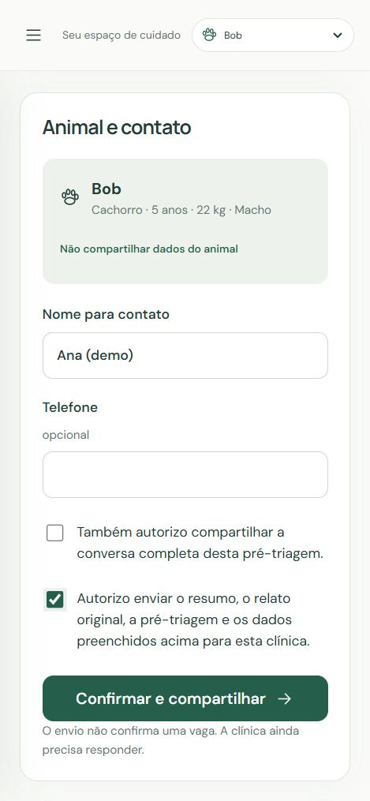

### F4 — Painel da clínica

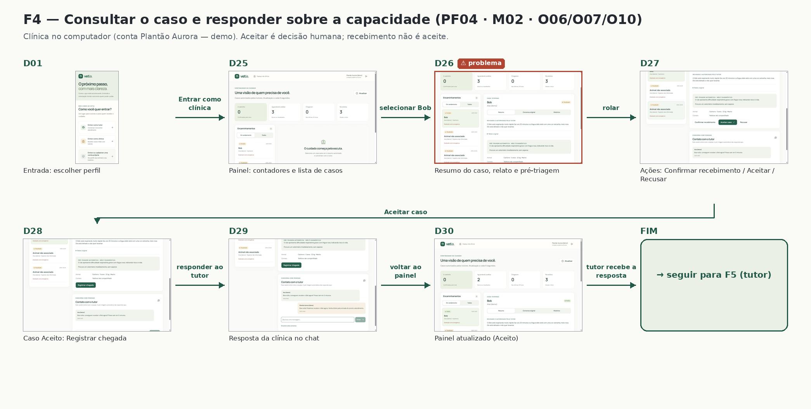

Telas: [D25](../assets/06_prototipos/D25_painel_clinica.jpg) · [D26](../assets/06_prototipos/D26_clinica_resumo_caso.jpg) · [D27](../assets/06_prototipos/D27_clinica_acoes.jpg) · [D28](../assets/06_prototipos/D28_clinica_caso_aceito.jpg) · [D29](../assets/06_prototipos/D29_clinica_resposta.jpg) · [D30](../assets/06_prototipos/D30_painel_atualizado.jpg)

Tela crítica — ações do painel (D27):

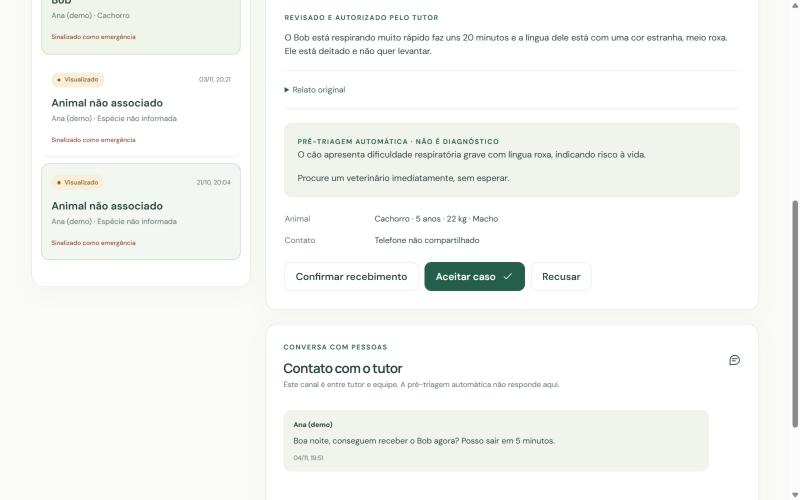

### F5 — Acompanhar a resposta da clínica

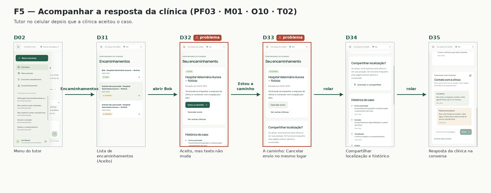

Telas: [D31](../assets/06_prototipos/D31_tutor_encaminhamentos.jpg) · [D32](../assets/06_prototipos/D32_tutor_aceito.jpg) · [D33](../assets/06_prototipos/D33_tutor_a_caminho.jpg) · [D34](../assets/06_prototipos/D34_tutor_localizacao_historico.jpg) · [D35](../assets/06_prototipos/D35_tutor_resposta_clinica.jpg)

### F6 — Informação insuficiente

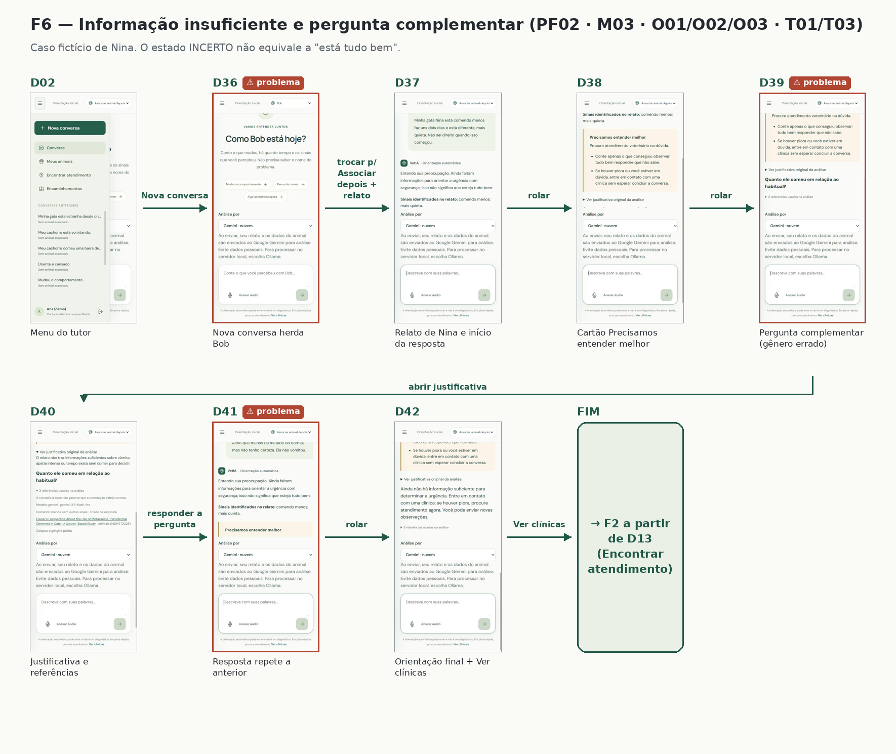

Telas: [D36](../assets/06_prototipos/D36_nova_conversa_animal_anterior.jpg) · [D37](../assets/06_prototipos/D37_incerto_relato.jpg) · [D38](../assets/06_prototipos/D38_incerto_cartao.jpg) · [D39](../assets/06_prototipos/D39_pergunta_complementar.jpg) · [D40](../assets/06_prototipos/D40_justificativa_referencias.jpg) · [D41](../assets/06_prototipos/D41_resposta_apos_complemento.jpg) · [D42](../assets/06_prototipos/D42_orientacao_final.jpg)

## Cobertura MoLIC → telas, por cena

A teoria lembra que uma cena pode virar mais de uma unidade de apresentação e que o acesso ubíquo costuma virar menu ou atalho fixo. A tabela aponta, para cada cena da [E10](10_molic.md), as telas que a materializam. "Sem tela" indica cena que o protótipo ainda não mostra.

### M01 — Relatar os sinais de Bob e buscar atendimento (Julian)

| Cena | Tópico | Tela(s) | Observação |
|---|---|---|---|
| M01.C01 | Relatar sinais | D08, D09; seletor de animal no topo; D02–D07 (cadastro opcional) | "Associar animal depois" no seletor mantém o cadastro não bloqueante |
| M01.C02 | Gravar relato | **Sem tela** | D08 tem "Anexar áudio", mas não a gravação com transcrição revisável |
| M01.C03 | Conferir o que será enviado | D09 | Texto editável antes de enviar; animal visível no seletor |
| M01.C04 | Acompanhar análise | **Sem tela** | Estado de carregamento não capturado |
| M01.C05 | Recuperar o relato | **Sem tela** | Falha da análise não prototipada |
| M01.C06 | Esclarecer lacuna | D38, D39 | Compartilhada com M03.C01/C02 |
| M01.C07 | Compreender orientação | D10, D11, D12 | Orientação, sinais considerados, justificativa e próximo passo |
| Acesso ubíquo | Buscar ajuda | Link "Ver clínicas" no rodapé de D08–D12; item "Encontrar atendimento" no menu (D02) | O acesso ubíquo virou atalho fixo no rodapé e item de menu |
| M01.C08 | Definir região | D13 | Endereço ou localização |
| M01.C09 | Comparar opções | D15, D16, D17 | Mapa e lista, com e sem filtro "Abertas agora" |
| M01.C10 | Rever busca | **Sem tela** | Nenhuma opção encontrada ou falha da busca não prototipadas |
| M01.C11 | Contatar a unidade | D17 | "Ligar" e "Rota" no cartão |
| M01.C12 | Prosseguir sem integração | D15, D17 ("Informações públicas · sem encaminhamento pela plataforma"); D14 (unidades fictícias habilitadas, separadas) | |
| M01.C13 | Revisar compartilhamento | D14, D18, D19, D20, D21 | Resumo editável, pré-triagem, destinatário, autorizações desmarcadas |
| M01.C14 | Acompanhar resposta | D22, D23, D31, D32, D33, D34, D35 | Selos Enviado/Visualizado/Aceito/A caminho com horário; estado "recusado" sem tela |
| M01.C15 | Recuperar envio | **Sem tela** | Envio não confirmado não prototipado |
| M01.C16 | Confirmar cancelamento | **Sem tela** | Botão "Cancelar envio" existe (D22, D32, D33); a confirmação não é mostrada |
| M01.C17 | Responder à clínica | D24, D35 | Canal "Contato com a clínica" |

### M02 — Organizar o caso e responder sobre a capacidade (Vinícius)

| Cena | Tópico | Tela(s) | Observação |
|---|---|---|---|
| M02.C01 | Identificar acesso da clínica | D01 | Entrada separada por papel |
| M02.C02 | Escolher encaminhamento | D25 | Contadores e lista de casos autorizados |
| M02.C03 | Conferir origem do caso | D26, D27 | Resumo revisado pelo tutor, relato original e pré-triagem automática identificada |
| M02.C04 | Recuperar consulta | **Sem tela** | Lista vazia e falha não prototipadas |
| M02.C05 | Rever permissão | **Sem tela** | Sessão expirada e acesso negado não prototipados |
| M02.C06 | Preparar resposta | D27, D29 | Mensagem no canal com o tutor |
| M02.C07 | Confirmar capacidade | D27, D28 | Confirmar recebimento, Aceitar caso, Recusar; caso aceito |
| M02.C08 | Consultar comunicação registrada | D29, D30 | Painel atualizado com "Aceito" |
| M02.C09 | Recuperar resposta | **Sem tela** | Mensagem não enviada não prototipada |
| M02.C10 | Conferir alteração do caso | **Sem tela** | Conflito de versão não prototipado |

M02 não tem acesso ubíquo, por decisão da E10 (exige vínculo autorizado).

### M03 — Compreender a orientação e resolver informação insuficiente (João)

| Cena | Tópico | Tela(s) | Observação |
|---|---|---|---|
| M03.C01 | Conferir contexto e lacuna | D36, D37, D38 | Relato da Nina, cartão "Precisamos entender melhor" |
| M03.C02 | Esclarecer sem adivinhar | D38, D39 | Cartão diz que tudo bem não saber; pergunta com campo livre |
| M03.C03 | Responder pergunta objetiva | **Sem tela** | Não há opções de resposta, nem atalho "Não sei" (HC08) |
| M03.C04 | Acompanhar complemento | **Sem tela** | Carregamento não capturado |
| M03.C05 | Recuperar complemento | **Sem tela** | Falha do complemento não prototipada |
| M03.C06 | Reconhecer limite da conversa | D41, D42 | "Ainda não há informação suficiente…"; D41 não mostra o que foi incorporado (HC15) |
| M03.C07 | Interpretar orientação | D42 (informação insuficiente); D10–D12 (possível emergência) | A orientação de não emergência existe na demo (usada em UT06), mas não há captura no repositório |
| M03.C08 | Esclarecer motivos e limites | D12, D40 | Justificativa original e referências recolhidas |
| M03.C09 | Planejar observação e reavaliação | Demo, sem captura | ⚠️ Capturar a orientação de não emergência (caso de UT06) e acrescentar como D43 |
| M03.C10 | Priorizar atendimento | D11 → D13 | Compartilhada com M01 |
| Acesso ubíquo | Buscar ajuda | Link "Ver clínicas" no rodapé de D37–D42 | |

### Cenas sem tela: decisão

Nenhum destes estados foi prototipado antes do teste de 18/11, por isso eles ficaram **fora do recorte daquela rodada**: o teste não conseguiu observar a recuperação de falhas, e isso está registrado como limitação na E14. A decisão para a próxima iteração:

| Cenas | Estado | Decisão | Motivo |
|---|---|---|---|
| M01.C04/C05, M03.C04/C05 | Carregamento e falha da análise, com relato preservado | **Prototipar** no F2 e no F6 | É o estado que mais testa "falha não vira resultado" e "não perder o que escreveu" (O09); MU03 e MU04 dependem dele |
| M01.C14 (recusado), M02.C07 (Recusar) | Recusa pela clínica | **Prototipar** no F4 e no F5 | O tutor precisa saber que deve procurar outra unidade; ligado a MU04 |
| M01.C15, M02.C09 | Envio não confirmado | **Prototipar** no F3 | Risco de falso sucesso |
| M01.C10 | Busca sem opções ou com falha | **Prototipar** no F2 | Caminho urgente sem saída é crítico |
| M01.C16 | Confirmação de cancelamento | **Prototipar** junto com a correção de HC05 | Alcance do cancelamento após o aceite |
| M03.C03 | Pergunta objetiva com opções e "Não sei" | **Prototipar** junto com a correção de HC08 | Já há regra no signo S06 |
| M01.C02 | Gravação de voz com transcrição | Fora do recorte | Depende de H09; o teste da E12 tratou voz só como pergunta exploratória |
| M02.C04/C05/C10 | Lista vazia, permissão e conflito no painel | Fora do recorte | Ramo da clínica condicionado a H03/H05; sem participantes profissionais |

## Catálogo de telas/estados

| Tela | Objetivo do usuário | Signos principais | Origem (cena) |
|---|---|---|---|
| D01 Entrada | Escolher entre tutor e clínica | S29 papel, S01 usuário | M02.C01; abertura do tutor |
| D02–D07 Menu e cadastro do animal | Cadastrar o animal sem bloquear a conversa | S02 animal, S26 histórico do animal (campo "Histórico relevante" e conversas anteriores no menu) | M01.C01 · O08 |
| D08–D09 Conversa e relato | Contar o que observou | S02, S03 relato, S04 início dos sinais, S31 provedor da análise | M01.C01/C03 · O01 |
| D10–D12 Possível emergência | Entender a orientação e o motivo | S09 orientação, S30 sinais considerados ("Sinais identificados no relato"), S10 justificativa, S11 limites, S12 próximo passo, S31 | M01.C07, M03.C08/C10 · O03 |
| D13, D15–D17 Encontrar atendimento | Achar uma clínica aberta e ligar | S13 região, S14 clínica, S15 horário informado, S16 contato | M01.C08–C12 · O04 |
| D14, D18–D21 Revisar e autorizar | Conferir o que será enviado e autorizar | S17 resumo, S18 destinatário, S19 autorização, S25 caso/encaminhamento (criado ao confirmar) | M01.C13 · O05 |
| D22–D24, D31–D35 Encaminhamento | Acompanhar o estado e a resposta da clínica | S25, S20 estado do encaminhamento, S21 origem, S23 resposta da clínica, S24 horário, S27 canal com a clínica | M01.C14/C17 · O10 |
| D25 Painel da clínica | Ver os casos autorizados | S29, S25, S02, S20, S24 | M02.C02 |
| D26–D28 Caso na clínica | Conferir a origem e aceitar ou recusar | S25, S03, S09, S17, S21, S23 | M02.C03/C07 |
| D29–D30 Resposta da clínica | Comunicar ao tutor | S22 mensagem profissional, S23, S27 | M02.C06/C08 |
| D36–D42 Informação insuficiente | Responder a pergunta e saber o próximo passo | S02, S06 pergunta complementar, S07 resposta complementar, S09, S30, S10, S11, S12, S31 | M03.C01–C08 · O02, O03 |

S28 (senha) não aparece nas telas: as contas de demonstração usam acesso rápido sem senha, como a E9 registra.

## Sistema visual e consistência

| Elemento | Regra adotada | Justificativa |
|---|---|---|
| Tipografia | Uma família sans-serif; títulos grandes e frases curtas. | Leitura rápida no celular e sob estresse. |
| Cores | Verde-escuro nas ações; emergência em salmão com borda terracota; informação insuficiente em areia com borda ocre. | Estado comunicado por título e cor, não só pela cor. |
| Componentes | Uma ação principal por tela (botão verde cheio); secundárias com contorno; seletor de animal no topo. | Mesma função, mesmo componente no tutor e na clínica. |
| Feedback | Selos Enviado, Visualizado, Aceito, A caminho, com data e hora; origem de cada mensagem identificada. | Distinguir envio de aceite e o automático do humano. |

## Verificação de acessibilidade básica

Contraste estimado por amostragem de cor nas capturas (detalhes e método na [E13, seção 8](13_avaliacao_heuristica.md#8-estados-não-prototipados-e-acessibilidade)): botão primário 7,7:1 (a estimativa anterior de 8:1 se confirma); rodapé "A orientação automática pode errar…" **3,7:1, abaixo do mínimo de 4,5:1** para texto pequeno (HC16); "Informações públicas…", "Fechada agora" e "O envio não confirma uma vaga" no limite (4,4–4,5:1), a confirmar pelas cores do CSS. Os estados não dependem só da cor. Foco visível e navegação por teclado no painel da clínica **ainda não foram verificados**.

## Checklist

- [x] Link do protótipo está acessível (caminho b; data da verificação acima).
- [x] Há screenshots representativos no repositório, com links individuais por fluxo.
- [ ] Todos os MoLIC relevantes estão cobertos — cobertura por cena feita; 13 cenas sem tela e uma (M03.C09) sem captura, com decisão registrada.
- [x] Estados de erro, feedback e recuperação foram prototipados — parcialmente: botão desabilitado sem autorização (D20), selos de estado (D22, D32, D33), pergunta complementar (D39), unidade sem integração (D15/D17); falha da análise, recusa e envio não confirmado ainda não.
- [x] Terminologia/signos são consistentes com a E9, incluindo S25–S31.
- [x] Componentes equivalentes se comportam de forma consistente.
- [x] Fluxos críticos são clicáveis do início ao fim.
- [x] O protótipo foi usado na inspeção e no teste sem links mortos nas tarefas avaliadas.
- [x] Painel, histórico e filtros presentes possuem justificativa rastreável.
- [x] Estados de vazio, processamento, erro e recuperação foram considerados, com decisão por cena.
- [x] Resultados técnicos são apresentados de forma interpretável para o perfil de usuário.
- [x] A equipe distingue no protótipo o que é interação simulada e o que é funcionalidade técnica realmente integrada.
