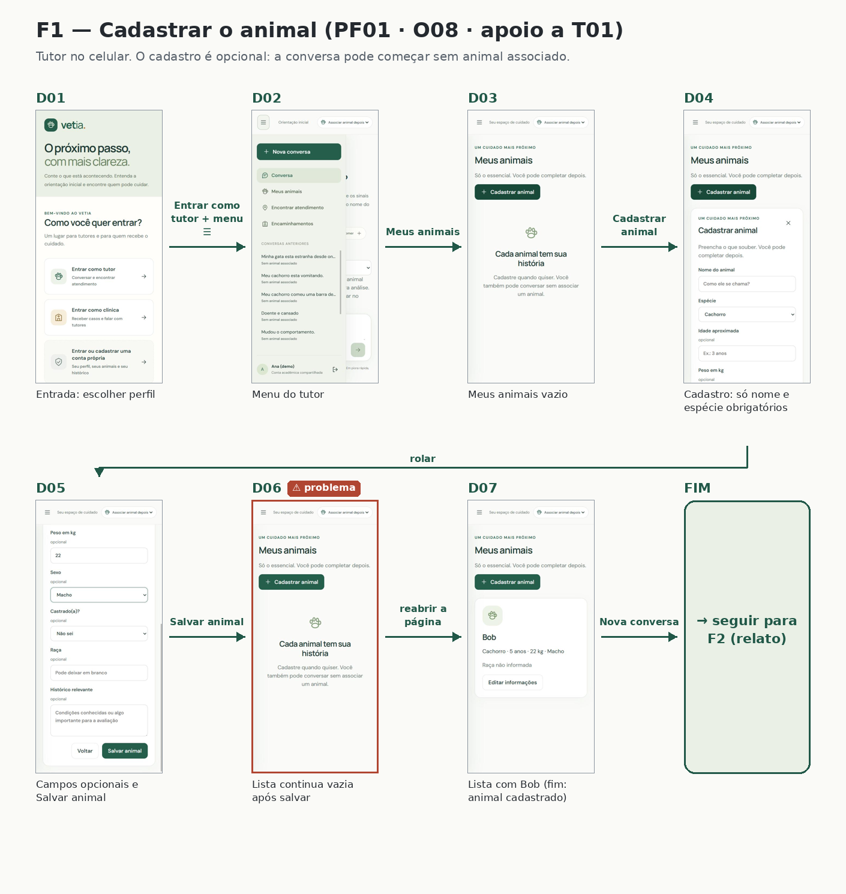
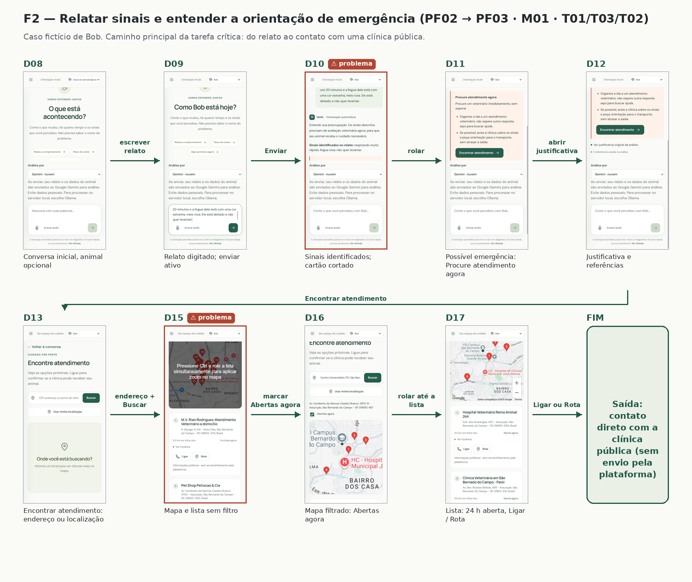
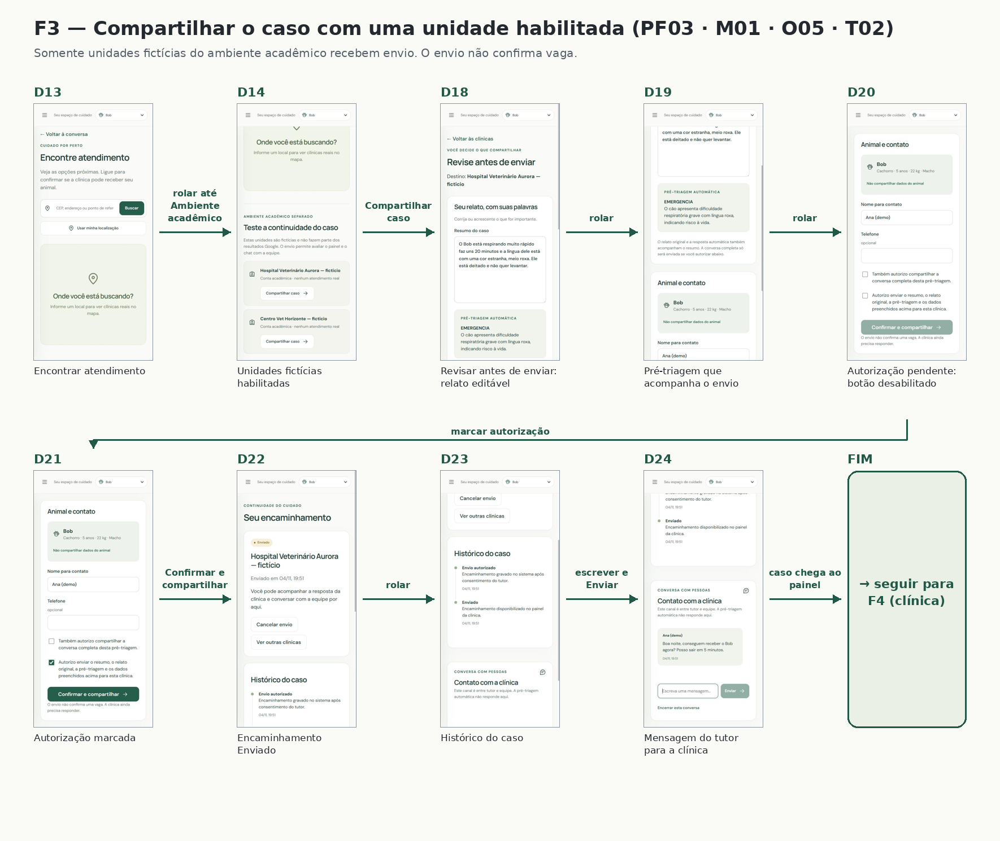
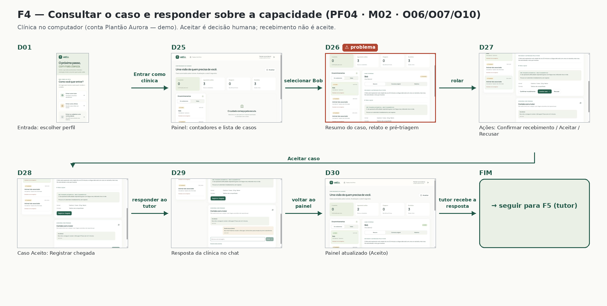
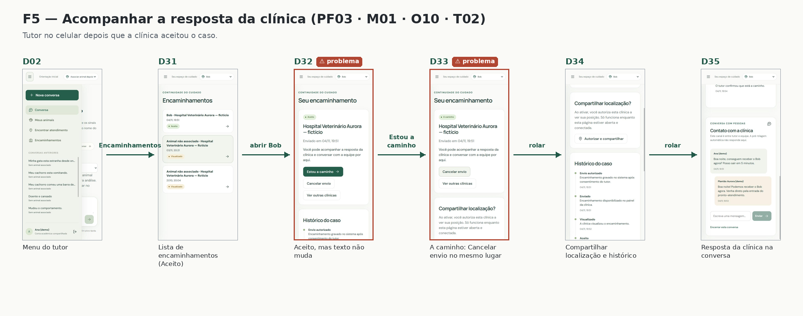
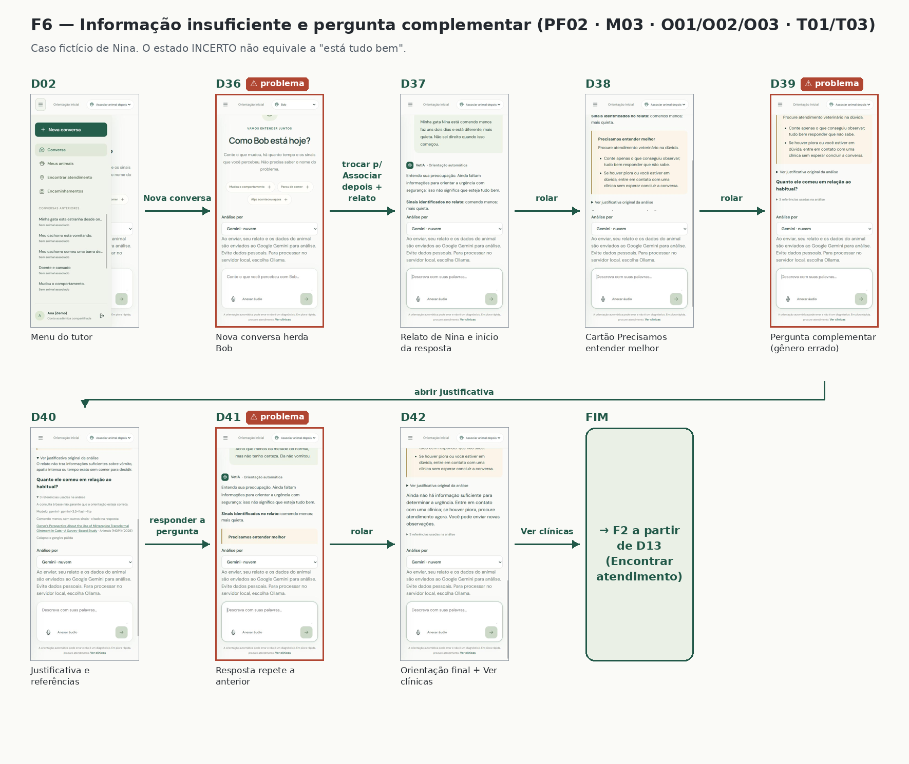

# Entrega 11 — Protótipo no Figma

**Data:** 11/11/2026  
**Status:** 🟨 em andamento  
**Responsabilidade:** 1 protótipo integrado por equipe cobrindo os fluxos MoLIC. Se a turma exigir divisão individual, identifique o responsável por cada fluxo/tela.

## Objetivo da atividade

Materializar o modelo de interação em um protótipo navegável, preservando a lógica dos objetivos, tópicos, signos, feedbacks, alternativas e recuperações definidos anteriormente.

## Biblioteca de possibilidades para projetos técnicos

O protótipo deve materializar os fluxos definidos nas entregas anteriores. Dependendo do escopo, podem fazer sentido:

1. **Dashboard:** indicadores, alertas, estado, tendências e atalhos para tarefas frequentes.
2. **Configuração/parametrização:** escolhas, presets, validação e explicação de opções técnicas.
3. **Entrada de dados:** upload, conexão, seleção, pré-visualização e validação.
4. **Processamento:** fila, status, progresso, cancelamento, falha e reexecução.
5. **Relatório/resultados:** síntese, métricas, gráficos, explicação, exportação e compartilhamento.
6. **Histórico:** busca, filtros, ordenação, paginação, detalhes e repetição de execução.
7. **Comparação:** antes/depois, modelo A/B, execução A/B, baseline ou períodos.
8. **Explicabilidade:** confiança, fatores, evidências, limitações e correção/contestação.
9. **Administração:** usuários, grupos, perfis, permissões, integrações e políticas.
10. **CRUDs de domínio:** somente quando criar/consultar/editar/excluir representa tarefa real.
11. **Auditoria/logs:** histórico de alterações e eventos em linguagem adequada.
12. **Alertas/ocorrências:** severidade, impacto, ação, responsável e resolução.
13. **Ajuda/documentação:** apoio contextual a tarefas complexas.

### Estados que não podem ser esquecidos

Quando aplicável, considere: vazio/sem dados; carregamento/processamento; sucesso; erro de entrada; erro de processamento; filtro sem resultados; permissão insuficiente; confirmação de ação destrutiva; cancelamento/desfazer/recuperação; dados desatualizados/conflito.

> Esta lista é repertório de design, **não uma exigência de quantidade de telas**. A rastreabilidade deve explicar por que cada tela existe.

## Link do Figma

**Protótipo:** <https://vetia.chilecentral.cloudapp.azure.com/> (protótipo navegável; contas `Ana (demo)` e `Plantão Aurora (demo)`)  
**Arquivo editável:** {{URL}}  
**Última verificação de permissão:** {{dd/mm/aaaa}}

> Teste o link em janela anônima. O avaliador deve conseguir abrir o protótipo sem solicitar permissão.

Casos (Bob e Nina) e unidades (Hospital Veterinário Aurora, Centro Vet Horizonte) são fictícios. As clínicas do mapa são dados públicos e não recebem casos pela plataforma.

## Fluxos no protótipo

Cada seta indica o controle que leva à próxima tela.

### F1 — Cadastrar o animal

### F2 — Relatar sinais e entender a orientação de emergência

### F3 — Compartilhar o caso

### F4 — Painel da clínica

### F5 — Acompanhar a resposta da clínica

### F6 — Informação insuficiente

## Cobertura MoLIC → Figma

| MoLIC | Objetivo | Fluxo/telas no Figma | Estados de erro/recuperação | Responsável |
|---|---|---|---|---|
| M01 (CI01) | O01, O03, O04, O08 | F1, F2: `D08 → D09 → D10 → D11 → D12 → D13 → D15 → D16 → D17` | `D08` animal opcional, `D13` busca sem localização | Julian |
| M01 (CI01) | O05, O10 | F3, F5: `D14 → D18 → D20 → D21 → D22 → D31 → D32 → D33 → D35` | `D18` relato editável, `D20` envio bloqueado sem autorização, `D22` cancelar envio | Julian |
| M02 (CI02) | O06, O07, O10 | F4: `D25 → D26 → D27 → D28 → D29 → D30` | `D27` recebimento separado de aceite, opção Recusar | Vinícius |
| M03 (CI03) | O01, O02, O03, O09 | F6: `D36 → D37 → D38 → D39 → D41 → D42 → D13` | `D38` informação insuficiente, `D39` pergunta complementar, `D42` saída para clínicas | João |

M01 e M03 ainda serão incluídos na E10. Estados ainda não prototipados: carregamento e falha da análise, recusa pela clínica, confirmação de cancelamento, lista vazia e sessão expirada no painel.

## Catálogo de telas/estados

| Tela | Objetivo do usuário | Signos principais | Origem |
|---|---|---|---|
| D01 Entrada | Escolher entre tutor e clínica | S01 | M01, M02.C01 |
| D02–D07 Menu e cadastro do animal | Cadastrar o animal sem bloquear a conversa | S02 | M01 · O08 |
| D08–D09 Conversa e relato | Contar o que observou | S02, S03, S04 | M01, M03 · O01 |
| D10–D12 Possível emergência | Entender a orientação e o motivo | S09, S10, S11, S12 | M01 · O03 |
| D13, D15–D17 Encontrar atendimento | Achar uma clínica aberta e ligar | S13, S14, S15, S16 | M01 · O04 |
| D14, D18–D21 Revisar e autorizar | Conferir o que será enviado e autorizar | S17, S18, S19 | M01 · O05 |
| D22–D24, D31–D35 Encaminhamento | Acompanhar o estado e a resposta da clínica | S20, S22, S23, S24 | M01 · O10 |
| D25 Painel da clínica | Ver os casos autorizados | S02, S20, S24 | M02.C02 |
| D26–D28 Caso na clínica | Conferir a origem e aceitar ou recusar | S03, S09, S17, S21, S23 | M02.C03, C07 |
| D29–D30 Resposta da clínica | Comunicar ao tutor | S22, S23 | M02.C06, C08 |
| D36–D42 Informação insuficiente | Responder a pergunta e saber o próximo passo | S06, S07, S09, S10 | M03 · O02, O03 |

Prints completos em [`../assets/06_prototipos/`](../assets/06_prototipos/).

## Sistema visual e consistência

| Elemento | Regra adotada | Justificativa |
|---|---|---|
| Tipografia | Uma família sans-serif; títulos grandes e frases curtas. | Leitura rápida no celular e sob estresse. |
| Cores | Verde-escuro nas ações; emergência em salmão com borda terracota; informação insuficiente em areia com borda ocre. | Estado comunicado por título e cor, não só pela cor. |
| Componentes | Uma ação principal por tela (botão verde cheio); secundárias com contorno; seletor de animal no topo. | Mesma função, mesmo componente no tutor e na clínica. |
| Feedback | Selos Enviado, Visualizado, Aceito, A caminho, com data e hora; origem de cada mensagem identificada. | Distinguir envio de aceite e o automático do humano. |

## Verificação de acessibilidade básica

Contraste do botão primário (branco sobre verde-escuro) estimado em cerca de 8:1. Os estados não dependem só da cor. Ainda falta medir o texto cinza pequeno do rodapé e verificar o foco e a navegação por teclado no painel da clínica.

## Checklist

- [ ] Link do Figma está acessível.
- [x] Há screenshots representativos no repositório.
- [ ] Todos os MoLIC relevantes estão cobertos.
- [ ] Estados de erro, feedback e recuperação foram prototipados.
- [x] Terminologia/signos são consistentes com Entrega 9.
- [x] Componentes equivalentes se comportam de forma consistente.
- [x] Fluxos críticos são clicáveis do início ao fim.
- [ ] O protótipo está pronto para inspeção e testes, sem “links mortos” nas tarefas avaliadas.
- [x] Dashboards, relatórios, históricos, filtros, administração e CRUDs presentes possuem justificativa rastreável.
- [ ] Estados de vazio, processamento, erro e recuperação foram considerados quando pertinentes.
- [x] Resultados técnicos são apresentados de forma interpretável para o perfil de usuário.
- [x] A equipe distingue no protótipo o que é interação simulada e o que é funcionalidade técnica realmente integrada, quando necessário.
