# Entrega 13 — Avaliação de IHC por inspeção heurística

**Data:** 18/11/2026  
**Status:** 🟩 concluída  
**Responsabilidade:** 1 avaliação completa por integrante, sobre todas as telas/estados relevantes do projeto.

## Objetivo da atividade

Encontrar problemas de usabilidade por inspeção sistemática da interface com as **10 heurísticas de Nielsen**. Cada avaliador trabalha individualmente primeiro; depois a equipe consolida problemas duplicados e prioridades.

> **Parte de violações:** registre somente problemas reais. Não invente uma violação para “preencher” cada heurística. Para provar que todas foram exercitadas, use a **matriz de cobertura H1–H10**. Para heurísticas sem violação, a disciplina solicita um exemplo didático de boa prática.

## 1. Heurísticas adotadas

1. Visibilidade do status do sistema
2. Compatibilidade entre o sistema e o mundo real
3. Controle e liberdade do usuário
4. Consistência e padrões
5. Prevenção de erros
6. Reconhecimento em vez de memorização
7. Flexibilidade e eficiência de uso
8. Estética e design minimalista
9. Ajudar usuários a reconhecer, diagnosticar e recuperar-se de erros
10. Ajuda e documentação

## Cobertura especial para interfaces administrativas e analíticas

Quando existirem, não limite a avaliação às “telas principais”. Inspecione também:

- dashboard em estados normal, vazio e erro;
- filtros sem resultado e filtros combinados;
- relatórios e exportação;
- histórico/listas longas;
- formulários CRUD (criação, edição, exclusão, validação);
- alteração de perfil/permissão;
- confirmações de ações destrutivas;
- processamento/loading/progresso;
- falha e recuperação;
- comparação de resultados;
- mensagens de termos técnicos, métricas e recomendações;
- ajuda/documentação contextual.

Em TCCs técnicos, observe especialmente se a interface comunica o estado do processamento e traduz informações técnicas para o vocabulário do usuário escolhido.

## Processo/Fluxograma Avaliação Heurística

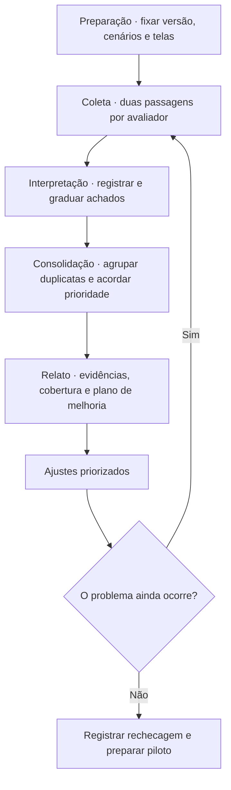

## 2. Escopo da inspeção

| Item | Definição |
|---|---|
| Versão avaliada | [Demo VetIA](https://vetia.chilecentral.cloudapp.azure.com/), consultada em 18/11/2026. As capturas de referência são do commit documental `adc5d3d` da E11. |
| Telas/estados | D01–D42 como referência. Na demo: entrada dos dois perfis, cadastro com nome vazio, conversas de Bob e Nina, troca para nova conversa, busca inicial, revisão do envio, seguimento de caso a caminho e painel com filtros, detalhes e aba de conversa sem autorização. A equipe também confirmou a cobertura dos estados relevantes, incluindo processamento e erros aplicáveis. |
| Fluxos | F1 cadastro, F2 possível emergência e atendimento, F3 compartilhamento, F4 painel, F5 acompanhamento, F6 informação insuficiente. Correspondências em E10 e E11. |
| Dispositivo/viewport | Chrome em ambiente desktop na demo, complementado pelas capturas publicadas do tutor e da clínica. |
| Avaliadores | A02 Vinícius de Castro Duarte, A01 Julian Ryu Takada, A03 João Pedro Gardenghi Peterutto |

## 3. Procedimento individual

Cada avaliador deve:

1. percorrer os fluxos/telas ao menos uma vez para familiarização;
2. inspecionar novamente aplicando sistematicamente H1–H10;
3. registrar cada problema com evidência e contexto;
4. atribuir severidade **depois de compreender bem o problema**, justificando a decisão;
5. não discutir achados com os demais antes de terminar a inspeção individual, quando o objetivo for preservar independência.

### Escala de severidade (0–4)

| Grau | Interpretação |
|---:|---|
| 0 | não é considerado problema de usabilidade |
| 1 | problema cosmético; corrigir se houver tempo |
| 2 | problema menor; baixa prioridade |
| 3 | problema maior; alta prioridade |
| 4 | catástrofe de usabilidade; correção imperativa antes de disponibilizar |

Ao justificar, considere **frequência, impacto e persistência** do problema no contexto real de uso.

---

## Avaliador A02 — Vinícius de Castro Duarte

### 4. Matriz de cobertura das 10 heurísticas

| Heurística | Telas/fluxos examinados | Houve violação? | IDs dos achados | Exemplo de boa prática se não violada |
|---|---|---|---|---|
| H1 | F5 · selo e horário ([D34](../assets/06_prototipos/D34_tutor_localizacao_historico.jpg)) | Nenhuma neste recorte | — | A linha do tempo identifica o estado e horário. |
| H2 | F2 · orientação em linguagem cotidiana ([D11](../assets/06_prototipos/D11_resultado_emergencia.jpg)) | Sim | A02-V02 | — |
| H3 | F3 · revisão e retorno ([D18](../assets/06_prototipos/D18_revisar_envio.jpg)) | Nenhuma registrada neste recorte | — | O resumo pode ser corrigido e “Voltar às clínicas” permite rever o destino antes do envio. |
| H4 | F4/F5 · estado “Aceito” ([D30](../assets/06_prototipos/D30_painel_atualizado.jpg) · [D32](../assets/06_prototipos/D32_tutor_aceito.jpg)) | Nenhuma registrada neste recorte | — | A lista e o detalhe do painel e a tela do tutor usam o mesmo rótulo para o aceite. |
| H5 | F3 · autorização de envio ([D20](../assets/06_prototipos/D20_autorizacao_pendente.jpg) · [D21](../assets/06_prototipos/D21_autorizacao_marcada.jpg)) | Sim | A02-V03 | — |
| H6 | F2 · lista de clínicas ([D17](../assets/06_prototipos/D17_lista_abertas_agora.jpg)) | Nenhuma registrada neste recorte | — | Horário e ações “Ligar” e “Rota” aparecem no cartão do estabelecimento. |
| H7 | F2 · entrada de região ([D13](../assets/06_prototipos/D13_encontrar_atendimento.jpg)) | Nenhuma registrada neste recorte | — | A busca oferece localização atual e entrada manual para o mesmo objetivo. |
| H8 | F2 · detalhes sob demanda ([D12](../assets/06_prototipos/D12_resultado_justificativa.jpg)) | Nenhuma registrada neste recorte | — | Justificativa original e referências aparecem recolhidas abaixo da orientação principal. |
| H9 | F1 · validação de nome obrigatório (demo · Cadastro → Salvar animal com nome vazio) | Nenhuma registrada neste recorte | — | Ao tentar salvar sem nome, a interface volta o foco ao campo vazio e o navegador mostra “Please fill out this field.”. O foco indica onde corrigir. A mensagem em inglês limita a clareza para tutores que usam português. |
| H10 | F3 · instrução contextual ([D18](../assets/06_prototipos/D18_revisar_envio.jpg)) | Nenhuma registrada neste recorte | — | A revisão orienta o tutor a corrigir ou acrescentar informação antes de compartilhar. |

### 5. Declaração de violações

| ID | Heurística | Tela/estado | Problema observado | Evidência | Severidade | Justificativa da severidade | Recomendação |
|---|---|---|---|---|---:|---|---|
| A02-V02 | H2 | F4 · D27 | “Confirmar recebimento” e “Aceitar caso” aparecem lado a lado sem explicação da diferença perto das ações. A equipe de plantão pode hesitar sobre qual delas comunica disponibilidade ao tutor. | [D27](../assets/06_prototipos/D27_clinica_acoes.jpg) | 3 | Afeta a decisão central a cada caso novo. Escolher o comando errado pode atrasar ou comunicar incorretamente a continuidade do atendimento. A inspeção verificou a apresentação das ações antes da decisão. | Explicar junto aos botões que recebimento acusa leitura e aceite informa capacidade de receber o caso. |
| A02-V03 | H5 | F3 · D19–D21 | Na revisão do caso do Bob para o Hospital Aurora fictício, a opção adicional de compartilhar a conversa completa aparece antes da autorização principal. As duas caixas usam “autorizo” e ocupam a mesma região, o que torna fácil confundir qual é necessária para enviar apenas os dados previstos. | [D19](../assets/06_prototipos/D19_revisar_pretriagem.jpg) · [D20](../assets/06_prototipos/D20_autorizacao_pendente.jpg) · [D21](../assets/06_prototipos/D21_autorizacao_marcada.jpg) | 3 | A escolha aparece a cada envio. Uma seleção equivocada pode expor conteúdo além do pretendido e a exposição não pode ser desfeita pelo tutor após a leitura. | Apresentar primeiro a autorização necessária e agrupar a conversa completa em uma opção explicitamente opcional, desmarcada por padrão, com resumo do que será enviado. |

**Qualidade do relato:** o problema deve ser observável e localizado. Evite “interface confusa” sem dizer **o que**, **onde**, **quando** e **para quem**.

Capturas e elementos de cada achado

**A02-V02.** Localize os botões **Confirmar recebimento** e **Aceitar caso** abaixo do resumo.

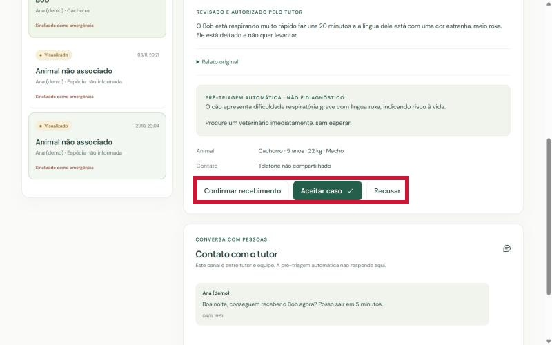

**A02-V03.** Compare as duas caixas **Também autorizo** e **Autorizo enviar** antes do botão.

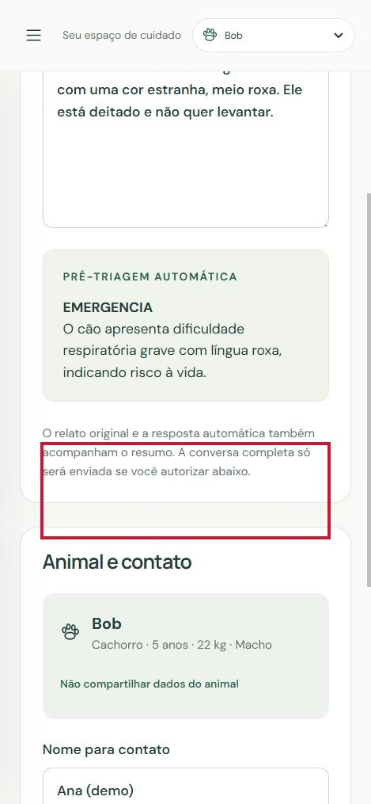 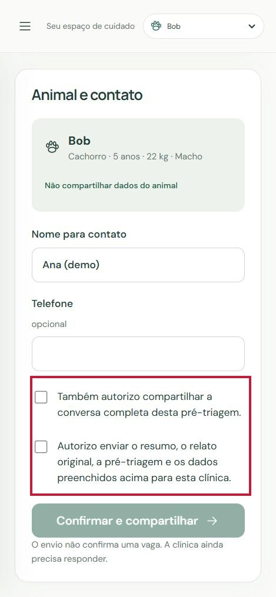 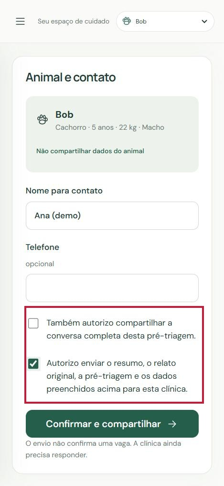

### 6. Boas práticas — heurísticas não violadas (atividade didática)

| Heurística sem violação | Exemplo no sistema | Evidência | Por que atende |
|---|---|---|---|
| H1 | F5 · selo e horário | [D34](../assets/06_prototipos/D34_tutor_localizacao_historico.jpg) | A linha do tempo explicita “Visualizado” e o momento do evento. |
| H3 | F3 · revisão e retorno | [D18](../assets/06_prototipos/D18_revisar_envio.jpg) | O resumo pode ser corrigido e “Voltar às clínicas” permite rever o destino antes do envio. |
| H4 | F4/F5 · estado “Aceito” | [D30](../assets/06_prototipos/D30_painel_atualizado.jpg) · [D32](../assets/06_prototipos/D32_tutor_aceito.jpg) | A lista e o detalhe do painel e a tela do tutor usam o mesmo rótulo para o aceite. |
| H6 | F2 · lista de clínicas | [D17](../assets/06_prototipos/D17_lista_abertas_agora.jpg) | Horário e ações “Ligar” e “Rota” aparecem no cartão do estabelecimento. |
| H7 | F2 · entrada de região | [D13](../assets/06_prototipos/D13_encontrar_atendimento.jpg) | A busca oferece localização atual e entrada manual para o mesmo objetivo. |
| H8 | F2 · detalhes sob demanda | [D12](../assets/06_prototipos/D12_resultado_justificativa.jpg) | Justificativa original e referências aparecem recolhidas abaixo da orientação principal. |
| H9 | F1 · validação de nome obrigatório | demo · Cadastro → Salvar animal com nome vazio | Ao tentar salvar sem nome, a interface volta o foco ao campo vazio e o navegador mostra “Please fill out this field.”. O foco indica onde corrigir. A mensagem em inglês limita a clareza para tutores que usam português. |
| H10 | F3 · instrução contextual | [D18](../assets/06_prototipos/D18_revisar_envio.jpg) | A revisão orienta o tutor a corrigir ou acrescentar informação antes de compartilhar. |

## Avaliador A01 — Julian Ryu Takeda

### 4. Matriz de cobertura das 10 heurísticas

| Heurística | Telas/fluxos examinados | Houve violação? | IDs dos achados | Exemplo de boa prática se não violada |
|---|---|---|---|---|
| H1 | F5 · selo e horário ([D34](../assets/06_prototipos/D34_tutor_localizacao_historico.jpg)) | Sim | A01-V01 | — |
| H2 | F2 · orientação em linguagem cotidiana ([D11](../assets/06_prototipos/D11_resultado_emergencia.jpg)) | Nenhuma registrada neste recorte | — | “Procure atendimento agora” apresenta a ação direta antes dos detalhes técnicos. |
| H3 | F3 · revisão e retorno ([D18](../assets/06_prototipos/D18_revisar_envio.jpg)) | Sim | A01-V02 | — |
| H4 | F4/F5 · estado “Aceito” ([D30](../assets/06_prototipos/D30_painel_atualizado.jpg) · [D32](../assets/06_prototipos/D32_tutor_aceito.jpg)) | Nenhuma registrada neste recorte | — | A lista e o detalhe do painel e a tela do tutor usam o mesmo rótulo para o aceite. |
| H5 | F3 · autorização de envio ([D20](../assets/06_prototipos/D20_autorizacao_pendente.jpg) · [D21](../assets/06_prototipos/D21_autorizacao_marcada.jpg)) | Nenhuma registrada neste recorte | — | A ação de compartilhar aparece inativa sem autorização e ativa após marcar a caixa exigida. |
| H6 | F2 · lista de clínicas ([D17](../assets/06_prototipos/D17_lista_abertas_agora.jpg)) | Nenhuma registrada neste recorte | — | Horário e ações “Ligar” e “Rota” aparecem no cartão do estabelecimento. |
| H7 | F2 · entrada de região ([D13](../assets/06_prototipos/D13_encontrar_atendimento.jpg)) | Nenhuma registrada neste recorte | — | A busca oferece localização atual e entrada manual para o mesmo objetivo. |
| H8 | F2 · detalhes sob demanda ([D12](../assets/06_prototipos/D12_resultado_justificativa.jpg)) | Sim | A01-V03 | — |
| H9 | F1 · validação de nome obrigatório (demo · Cadastro → Salvar animal com nome vazio) | Nenhuma registrada neste recorte | — | Ao tentar salvar sem nome, a interface volta o foco ao campo vazio e o navegador mostra “Please fill out this field.”. O foco indica onde corrigir. A mensagem em inglês limita a clareza para tutores que usam português. |
| H10 | F3 · instrução contextual ([D18](../assets/06_prototipos/D18_revisar_envio.jpg)) | Nenhuma registrada neste recorte | — | A revisão orienta o tutor a corrigir ou acrescentar informação antes de compartilhar. |

### 5. Declaração de violações

| ID | Heurística | Tela/estado | Problema observado | Evidência | Severidade | Justificativa da severidade | Recomendação |
|---|---|---|---|---|---:|---|---|
| A01-V01 | H1 | F5 · D21–D22 | Antes de confirmar, a página explica que o envio não confirma vaga. No topo do acompanhamento a mensagem passa a ser genérica e o selo diz apenas “Enviado”. A informação sobre a resposta pendente perde destaque justamente depois do envio. | [D21](../assets/06_prototipos/D21_autorizacao_marcada.jpg) · [D22](../assets/06_prototipos/D22_encaminhamento_enviado.jpg) | 3 | O estado aparece para todo envio antes do aceite. Interpretá-lo como confirmação pode influenciar o deslocamento. O risco persiste enquanto a resposta estiver pendente. | Exibir “Enviado · aguardando resposta da clínica” e manter junto ao selo um aviso curto de que o atendimento ainda não está confirmado. |
| A01-V02 | H3 | F5 · D22, D32–D33 | “Cancelar envio” continua com o mesmo rótulo depois de “Aceito” e “A caminho”. A tela não explica o alcance da ação quando a clínica já teve acesso ao caso. | [D22](../assets/06_prototipos/D22_encaminhamento_enviado.jpg) · [D32](../assets/06_prototipos/D32_tutor_aceito.jpg) · [D33](../assets/06_prototipos/D33_tutor_a_caminho.jpg) | 2 | Afeta quem reconsidera o envio em estados posteriores. A dúvida volta em cada estado e exige inferir se a ação interrompe o acompanhamento ou altera os dados já vistos. | Explicar o efeito antes de confirmar o cancelamento e usar um rótulo compatível com o estado.  |
| A01-V03 | H8 | F2/F6 · D11–D12, D38–D40 | O seletor de provedor e o aviso sobre processamento ocupam uma faixa grande da conversa mesmo durante a leitura da orientação. Nas capturas, essa área divide a atenção com o próximo passo e a pergunta complementar. | [D11](../assets/06_prototipos/D11_resultado_emergencia.jpg) · [D12](../assets/06_prototipos/D12_resultado_justificativa.jpg) · [D38](../assets/06_prototipos/D38_incerto_cartao.jpg) · [D39](../assets/06_prototipos/D39_pergunta_complementar.jpg) · [D40](../assets/06_prototipos/D40_justificativa_referencias.jpg) | 2 | A faixa reaparece durante a conversa e reduz o espaço visível. O usuário consegue continuar, mas pode precisar rolar para recuperar informações importantes. | Manter visível a informação de privacidade necessária no envio e compactar a escolha de provedor fora da leitura da orientação. |

**Qualidade do relato:** o problema deve ser observável e localizado. Evite “interface confusa” sem dizer **o que**, **onde**, **quando** e **para quem**.

Capturas e elementos de cada achado

**A01-V01.** Compare o aviso **O envio não confirma uma vaga** com o selo **Enviado** no acompanhamento.

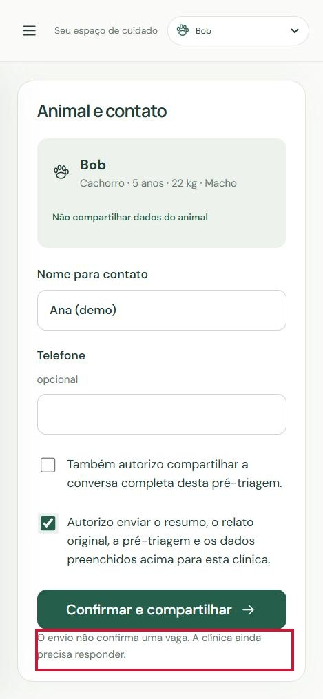 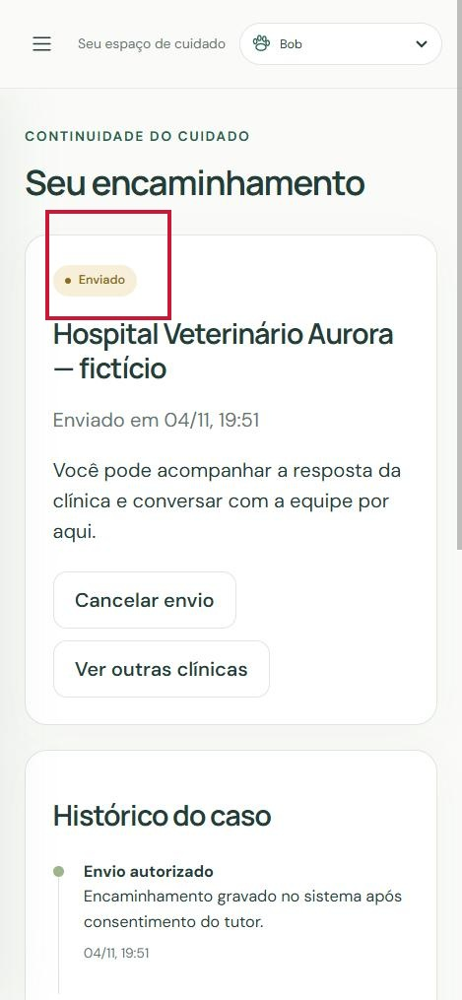

**A01-V02.** Localize **Cancelar envio** nos estados enviado, aceito e a caminho.

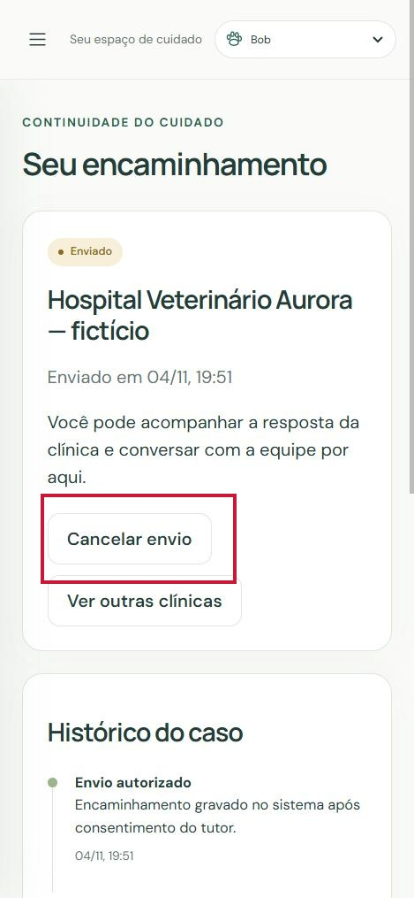 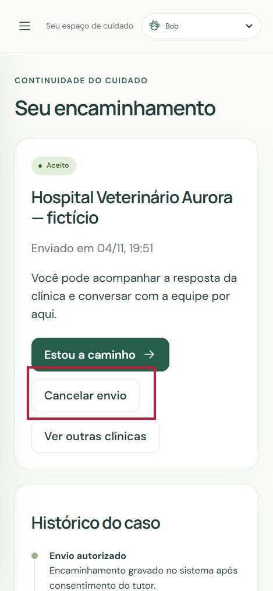 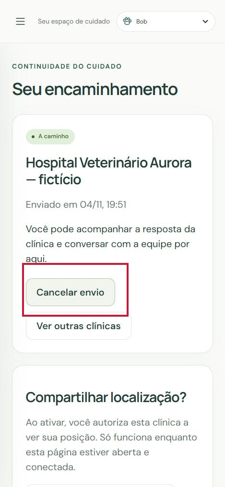

**A01-V03.** Observe a faixa **Análise por**, entre a orientação ou pergunta e o campo de resposta.

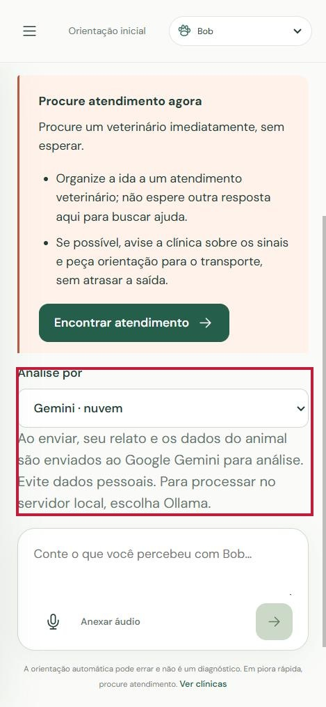 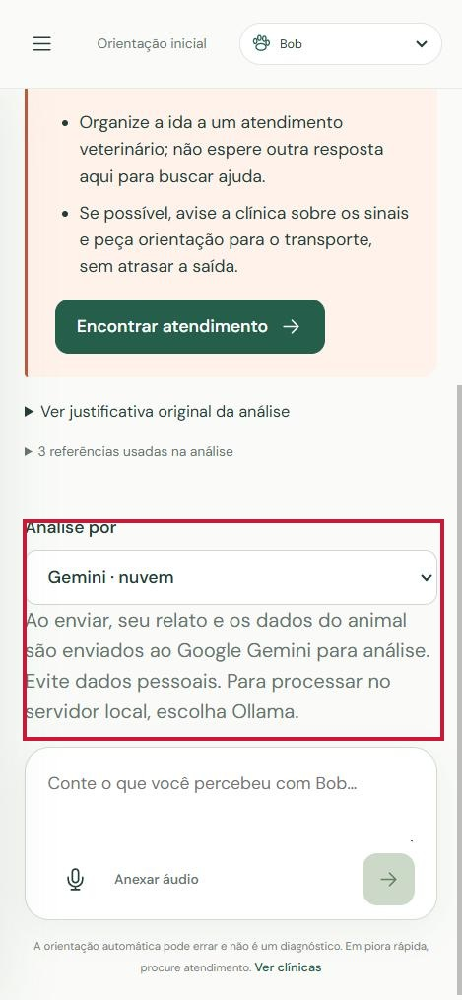 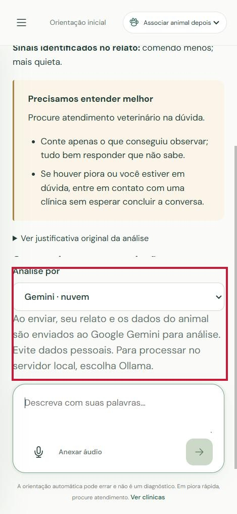 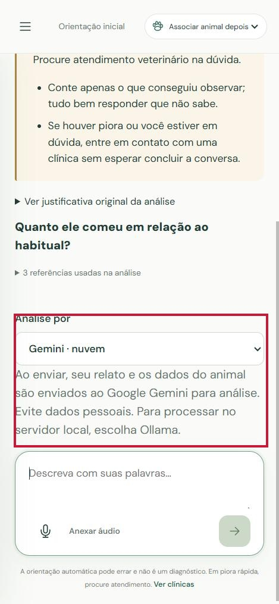 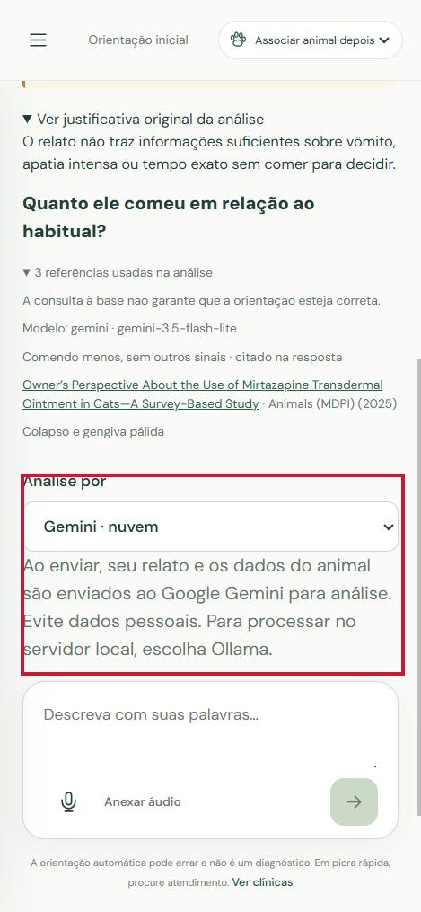

### 6. Boas práticas — heurísticas não violadas (atividade didática)

| Heurística sem violação | Exemplo no sistema | Evidência | Por que atende |
|---|---|---|---|
| H2 | F2 · orientação em linguagem cotidiana | [D11](../assets/06_prototipos/D11_resultado_emergencia.jpg) | “Procure atendimento agora” apresenta a ação direta antes dos detalhes técnicos. |
| H4 | F4/F5 · estado “Aceito” | [D30](../assets/06_prototipos/D30_painel_atualizado.jpg) · [D32](../assets/06_prototipos/D32_tutor_aceito.jpg) | A lista e o detalhe do painel e a tela do tutor usam o mesmo rótulo para o aceite. |
| H5 | F3 · autorização de envio | [D20](../assets/06_prototipos/D20_autorizacao_pendente.jpg) · [D21](../assets/06_prototipos/D21_autorizacao_marcada.jpg) | A ação de compartilhar aparece inativa sem autorização e ativa após marcar a caixa exigida. |
| H6 | F2 · lista de clínicas | [D17](../assets/06_prototipos/D17_lista_abertas_agora.jpg) | Horário e ações “Ligar” e “Rota” aparecem no cartão do estabelecimento. |
| H7 | F2 · entrada de região | [D13](../assets/06_prototipos/D13_encontrar_atendimento.jpg) | A busca oferece localização atual e entrada manual para o mesmo objetivo. |
| H9 | F1 · validação de nome obrigatório | demo · Cadastro → Salvar animal com nome vazio | Ao tentar salvar sem nome, a interface volta o foco ao campo vazio e o navegador mostra “Please fill out this field.”. O foco indica onde corrigir. A mensagem em inglês limita a clareza para tutores que usam português. |
| H10 | F3 · instrução contextual | [D18](../assets/06_prototipos/D18_revisar_envio.jpg) | A revisão orienta o tutor a corrigir ou acrescentar informação antes de compartilhar. |

## Avaliador A03 — João Pedro Gardenghi Peterutto

### 4. Matriz de cobertura das 10 heurísticas

| Heurística | Telas/fluxos examinados | Houve violação? | IDs dos achados | Exemplo de boa prática se não violada |
|---|---|---|---|---|
| H1 | F5 · selo e horário ([D34](../assets/06_prototipos/D34_tutor_localizacao_historico.jpg)) | Nenhuma registrada neste recorte | — | A linha do tempo explicita “Visualizado” e o momento do evento. |
| H2 | F6 · referência ambígua ao animal na pergunta complementar ([D37](../assets/06_prototipos/D37_incerto_relato.jpg) · [D39](../assets/06_prototipos/D39_pergunta_complementar.jpg)) | Sim | A03-V03 | — |
| H3 | F3 · revisão e retorno ([D18](../assets/06_prototipos/D18_revisar_envio.jpg)) | Nenhuma registrada neste recorte | — | O resumo pode ser corrigido e “Voltar às clínicas” permite rever o destino antes do envio. |
| H4 | F4/F5 · estado “Aceito” ([D30](../assets/06_prototipos/D30_painel_atualizado.jpg) · [D32](../assets/06_prototipos/D32_tutor_aceito.jpg)) | Nenhuma registrada neste recorte | — | A lista e o detalhe do painel e a tela do tutor usam o mesmo rótulo para o aceite. |
| H5 | F6 · nova conversa com o animal anterior ([D36](../assets/06_prototipos/D36_nova_conversa_animal_anterior.jpg) · [D37](../assets/06_prototipos/D37_incerto_relato.jpg)) | Sim | A03-V01 | — |
| H6 | F6 · pergunta complementar sem opção visível “Não sei” ([D38](../assets/06_prototipos/D38_incerto_cartao.jpg) · [D39](../assets/06_prototipos/D39_pergunta_complementar.jpg)) | Sim | A03-V02 | — |
| H7 | F2 · entrada de região ([D13](../assets/06_prototipos/D13_encontrar_atendimento.jpg)) | Nenhuma registrada neste recorte | — | A busca oferece localização atual e entrada manual para o mesmo objetivo. |
| H8 | F2 · detalhes sob demanda ([D12](../assets/06_prototipos/D12_resultado_justificativa.jpg)) | Nenhuma registrada neste recorte | — | Justificativa original e referências aparecem recolhidas abaixo da orientação principal. |
| H9 | F1 · validação de nome obrigatório (demo · Cadastro → Salvar animal com nome vazio) | Nenhuma registrada neste recorte | — | Ao tentar salvar sem nome, a interface volta o foco ao campo vazio e o navegador mostra “Please fill out this field.”. O foco indica onde corrigir. A mensagem em inglês limita a clareza para tutores que usam português. |
| H10 | F3 · instrução contextual ([D18](../assets/06_prototipos/D18_revisar_envio.jpg)) | Nenhuma registrada neste recorte | — | A revisão orienta o tutor a corrigir ou acrescentar informação antes de compartilhar. |

### 5. Declaração de violações

| ID | Heurística | Tela/estado | Problema observado | Evidência | Severidade | Justificativa da severidade | Recomendação |
|---|---|---|---|---|---:|---|---|
| A03-V01 | H5 | F6 · D36 | Ao abrir o histórico do Bob e clicar em “Nova conversa”, o seletor mantém Bob e o título passa a “Como Bob está hoje?”. O animal selecionado está visível, mas o início pode induzir o tutor a seguir com o perfil anterior ao mudar de caso. | [D36](../assets/06_prototipos/D36_nova_conversa_animal_anterior.jpg) · [D37](../assets/06_prototipos/D37_incerto_relato.jpg) | 3 | A condição afeta quem alterna entre animais. Um relato atribuído ao perfil errado pode exigir refazer a conversa. A observação se refere ao estado antes de enviar. | Tornar explícita a escolha de animal ao iniciar outro caso ou começar sem associação e manter o animal reconhecível junto à ação de enviar. |
| A03-V02 | H6 | F6 · D38–D39 | O cartão explica que tudo bem responder que não sabe. No histórico da Nina, a pergunta “Quanto ele comeu em relação ao habitual?” aparece com campo livre e sem opção visível “Não sei”. | [D38](../assets/06_prototipos/D38_incerto_cartao.jpg) · [D39](../assets/06_prototipos/D39_pergunta_complementar.jpg) | 2 | Afeta respostas sobre sinais que o tutor não observou. Digitar livremente continua possível, mas o usuário precisa recuperar a instrução do cartão a cada pergunta. | Exibir “Não sei” como resposta rápida junto da pergunta e manter a resposta livre disponível. |
| A03-V03 | H2 | F6 · D37–D40 | A pergunta usa “ele” após o relato identificar Nina como gata. A referência fica ambígua para quem acabou de lidar com outro animal, embora o contexto permita inferir a intenção. | [D37](../assets/06_prototipos/D37_incerto_relato.jpg) · [D39](../assets/06_prototipos/D39_pergunta_complementar.jpg) | 2 | A inconsistência é visível no caso registrado. Pode exigir releitura e voltar em perguntas complementares se os rótulos usarem referências genéricas. | Usar uma formulação neutra, como “Quanto seu animal comeu em relação ao habitual?”, ou o nome do animal quando a associação tiver sido confirmada. |

**Qualidade do relato:** o problema deve ser observável e localizado. Evite “interface confusa” sem dizer **o que**, **onde**, **quando** e **para quem**.

Capturas e elementos de cada achado

**A03-V01.** Observe **Bob** no seletor e no título da nova conversa. Em D37, veja o início do relato de **Nina**.

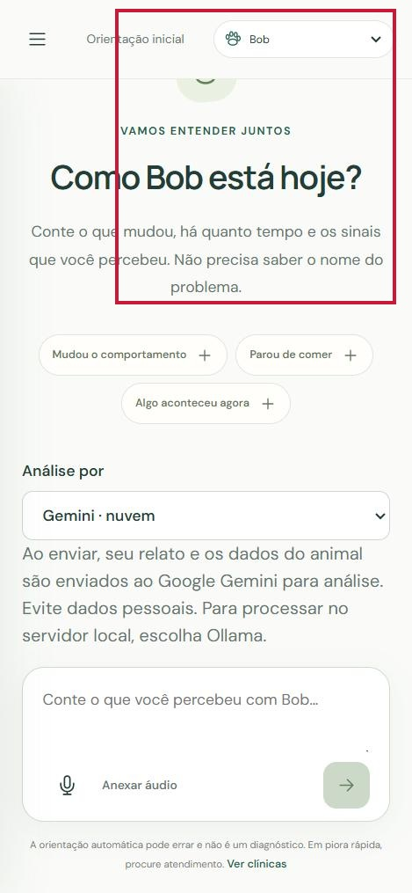 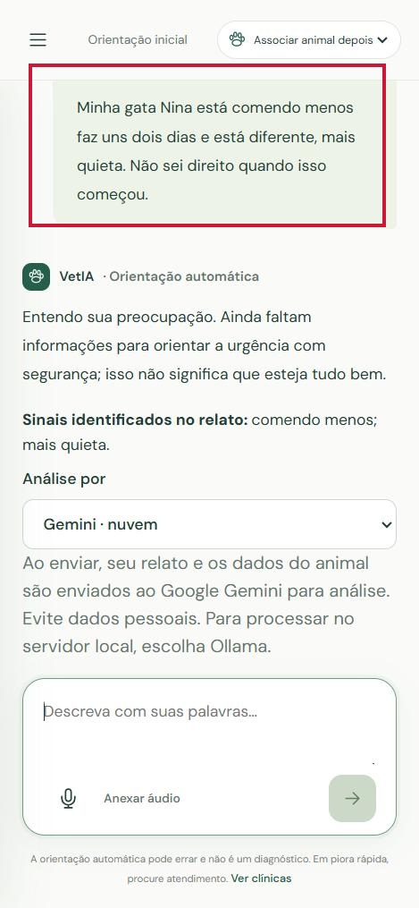

**A03-V02.** Compare **tudo bem responder que não sabe** com as opções visíveis junto à pergunta.

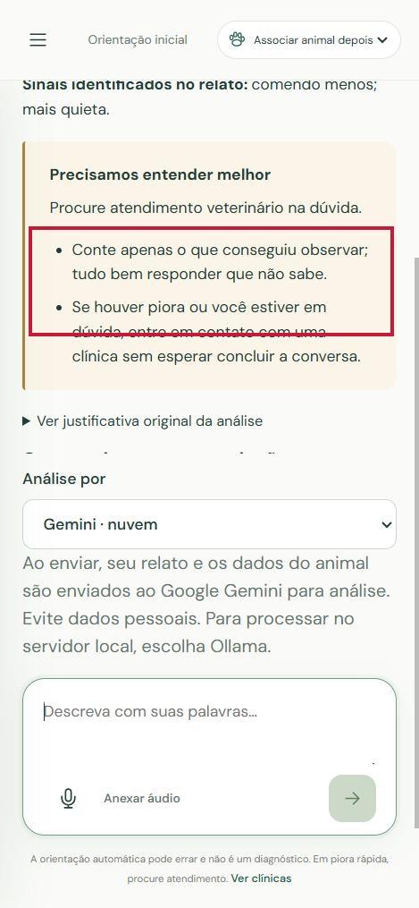 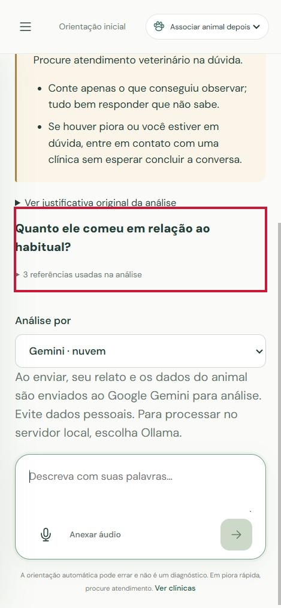

**A03-V03.** Compare **Minha gata Nina** no relato com **Quanto ele comeu** na pergunta.

 

### 6. Boas práticas — heurísticas não violadas (atividade didática)

| Heurística sem violação | Exemplo no sistema | Evidência | Por que atende |
|---|---|---|---|
| H1 | F5 · selo e horário | [D34](../assets/06_prototipos/D34_tutor_localizacao_historico.jpg) | A linha do tempo explicita “Visualizado” e o momento do evento. |
| H3 | F3 · revisão e retorno | [D18](../assets/06_prototipos/D18_revisar_envio.jpg) | O resumo pode ser corrigido e “Voltar às clínicas” permite rever o destino antes do envio. |
| H4 | F4/F5 · estado “Aceito” | [D30](../assets/06_prototipos/D30_painel_atualizado.jpg) · [D32](../assets/06_prototipos/D32_tutor_aceito.jpg) | A lista e o detalhe do painel e a tela do tutor usam o mesmo rótulo para o aceite. |
| H7 | F2 · entrada de região | [D13](../assets/06_prototipos/D13_encontrar_atendimento.jpg) | A busca oferece localização atual e entrada manual para o mesmo objetivo. |
| H8 | F2 · detalhes sob demanda | [D12](../assets/06_prototipos/D12_resultado_justificativa.jpg) | Justificativa original e referências aparecem recolhidas abaixo da orientação principal. |
| H9 | F1 · validação de nome obrigatório | demo · Cadastro → Salvar animal com nome vazio | Ao tentar salvar sem nome, a interface volta o foco ao campo vazio e o navegador mostra “Please fill out this field.”. O foco indica onde corrigir. A mensagem em inglês limita a clareza para tutores que usam português. |
| H10 | F3 · instrução contextual | [D18](../assets/06_prototipos/D18_revisar_envio.jpg) | A revisão orienta o tutor a corrigir ou acrescentar informação antes de compartilhar. |

> Repita a seção para A02, A03... um avaliador por integrante.

## 7. Consolidação da equipe

Problemas iguais ou muito semelhantes encontrados por avaliadores diferentes devem ser consolidados, preservando quem os encontrou.

| ID consolidado | Achados individuais | Heurística | Problema | Severidade final | Prioridade | Responsável pela correção |
|---|---|---|---|---:|---|---|
| HC02 | A02-V02 | H2 | Distinção insuficiente entre recebimento e aceite | 3 | alta | Vinícius |
| HC03 | A02-V03 | H5 | Consentimento opcional e obrigatório com hierarquia pouco clara | 3 | alta | Vinícius |
| HC04 | A01-V01 | H1 | Resposta pendente com pouco destaque após envio | 3 | alta | Julian |
| HC05 | A01-V02 | H3 | Alcance do cancelamento após o aceite pouco claro | 2 | baixa | Julian |
| HC06 | A01-V03 | H8 | Configuração de provedor ocupa espaço da conversa | 2 | baixa | Julian |
| HC07 | A03-V01 | H5 | Animal anterior em destaque ao começar outro caso | 3 | alta | João |
| HC08 | A03-V02 | H6 | Resposta “Não sei” sem opção visível junto da pergunta | 2 | baixa | João |
| HC09 | A03-V03 | H2 | Referência ambígua ao animal na pergunta complementar | 2 | baixa | João |

A equipe comparou os registros individuais e consolidou oito problemas distintos. HC02 e HC04 tratam de estados em etapas e papéis diferentes.

## 8. Síntese e plano de melhoria

- Quantidade de problemas por heurística e severidade.
- Problemas críticos/graves que bloqueiam teste ou release.
- Padrões recorrentes entre telas.
- Correções que serão feitas antes/para a avaliação com usuários.

Foram registrados 8 problemas. Por heurística, H1: 1, H2: 2, H3: 1, H5: 2, H6: 1, H8: 1. Por severidade, grau 2: 4 e grau 3: 4.

**Prioridades de correção.** Explicitar a diferença entre recebimento, envio e aceite (HC02 e HC04), separar as autorizações obrigatória e opcional (HC03) e evitar o uso involuntário do perfil do animal anterior (HC07). Priorizar os problemas de grau 3 antes dos testes com tutores. O registro não inclui problemas de grau 4.

## Uso das Heurísticas

Exercício didático do Modelo 01. Os exemplos indicam como uma heurística aparece em um ponto da interface. A ocorrência de um exemplo favorável é compatível com problemas em outras telas.

| Heurística | Aplicação no VetIA | Evidência | Como o exemplo se relaciona à heurística |
|---|---|---|---|
| H1 | F5 · selo e horário | [D34](../assets/06_prototipos/D34_tutor_localizacao_historico.jpg) | A linha do tempo explicita “Visualizado” e o momento do evento. |
| H2 | F2 · orientação em linguagem cotidiana | [D11](../assets/06_prototipos/D11_resultado_emergencia.jpg) | “Procure atendimento agora” apresenta a ação direta antes dos detalhes técnicos. |
| H3 | F3 · revisão e retorno | [D18](../assets/06_prototipos/D18_revisar_envio.jpg) | O resumo pode ser corrigido e “Voltar às clínicas” permite rever o destino antes do envio. |
| H4 | F4/F5 · estado “Aceito” | [D30](../assets/06_prototipos/D30_painel_atualizado.jpg) · [D32](../assets/06_prototipos/D32_tutor_aceito.jpg) | A lista e o detalhe do painel e a tela do tutor usam o mesmo rótulo para o aceite. |
| H5 | F3 · autorização de envio | [D20](../assets/06_prototipos/D20_autorizacao_pendente.jpg) · [D21](../assets/06_prototipos/D21_autorizacao_marcada.jpg) | A ação de compartilhar aparece inativa sem autorização e ativa após marcar a caixa exigida. |
| H6 | F2 · lista de clínicas | [D17](../assets/06_prototipos/D17_lista_abertas_agora.jpg) | Horário e ações “Ligar” e “Rota” aparecem no cartão do estabelecimento. |
| H7 | F2 · entrada de região | [D13](../assets/06_prototipos/D13_encontrar_atendimento.jpg) | A busca oferece localização atual e entrada manual para o mesmo objetivo. |
| H8 | F2 · detalhes sob demanda | [D12](../assets/06_prototipos/D12_resultado_justificativa.jpg) | Justificativa original e referências aparecem recolhidas abaixo da orientação principal. |
| H9 | F1 · validação de nome obrigatório | demo · Cadastro → Salvar animal com nome vazio | Ao tentar salvar sem nome, a interface volta o foco ao campo vazio e o navegador mostra “Please fill out this field.”. O foco indica onde corrigir. A mensagem em inglês limita a clareza para tutores que usam português. |
| H10 | F3 · instrução contextual | [D18](../assets/06_prototipos/D18_revisar_envio.jpg) | A revisão orienta o tutor a corrigir ou acrescentar informação antes de compartilhar. |

## Checklist

- [x] Cada integrante fez uma inspeção completa e identificada.
- [x] Todas as telas/estados relevantes foram examinados.
- [x] Estados administrativos, filtros, relatórios, históricos, processamento e erros foram incluídos quando existentes.
- [x] A inspeção avaliou a interface/protótipo, não o mérito técnico do algoritmo/modelo.
- [x] H1–H10 aparecem na matriz de cobertura de cada avaliador.
- [x] Parte de violações contém apenas violações, sem “forçar” exemplos.
- [x] Todo problema tem print/localização e contexto.
- [x] Severidade possui justificativa, não apenas número.
- [x] Recomendação resolve a causa ou reduz o impacto.
- [x] Achados duplicados foram consolidados ao final.
