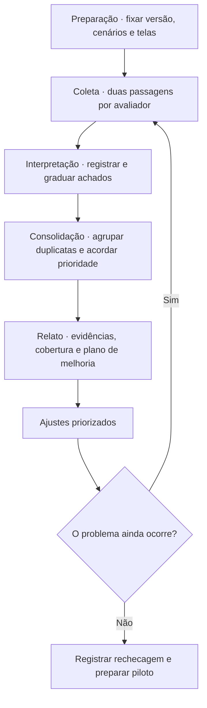

# Entrega 13 — Avaliação de IHC por inspeção heurística

**Data:** 18/11/2026 · revisão em 25/11/2026  
**Status:** 🟩 concluída  
**Responsabilidade:** 1 avaliação completa por integrante, sobre todas as telas/estados relevantes do projeto.

## Objetivo da atividade

Encontrar problemas de usabilidade por inspeção sistemática da interface com as **10 heurísticas de Nielsen**. Cada avaliador trabalha individualmente primeiro; depois a equipe consolida problemas duplicados e prioridades.

> **Parte de violações:** registre somente problemas reais. Não invente uma violação para “preencher” cada heurística. Para provar que todas foram exercitadas, use a **matriz de cobertura H1–H10**. Para heurísticas sem violação, a disciplina solicita um exemplo didático de boa prática.

## 1. Heurísticas adotadas

1. Visibilidade do status do sistema
2. Compatibilidade entre o sistema e o mundo real
3. Controle e liberdade do usuário
4. Consistência e padrões
5. Prevenção de erros
6. Reconhecimento em vez de memorização
7. Flexibilidade e eficiência de uso
8. Estética e design minimalista
9. Ajudar usuários a reconhecer, diagnosticar e recuperar-se de erros
10. Ajuda e documentação

## Cobertura especial para interfaces administrativas e analíticas

Quando existirem, não limite a avaliação às “telas principais”. Inspecione também:

- dashboard em estados normal, vazio e erro;
- filtros sem resultado e filtros combinados;
- relatórios e exportação;
- histórico/listas longas;
- formulários CRUD (criação, edição, exclusão, validação);
- alteração de perfil/permissão;
- confirmações de ações destrutivas;
- processamento/loading/progresso;
- falha e recuperação;
- comparação de resultados;
- mensagens de termos técnicos, métricas e recomendações;
- ajuda/documentação contextual.

Em TCCs técnicos, observe especialmente se a interface comunica o estado do processamento e traduz informações técnicas para o vocabulário do usuário escolhido.

## Processo/Fluxograma Avaliação Heurística

## 2. Escopo da inspeção

| Item | Definição |
|---|---|
| Versão avaliada | [Demo VetIA](https://vetia.chilecentral.cloudapp.azure.com/) em 18/11/2026, com referências da E11 no commit documental `adc5d3d`. Reinspeção em 25/11/2026 no build local `vetia-e13-rc2`, commit `7c41e9a`, em `http://localhost:5173`, com apoio de capturas do repositório. |
| Telas/estados | D01–D42 como referências da E11. A reinspeção percorreu F1–F6, cobrindo cadastro e lista, relato e resultado, mapa e filtros, revisão e autorizações, lista e detalhes do painel, estados de encaminhamento, cartão INCERTO e complemento. O modo de inspeção e as restrições são indicados por avaliador. |
| Fluxos | F1 cadastro, F2 possível emergência e atendimento, F3 compartilhamento, F4 painel, F5 acompanhamento, F6 informação insuficiente. Correspondências em E10 e E11. |
| Dispositivo/viewport | Na reinspeção, Chrome 141, tutor em 375 × 812 e painel em 1366 × 768. A inspeção original foi em Chrome desktop com capturas de apoio. |
| Avaliadores | A02 Vinícius de Castro Duarte, A01 Julian Ryu Takeda, A03 João Pedro Gardenghi Peterutto |

Correspondência dos IDs individuais

Os códigos da rodada de 18/11 continuam associados aos seus achados nas tabelas e na seção 7. A primeira coluna abaixo é exclusiva das fichas de 25/11. Por exemplo, `A03-V01` na E13 original refere-se ao animal anterior selecionado (HC07). `E13n-A03-V01` refere-se à validação do nome em inglês.

| Código na ficha de 25/11 | ID nesta revisão | Achado |
| --- | --- | --- |
| A01-V01 | E13n-A01-V01 | Resumo do caso truncado no painel sem ação de expansão |
| A01-V02 | E13n-A01-V02 | Aceite do caso sem confirmação e sem desfazer |
| A01-V03 | E13n-A01-V03 | Rótulo "Novo" cobre dois estados distintos na lista da clínica |
| A01-V04 | E13n-A01-V04 | "Enviado" exibido com selo de confirmação enquanto a clínica não aceitou |
| A01-V05 | E13n-A01-V05 | Cartão INCERTO com tratamento visual igual ao conclusivo |
| A01-V06 | E13n-A01-V06 | Sessão expirada mantém o caso aberto e falha com toast genérico |
| A01-V07 | E13n-A01-V07 | Perguntas respondidas com "não sei" não são registradas no resumo |
| A02-V01 | E13n-A02-V01 | Cadastro concluído sem atualização da lista |
| A02-V02 | E13n-A02-V02 | Check verde de "Enviado" associado ao caso, não ao aceite |
| A02-V03 | E13n-A02-V03 | Contador de resultados não acompanha os filtros aplicados |
| A02-V04 | E13n-A02-V04 | Transcrição de voz sem etapa de revisão antes do processamento |
| A02-V05 | E13n-A02-V05 | Falso positivo em estado "a caminho" quando a clínica não aceitou |
| A02-V06 | E13n-A02-V06 | Peso com vírgula decimal exibe "NaN kg" |
| A02-V07 | E13n-A02-V07 | Mapa sobrepõe o botão de ação no viewport do tutor |
| A02-V08 | E13n-A02-V08 | Estado do caso some ao recarregar o painel |
| A03-V01 | E13n-A03-V01 | Mensagem de validação do nome em inglês |
| A03-V02 | E13n-A03-V02 | Compartilhar habilitado enquanto o resumo ainda carrega |
| A03-V03 | E13n-A03-V03 | "Marcar todas" não assume estado intermediário |
| A03-V04 | E13n-A03-V04 | Confirmação diz "Atendimento solicitado" antes de qualquer aceite |
| A03-V05 | E13n-A03-V05 | Recusa indisponível quando o caso está em "a caminho" |
| A03-V06 | E13n-A03-V06 | Contraste insuficiente em microtextos dos cartões de clínica |
| A03-V07 | E13n-A03-V07 | Edição do resumo não deixa rastro de revisão |

## 3. Procedimento individual

Cada avaliador deve:

1. percorrer os fluxos/telas ao menos uma vez para familiarização;
2. inspecionar novamente aplicando sistematicamente H1–H10;
3. registrar cada problema com evidência e contexto;
4. atribuir severidade **depois de compreender bem o problema**, justificando a decisão;
5. não discutir achados com os demais antes de terminar a inspeção individual, quando o objetivo for preservar independência.

### Escala de severidade (0–4)

| Grau | Interpretação |
|---:|---|
| 0 | não é considerado problema de usabilidade |
| 1 | problema cosmético; corrigir se houver tempo |
| 2 | problema menor; baixa prioridade |
| 3 | problema maior; alta prioridade |
| 4 | catástrofe de usabilidade; correção imperativa antes de disponibilizar |

Ao justificar, considere **frequência, impacto e persistência** do problema no contexto real de uso.

---

## Avaliador A02 — Vinícius de Castro Duarte

**Reinspeção de 25/11.** 09:20–12:10. F1 → F2 → F3 → F5 → F6 → F4. Autoria em F3/F5. F4 e a lista vazia de F1 foram avaliados por captura conforme a ficha, com reprodução posterior de D06 confirmada pela equipe. F2 foi repetido após limpar o cache. A voz processou em menos de 400 ms nas tentativas registradas, o que limitou a observação do indicador. A02 percorreu F1 e F2 com Tab e relatou que o foco ficou preso nos controles do mapa.

### 4. Matriz de cobertura das 10 heurísticas

| Heurística | Telas/fluxos examinados | Houve violação? | IDs dos achados | Exemplo de boa prática se não violada |
|---|---|---|---|---|
| H1 | F1 · lista após salvar; F2 · contador; F4 · marcação de leitura; F5 · envio e a caminho | Sim | E13n-A02-V01, E13n-A02-V02, E13n-A02-V03, E13n-A02-V05, E13n-A02-V08 | — |
| H2 | F2 transcrição de voz; F6 cartão INCERTO | Sim | E13n-A02-V04 | — |
| H3 | F5 mensagens, F3 autorizações | Nenhuma no elemento descrito | — | autorizações destraváveis uma a uma |
| H4 | F2 filtros vs. contador | Sim | E13n-A02-V03 | — |
| H5 | F1 peso; F2 envio de relato vazio | Sim | E13n-A02-V06 | — |
| H6 | F2 justificativa do resultado | Nenhuma no elemento descrito | — | justificativa com os sinais citados |
| H7 | F2 filtro de distância | Nenhuma no elemento descrito | — | passo de 1 km e memória do último filtro |
| H8 | F2 mapa em 375 | Sim | E13n-A02-V07 | — |
| H9 | F1 validação, F2 falha de voz | Sim | E13n-A02-V06 | — |
| H10 | F2 dica de como descrever o relato | Nenhuma no elemento descrito | — | exemplo de relato acima do campo |

### 5. Declaração de violações

Os IDs sem prefixo registram a inspeção de 18/11. Os IDs `E13n-` registram a reinspeção de 25/11, com evidência textual nos campos de localização e reprodução.

| ID | Heurística | Tela/estado | Problema observado | Evidência | Severidade | Justificativa da severidade | Recomendação |
|---|---|---|---|---|---:|---|---|
| A02-V02 | H2 | F4 · D27 | “Confirmar recebimento” e “Aceitar caso” aparecem lado a lado sem explicação da diferença perto das ações. A equipe de plantão pode hesitar sobre qual delas comunica disponibilidade ao tutor. | [D27](../assets/06_prototipos/D27_clinica_acoes.jpg) | 3 | Afeta a decisão central a cada caso novo. Escolher o comando errado pode atrasar ou comunicar incorretamente a continuidade do atendimento. A inspeção verificou a apresentação das ações antes da decisão. | Explicar junto aos botões que recebimento acusa leitura e aceite informa capacidade de receber o caso. |
| A02-V03 | H5 | F3 · D19–D21 | Na revisão do caso do Bob para o Hospital Aurora fictício, a opção adicional de compartilhar a conversa completa aparece antes da autorização principal. As duas caixas usam “autorizo” e ocupam a mesma região, o que torna fácil confundir qual é necessária para enviar apenas os dados previstos. | [D19](../assets/06_prototipos/D19_revisar_pretriagem.jpg) · [D20](../assets/06_prototipos/D20_autorizacao_pendente.jpg) · [D21](../assets/06_prototipos/D21_autorizacao_marcada.jpg) | 3 | A escolha aparece a cada envio. Uma seleção equivocada pode expor conteúdo além do pretendido e a exposição não pode ser desfeita pelo tutor após a leitura. | Apresentar primeiro a autorização necessária e agrupar a conversa completa em uma opção explicitamente opcional, desmarcada por padrão, com resumo do que será enviado. |
| E13n-A02-V01 | H1, com relação a H6 | tutor, F1, D06, lista após salvamento, 375 × 812 | a lista continua vazia; o animal só aparece depois de reabrir a lista **Impacto:** o tutor entende que o cadastro falhou e repete, criando duplicata | preencher o cadastro → salvar → voltar à lista. | 2 | ocorre em todo salvamento; impacto visível logo após a ação; há recuperação ao reabrir, mas não é evidente | atualizar a lista após salvar e confirmar com o nome do animal |
| E13n-A02-V02 | H1, com relação a H2 | tutor, F5, cabeçalho do acompanhamento, 375 × 812 | o mesmo check verde aparece em "Enviado" e em "Aceito", sem mudança de cor ou ícone entre os dois marcos **Impacto:** os dois estados ficam visualmente indistinguíveis ao rolar o histórico | compartilhar um caso → permanecer na tela. | 3 | ocorre em todo caso; impacto direto na leitura de confirmação; persiste no histórico | ícones e cores distintos por marco, com o check reservado ao aceite |
| E13n-A02-V03 | H4, com relação a H1 | tutor, F2, D15 como referência, lista de clínicas com filtros, 375 × 812 | o contador mantém "12 clínicas" mesmo com a lista reduzida a três O contador permaneceu em “12 clínicas” no conjunto semeado. **Impacto:** o tutor acha que há opções fora da tela e rola sem encontrar | aplicar filtro de distância e de período → observar o topo da lista. | 2 | ocorre com qualquer filtro; impacto moderado; persiste enquanto o filtro estiver ativo | recalcular o contador e anunciar a mudança por região viva |
| E13n-A02-V04 | H2, com relação a H5 | tutor, F2, relato por voz, 375 × 812 | o áudio é processado direto; a transcrição aparece já convertida em resultado, sem edição **Impacto:** erro de reconhecimento em nome de animal ou de sintoma vira resultado sem chance de correção | gravar um relato → encerrar a gravação. | 2 | frequente em ambiente ruidoso; impacto na qualidade da triagem; sem recuperação | exibir transcrição editável antes de processar |
| E13n-A02-V05 | H1, com relação a H3 | tutor, F5, D20, acompanhamento, 375 × 812 | o status avança para "a caminho" por tempo decorrido, mesmo sem aceite registrado **Impacto:** o tutor se desloca até uma clínica que pode não ter visto o caso | compartilhar → acompanhar sem aceite da clínica. | 3 | depende do tempo de espera, comum em plantão; impacto alto; persiste até o aceite | só avançar para "a caminho" com aceite explícito |
| E13n-A02-V06 | H9, com relação a H5 | tutor, F1, campo de peso, 375 × 812 | o campo formata como "NaN kg" e o salvamento é bloqueado sem mensagem no campo **Impacto:** não entende o motivo do bloqueio e pode desistir | digitar "12,5" → sair do campo. | 2 | vírgula é o padrão brasileiro; ocorre em toda tentativa; recuperação só apagando o campo | aceitar vírgula e ponto e normalizar na saída; mensagem no campo |
| E13n-A02-V07 | H8, com relação a H5 | tutor, F2, mapa com cartões, 375 × 812 | o mapa ocupa a metade inferior e cobre parcialmente o CTA do primeiro cartão **Impacto:** toque acidental no mapa em vez do botão | abrir o mapa → rolar até o primeiro cartão. | 2 | ocorre em todo uso do mapa em 375; impacto na conversão; persiste com o mapa aberto | mapa colapsável e CTA fixo acima dele |
| E13n-A02-V08 | H1, com relação a H9 | clínica, F4, lista, 1366 × 768 | a marcação de leitura se perde e o caso volta à aparência inicial **Impacto:** retrabalho na releitura e risco de aceitar caso já visto | abrir caso marcado como visualizado → recarregar. Estado registrado por captura, sem verificação interativa independente nesta edição. | 2 | ocorre a cada recarga; impacto moderado; persistência até nova leitura | persistir a marcação no servidor |

**Qualidade do relato:** o problema deve ser observável e localizado. Evite “interface confusa” sem dizer **o que**, **onde**, **quando** e **para quem**.

Capturas e elementos de cada achado

**A02-V02.** Localize os botões **Confirmar recebimento** e **Aceitar caso** abaixo do resumo.

[Captura D27](../assets/13_heuristica/a02-v02-D27_clinica_acoes.jpg)

**A02-V03.** Compare as duas caixas **Também autorizo** e **Autorizo enviar** antes do botão.

[Captura D19](../assets/13_heuristica/a02-v03-D19_revisar_pretriagem.jpg) [Captura D20](../assets/13_heuristica/a02-v03-D20_autorizacao_pendente.jpg) [Captura D21](../assets/13_heuristica/a02-v03-D21_autorizacao_marcada.jpg)

### 6. Boas práticas — heurísticas não violadas (atividade didática)

| Heurística sem violação | Exemplo no sistema | Evidência | Por que atende |
|---|---|---|---|
| H3 | F3, autorizações uma a uma | Localização descrita na ficha de 25/11. | Permite destravar só o necessário |
| H6 | F2, justificativa com os sinais citados | Localização descrita na ficha de 25/11. | Mostra por que o resultado apareceu |
| H7 | F2, filtro de distância | Localização descrita na ficha de 25/11. | Ajuste fino sem digitar |
| H10 | F2, exemplo de relato | Localização descrita na ficha de 25/11. | Ensina o formato esperado |

## Avaliador A01 — Julian Ryu Takeda

**Reinspeção de 25/11.** 08:40–11:05. F4 → F6 → F5 → F1 → F2 → F3. Autoria em F1/F2 e coautoria em F4/F6. A ordem previa começar por fluxo de outro autor, conforme a E12, mas A01 começou em F4 para aproveitar a sessão autenticada e o caso “a caminho”. F4, F5 e F6 foram percorridos na demo. A ficha inclui referências por captura para F1–F3, erro 500 e sessão expirada, com registros mistos sobre a interação em F1–F3. A acessibilidade por teclado foi observada em F4 e F6. O foco era visível e a ordem em F4 passava da busca ao aceite sem passar pela leitura do resumo.

### 4. Matriz de cobertura das 10 heurísticas

| Heurística | Telas/fluxos examinados | Houve violação? | IDs dos achados | Exemplo de boa prática se não violada |
|---|---|---|---|---|
| H1 | F1 · retorno à lista; F4 · etiqueta “Novo”; F5 · cabeçalho e linha do tempo | Sim | E13n-A01-V03, E13n-A01-V04 | — |
| H2 | F5 · selo e texto após envio; F6 · diferenciação do resultado INCERTO | Sim | E13n-A01-V04, E13n-A01-V05 | — |
| H3 | F4 · tentativa de recusa; F5 · tentativa de cancelar | Ações indisponíveis nos estados tentados | — | — |
| H4 | F4 cartão de caso vs. F5 cartão de acompanhamento | Sem violação observada nos elementos examinados | — | — |
| H5 | F4 aceite, F3 botão desabilitado | Sim | E13n-A01-V02 | — |
| H6 | F4 · leitura do resumo no cartão; F6 · resposta “não sei” e consulta ao resumo | Sim | E13n-A01-V01, E13n-A01-V07 | — |
| H7 | F4 busca por ID, filtros salvos | Nenhuma no elemento descrito | — | busca por ID resolve o caso direto |
| H8 | F4 cartão com resumo longo | Sim | E13n-A01-V01 | — |
| H9 | F4 sessão expirada, F4 erro 500 | Sim | E13n-A01-V06 | — |
| H10 | F4 painel, F6 perguntas complementares | Sem ajuda contextual no painel; F6 tem microtexto explicativo | — | — |

### 5. Declaração de violações

Os IDs sem prefixo registram a inspeção de 18/11. Os IDs `E13n-` registram a reinspeção de 25/11, com evidência textual nos campos de localização e reprodução.

| ID | Heurística | Tela/estado | Problema observado | Evidência | Severidade | Justificativa da severidade | Recomendação |
|---|---|---|---|---|---:|---|---|
| A01-V01 | H1 | F5 · D21–D22 | Antes de confirmar, a página explica que o envio não confirma vaga. No topo do acompanhamento a mensagem passa a ser genérica e o selo diz apenas “Enviado”. A informação sobre a resposta pendente perde destaque justamente depois do envio. | [D21](../assets/06_prototipos/D21_autorizacao_marcada.jpg) · [D22](../assets/06_prototipos/D22_encaminhamento_enviado.jpg) | 3 | O estado aparece para todo envio antes do aceite. Interpretá-lo como confirmação pode influenciar o deslocamento. O risco persiste enquanto a resposta estiver pendente. | Exibir “Enviado · aguardando resposta da clínica” e manter junto ao selo um aviso curto de que o atendimento ainda não está confirmado. |
| A01-V02 | H3 | F5 · D22, D32–D33 | “Cancelar envio” continua com o mesmo rótulo depois de “Aceito” e “A caminho”. A tela não explica o alcance da ação quando a clínica já teve acesso ao caso. | [D22](../assets/06_prototipos/D22_encaminhamento_enviado.jpg) · [D32](../assets/06_prototipos/D32_tutor_aceito.jpg) · [D33](../assets/06_prototipos/D33_tutor_a_caminho.jpg) | 2 | Afeta quem reconsidera o envio em estados posteriores. A dúvida volta em cada estado e exige inferir se a ação interrompe o acompanhamento ou altera os dados já vistos. | Explicar o efeito antes de confirmar o cancelamento e usar um rótulo compatível com o estado.  |
| A01-V03 | H8 | F2/F6 · D11–D12, D38–D40 | O seletor de provedor e o aviso sobre processamento ocupam uma faixa grande da conversa mesmo durante a leitura da orientação. Nas capturas, essa área divide a atenção com o próximo passo e a pergunta complementar. | [D11](../assets/06_prototipos/D11_resultado_emergencia.jpg) · [D12](../assets/06_prototipos/D12_resultado_justificativa.jpg) · [D38](../assets/06_prototipos/D38_incerto_cartao.jpg) · [D39](../assets/06_prototipos/D39_pergunta_complementar.jpg) · [D40](../assets/06_prototipos/D40_justificativa_referencias.jpg) | 2 | A faixa reaparece durante a conversa e reduz o espaço visível. O usuário consegue continuar, mas pode precisar rolar para recuperar informações importantes. | Manter visível a informação de privacidade necessária no envio e compactar a escolha de provedor fora da leitura da orientação. |
| E13n-A01-V01 | H8, com relação a H6 | clínica, F4, D26, cartão de caso recebido, 1366 × 768 | a última linha do resumo é cortada e não há controle para expandir; o texto completo só aparece ao abrir o caso O corte foi observado acima de três linhas. **Impacto:** a clínica decide com histórico incompleto ou precisa abrir cada caso para saber se vale a pena | abrir a lista → abrir um caso com resumo longo → ler o cartão. | 3 | depende do comprimento do resumo, que é comum em relatos de emergência; afeta a triagem; persiste enquanto o cartão permanecer fechado | permitir expandir no cartão e sinalizar visualmente que há conteúdo abaixo do trecho exibido |
| E13n-A01-V02 | H5, com relação a H1 | clínica, F4, detalhe do caso, 1366 × 768 | o aceite é imediato, sem diálogo de confirmação e sem possibilidade de desfazer; o botão passa a "Em atendimento" sem registro de quem aceitou **Impacto:** aceite acidental compromete a fila e o tutor passa a ver "aceito" sem que ninguém esteja de fato com o caso | abrir um caso recebido → acionar "Aceitar". | 3 | um clique errado é provável em painel com vários casos; impacto direto na falsa segurança do tutor; sem recuperação na interface | confirmação curta com resumo do caso e janela de desfazer; registrar autor do aceite |
| E13n-A01-V03 | H1, com relação a H4 | clínica, F4, D26, lista, 1366 × 768 | os dois aparecem com a etiqueta "Novo"; a diferença só existe na ordenação **Impacto:** a clínica não sabe o que ainda não foi lido nem o que já está em análise | abrir a lista com casos recém-recebidos e casos já visualizados. | 2 | ocorre sempre que há mistura de casos; impacto moderado na organização; persiste durante toda a sessão | separar "Recebido" de "Aguardando aceite" e marcar leitura |
| E13n-A01-V04 | H2, com relação a H1 | tutor, F5, tela de acompanhamento, 375 × 812 | o topo mostra "Enviado" em verde com ícone de check; o texto "aguardando resposta da clínica" é menor e some ao rolar **Impacto:** o tutor interpreta envio como atendimento confirmado e pode deixar de procurar outra clínica | concluir o compartilhamento → abrir acompanhamento. | 4 | ocorre em todo envio; impacto alto porque é o ponto mais sensível do protótipo; persiste até o aceite | trocar o selo por "Aguardando aceite da clínica" e reservar o check para o estado aceito |
| E13n-A01-V05 | H2, com relação a H8 | tutor, F6, D41, cartão de resultado, 375 × 812 | o cartão INCERTO usa a mesma moldura, cor e peso tipográfico do cartão de resultado conclusivo; só a palavra "INCERTO" difere **Impacto:** orientação inconclusiva lida como ausência de risco | nova conversa → selecionar animal → relato incompleto. | 3 | comum em relatos curtos; impacto alto na decisão de buscar atendimento; persiste enquanto o cartão estiver na tela | diferenciação estrutural do cartão incerto e frase de consequência explícita |
| E13n-A01-V06 | H9, com relação a H1 | clínica, F4, detalhe do caso, 1366 × 768 | o painel não avisa da expiração, o caso continua visível e o aceite falha com toast "Ocorreu um erro" **Impacto:** a clínica acredita ter aceitado e o caso volta à fila sem que ela saiba | deixar a sessão expirar com o caso aberto → acionar "Aceitar". Estado registrado por captura, sem verificação interativa independente nesta edição. | 3 | previsível em plantões longos; impacto alto porque simula ação concluída; recuperação só recarregando | detectar expiração antes do envio, bloquear a ação e oferecer reautenticação preservando o estado |
| E13n-A01-V07 | H6, com relação a H2 | tutor, F6, perguntas complementares, 375 × 812 | o resumo omite as perguntas sem resposta; não distingue "não sei" de "não perguntado" **Impacto:** a clínica recebe resumo que parece completo e pode não refazer a pergunta | responder duas perguntas com "não sei" → avançar → abrir o resumo. | 2 | frequente em tutores leigos; impacto moderado; persiste no resumo enviado | listar as lacunas explicitamente no resumo |

**Qualidade do relato:** o problema deve ser observável e localizado. Evite “interface confusa” sem dizer **o que**, **onde**, **quando** e **para quem**.

Capturas e elementos de cada achado

**A01-V01.** Compare o aviso **O envio não confirma uma vaga** com o selo **Enviado** no acompanhamento.

[Captura D21](../assets/13_heuristica/a01-v01-D21_autorizacao_marcada.jpg) [Captura D22](../assets/13_heuristica/a01-v01-D22_encaminhamento_enviado.jpg)

**A01-V02.** Localize **Cancelar envio** nos estados enviado, aceito e a caminho.

[Captura D22](../assets/13_heuristica/a01-v02-D22_encaminhamento_enviado.jpg) [Captura D32](../assets/13_heuristica/a01-v02-D32_tutor_aceito.jpg) [Captura D33](../assets/13_heuristica/a01-v02-D33_tutor_a_caminho.jpg)

**A01-V03.** Observe a faixa **Análise por**, entre a orientação ou pergunta e o campo de resposta.

[Captura D11](../assets/13_heuristica/a01-v03-D11_resultado_emergencia.jpg) [Captura D12](../assets/13_heuristica/a01-v03-D12_resultado_justificativa.jpg) [Captura D38](../assets/13_heuristica/a01-v03-D38_incerto_cartao.jpg) [Captura D39](../assets/13_heuristica/a01-v03-D39_pergunta_complementar.jpg) [Captura D40](../assets/13_heuristica/a01-v03-D40_justificativa_referencias.jpg)

### 6. Boas práticas — heurísticas não violadas (atividade didática)

| Heurística sem violação | Exemplo no sistema | Evidência | Por que atende |
|---|---|---|---|
| H7 | F4, busca por ID do caso | Localização descrita na ficha de 25/11. | Resolve o caso direto sem varrer a fila |
| H9 | F4, validação do filtro de data | Localização descrita na ficha de 25/11. | Mensagem específica quando o intervalo é invertido |
| H10 | F6, microtexto das perguntas complementares | Localização descrita na ficha de 25/11. | Explica por que a pergunta é feita |

## Avaliador A03 — João Pedro Gardenghi Peterutto

**Reinspeção de 25/11.** 13:30–16:00. F3 → F4 → F1 → F2 → F5 → F6. Autoria em F4/F6, em coautoria com A01. F1, F3 e F4 tiveram interação na demo. A ficha usou capturas para F2/F5/F6 e estados de carregamento. A03 registrou foco visível em F1/F3 e ausência de anúncio do agrupamento das autorizações. A equipe mediu contraste de 3,0:1 a 3,3:1 no microtexto dos cartões.

### 4. Matriz de cobertura das 10 heurísticas

| Heurística | Telas/fluxos examinados | Houve violação? | IDs dos achados | Exemplo de boa prática se não violada |
|---|---|---|---|---|
| H1 | F3 · carregamento do resumo e seleção parcial; F4 · etiquetas na lista | Sim, em F3 | E13n-A03-V02, E13n-A03-V03 | — |
| H2 | F1 · mensagens de validação; F3 · texto da confirmação de envio | Sim | E13n-A03-V01, E13n-A03-V04 | — |
| H3 | F4 · recusa em “a caminho”; F3 · edição do resumo | Sim | E13n-A03-V05 | — |
| H4 | F3 autorizações; F4 etiquetas de estado | Sim | E13n-A03-V03 | — |
| H5 | F3 envio com resumo em carregamento; F3 edição | Sim | E13n-A03-V02, E13n-A03-V07 | — |
| H6 | F3 comparação resumo original e editado | Nenhuma no elemento descrito | — | comparação lado a lado |
| H7 | F4 filtros combinados | Nenhuma no elemento descrito | — | combinação de filtros com contagem |
| H8 | F2 microtextos dos cartões | Sim | E13n-A03-V06 | — |
| H9 | F1 validação | Sim | E13n-A03-V01 | — |
| H10 | F3 texto de apoio das autorizações | Nenhuma no elemento descrito | — | explica o efeito de cada autorização |

### 5. Declaração de violações

Os IDs sem prefixo registram a inspeção de 18/11. Os IDs `E13n-` registram a reinspeção de 25/11, com evidência textual nos campos de localização e reprodução.

| ID | Heurística | Tela/estado | Problema observado | Evidência | Severidade | Justificativa da severidade | Recomendação |
|---|---|---|---|---|---:|---|---|
| A03-V01 | H5 | F6 · D36 | Ao abrir o histórico do Bob e clicar em “Nova conversa”, o seletor mantém Bob e o título passa a “Como Bob está hoje?”. O animal selecionado está visível, mas o início pode induzir o tutor a seguir com o perfil anterior ao mudar de caso. | [D36](../assets/06_prototipos/D36_nova_conversa_animal_anterior.jpg) · [D37](../assets/06_prototipos/D37_incerto_relato.jpg) | 3 | A condição afeta quem alterna entre animais. Um relato atribuído ao perfil errado pode exigir refazer a conversa. A observação se refere ao estado antes de enviar. | Tornar explícita a escolha de animal ao iniciar outro caso ou começar sem associação e manter o animal reconhecível junto à ação de enviar. |
| A03-V02 | H6 | F6 · D38–D39 | O cartão explica que tudo bem responder que não sabe. No histórico da Nina, a pergunta “Quanto ele comeu em relação ao habitual?” aparece com campo livre e sem opção visível “Não sei”. | [D38](../assets/06_prototipos/D38_incerto_cartao.jpg) · [D39](../assets/06_prototipos/D39_pergunta_complementar.jpg) | 2 | Afeta respostas sobre sinais que o tutor não observou. Digitar livremente continua possível, mas o usuário precisa recuperar a instrução do cartão a cada pergunta. | Exibir “Não sei” como resposta rápida junto da pergunta e manter a resposta livre disponível. |
| A03-V03 | H2 | F6 · D37–D40 | A pergunta usa “ele” após o relato identificar Nina como gata. A referência fica ambígua para quem acabou de lidar com outro animal, embora o contexto permita inferir a intenção. | [D37](../assets/06_prototipos/D37_incerto_relato.jpg) · [D39](../assets/06_prototipos/D39_pergunta_complementar.jpg) | 2 | A inconsistência é visível no caso registrado. Pode exigir releitura e voltar em perguntas complementares se os rótulos usarem referências genéricas. | Usar uma formulação neutra, como “Quanto seu animal comeu em relação ao habitual?”, ou o nome do animal quando a associação tiver sido confirmada. |
| E13n-A03-V01 | H9, com relação a H2 | tutor, F1, cadastro, 375 × 812 | o foco volta ao campo certo, mas a mensagem aparece como "This field is required" **Impacto:** o campo é identificável, mas o motivo do bloqueio pode não ficar claro | deixar o nome vazio → tentar salvar. | 2 | ocorre em toda tentativa sem nome; impede a conclusão até corrigir; recuperável ao preencher | manter o foco e escrever "Informe o nome do animal" |
| E13n-A03-V02 | H5, com relação a H1 | tutor, F3, D20, revisão do resumo, 375 × 812 | o botão fica ativo durante o carregamento do resumo e envia o conteúdo vazio **Impacto:** a clínica recebe caso sem resumo e o tutor não é avisado | abrir o compartilhamento e acionar o envio antes do fim do carregamento. Duas de cinco tentativas, segundo a ficha. | 2 | depende da latência, que é variável; impacto alto quando ocorre; sem recuperação após o envio | desabilitar até o resumo carregar, com indicador no botão |
| E13n-A03-V03 | H4, com relação a H1 | tutor, F3, autorizações, 375 × 812 | Com seleção parcial, a caixa mestre permanece desmarcada. Ao acioná-la, a seleção é ampliada. **Impacto:** não sabe se o conjunto está parcial e pode compartilhar mais do que queria | marcar duas de quatro autorizações → observar a caixa mestre. | 2 | ocorre sempre que há seleção parcial; impacto na privacidade do compartilhamento; persiste na tela | estado indeterminado na caixa mestre e rótulo com a contagem |
| E13n-A03-V04 | H2, com relação a H1 | tutor, F3, confirmação de envio, 375 × 812 | a tela diz "Atendimento solicitado" e some após 2 s, sem menção a espera por aceite **Impacto:** lê como atendimento garantido e não procura alternativa | concluir o envio → ler a confirmação. | 3 | ocorre em todo envio; impacto alto na falsa segurança; a mensagem some rápido, o que reforça a leitura | "Solicitação enviada. Aguarde o aceite da clínica." com permanência maior |
| E13n-A03-V05 | H3, com relação a H1 | clínica, F4, detalhe do caso, 1366 × 768 | o botão "Recusar" desaparece; resta "Concluir" **Impacto:** clínica sem condições de atender não tem como devolver o caso | abrir caso em "a caminho" → procurar recusa. | 2 | ocorre em toda mudança de estado; impacto no fluxo da clínica; sem contorno na interface | manter a recusa disponível com motivo obrigatório |
| E13n-A03-V06 | H8, com relação a H2 | tutor, F2, cartões de clínica, 375 × 812 | distância e horário em cinza claro sobre branco, entre 3,0:1 e 3,3:1 A equipe registrou entre 3,0:1 e 3,3:1. **Impacto:** informação de decisão ilegível sob luz forte | abrir a lista de clínicas e medir o texto de apoio. | 2 | afeta todos os cartões; impacto na escolha da clínica; persiste no componente | escurecer o token de texto secundário para 4,5:1 |
| E13n-A03-V07 | H5, com relação a H6 | tutor, F3, resumo editável, 375 × 812 | a edição persiste, mas não há marca de "editado por você" nem distinção do texto original **Impacto:** não sabe o que veio da IA e o que ele mudou antes de autorizar o envio | editar o resumo e voltar à etapa anterior → retornar. | 2 | ocorre em toda edição; impacto na confiança do conteúdo enviado; persiste no resumo | marcar trechos editados e manter versão original acessível |

**Qualidade do relato:** o problema deve ser observável e localizado. Evite “interface confusa” sem dizer **o que**, **onde**, **quando** e **para quem**.

Capturas e elementos de cada achado

**A03-V01.** Observe **Bob** no seletor e no título da nova conversa. Em D37, veja o início do relato de **Nina**.

[Captura D36](../assets/13_heuristica/a03-v01-D36_nova_conversa_animal_anterior.jpg) [Captura D37](../assets/13_heuristica/a03-v01-D37_incerto_relato.jpg)

**A03-V02.** Compare **tudo bem responder que não sabe** com as opções visíveis junto à pergunta.

[Captura D38](../assets/13_heuristica/a03-v02-D38_incerto_cartao.jpg) [Captura D39](../assets/13_heuristica/a03-v02-D39_pergunta_complementar.jpg)

**A03-V03.** Compare **Minha gata Nina** no relato com **Quanto ele comeu** na pergunta.

[Captura D37](../assets/13_heuristica/a03-v03-D37_incerto_relato.jpg) [Captura D39](../assets/13_heuristica/a03-v03-D39_pergunta_complementar.jpg)

### 6. Boas práticas — heurísticas não violadas (atividade didática)

| Heurística sem violação | Exemplo no sistema | Evidência | Por que atende |
|---|---|---|---|
| H6 | F3, comparação resumo original e editado | Localização descrita na ficha de 25/11. | Mostra o que mudou antes de autorizar |
| H7 | F4, filtros combinados com contagem | Localização descrita na ficha de 25/11. | Reduz a fila ao relevante |
| H10 | F3, texto de apoio das autorizações | Localização descrita na ficha de 25/11. | Explica o efeito de cada item |

> Repita a seção para A02, A03... um avaliador por integrante.

## 7. Consolidação da equipe

Problemas iguais ou muito semelhantes encontrados por avaliadores diferentes devem ser consolidados, preservando quem os encontrou.

| ID consolidado | Achados individuais | Heurística | Problema | Severidade final | Prioridade | Responsável pela correção |
|---|---|---|---|---:|---|---|
| HC02 | A02-V02 | H2 | Distinção insuficiente entre recebimento e aceite | 3 | alta | Vinícius |
| HC03 | A02-V03 | H5 | Consentimento opcional e obrigatório com hierarquia pouco clara | 3 | alta | Vinícius |
| HC04 | A01-V01 | H1 | Resposta pendente com pouco destaque após envio | 3 | alta | Julian |
| HC05 | A01-V02 | H3 | Alcance do cancelamento após o aceite pouco claro | 2 | baixa | Julian |
| HC06 | A01-V03 | H8 | Configuração de provedor ocupa espaço da conversa | 2 | baixa | Julian |
| HC07 | A03-V01 | H5 | Animal anterior em destaque ao começar outro caso | 3 | alta | João |
| HC08 | A03-V02 | H6 | Resposta “Não sei” sem opção visível junto da pergunta | 2 | baixa | João |
| HC09 | A03-V03 | H2 | Referência ambígua ao animal na pergunta complementar | 2 | baixa | João |
| E13n-C01 | E13n-A01-V01 | H8 | Resumo do caso truncado no painel sem ação de expansão | 3 | alta | A definir |
| E13n-C02 | E13n-A01-V02 | H5 | Aceite do caso sem confirmação e sem desfazer | 3 | alta | A definir |
| E13n-C03 | E13n-A01-V03 | H1 | Rótulo "Novo" cobre dois estados distintos na lista da clínica | 2 | baixa | A definir |
| E13n-C04 | E13n-A01-V04, E13n-A02-V02, E13n-A03-V04 | H2 | Confirmação de envio pode ser interpretada como aceite | 4 | imperativa | A definir |
| E13n-C05 | E13n-A01-V05 | H2 | Cartão INCERTO com tratamento visual igual ao conclusivo | 3 | alta | A definir |
| E13n-C06 | E13n-A01-V06 | H9 | Sessão expirada mantém o caso aberto e falha com toast genérico | 3 | alta | A definir |
| E13n-C07 | E13n-A01-V07 | H6 | Perguntas respondidas com "não sei" não são registradas no resumo | 2 | baixa | A definir |
| E13n-C08 | E13n-A02-V01 | H1 | Cadastro concluído sem atualização da lista | 2 | baixa | A definir |
| E13n-C09 | E13n-A02-V03 | H4 | Contador de resultados não acompanha os filtros aplicados | 2 | baixa | A definir |
| E13n-C10 | E13n-A02-V04 | H2 | Transcrição de voz sem etapa de revisão antes do processamento | 2 | baixa | A definir |
| E13n-C11 | E13n-A02-V05 | H1 | Falso positivo em estado "a caminho" quando a clínica não aceitou | 3 | alta | A definir |
| E13n-C12 | E13n-A02-V06 | H9 | Peso com vírgula decimal exibe "NaN kg" | 2 | baixa | A definir |
| E13n-C13 | E13n-A02-V07 | H8 | Mapa sobrepõe o botão de ação no viewport do tutor | 2 | baixa | A definir |
| E13n-C14 | E13n-A02-V08 | H1 | Estado do caso some ao recarregar o painel | 2 | baixa | A definir |
| E13n-C15 | E13n-A03-V01 | H9 | Mensagem de validação do nome em inglês | 2 | baixa | A definir |
| E13n-C16 | E13n-A03-V02 | H5 | Compartilhar habilitado enquanto o resumo ainda carrega | 2 | baixa | A definir |
| E13n-C17 | E13n-A03-V03 | H4 | "Marcar todas" não assume estado intermediário | 2 | baixa | A definir |
| E13n-C18 | E13n-A03-V05 | H3 | Recusa indisponível quando o caso está em "a caminho" | 2 | baixa | A definir |
| E13n-C19 | E13n-A03-V06 | H8 | Contraste insuficiente em microtextos dos cartões de clínica | 2 | baixa | A definir |
| E13n-C20 | E13n-A03-V07 | H5 | Edição do resumo não deixa rastro de revisão | 2 | baixa | A definir |

Os IDs HC02–HC09 identificam a rodada original. HC02 trata das ações no painel da clínica e HC04 do aviso ao tutor. A versão publicada consultada começa em HC02 e A02-V02, sem explicar a ausência de HC01 e A02-V01.

**Conciliação entre avaliadores.** Em F4, A03 avaliou favoravelmente a consistência visual das etiquetas. E13n-A01-V03 aponta que a mesma palavra “Novo” cobre dois estados, uma distinção de significado. Em F3, A02 avaliou favoravelmente o ajuste individual das autorizações. E13n-A03-V03 registra que “Marcar todas” não indica a seleção parcial. A ficha traz contagens conflitantes de caixas. A consolidação registra o problema do estado intermediário, que independe dessa contagem.

**Confirmação em F3/F5.** E13n-A01-V04, E13n-A02-V02 e E13n-A03-V04 foram agrupados em um problema, preservando o selo, o ícone e a mensagem descritos nas três fichas. O grau 4 de A01 indica o risco no build da reinspeção. O HC04 mantém seu grau 3 histórico. A expiração de sessão e a perda da marcação de leitura após recarga foram mantidas em linhas distintas porque têm gatilhos e efeitos diferentes.

**H5, H8 e H9.** Nas referências de D19–D21, desabilitar o envio sem autorização é uma proteção em H5. A hierarquia das caixas continua sendo o problema de HC03. Em D12, recolher a justificativa melhora a leitura do conteúdo clínico, enquanto a faixa do provedor ocupa espaço (HC06). No cadastro, o foco indica o campo a corrigir, mas a validação em inglês configura violação de H9, com relação a H2. Na reinspeção, a mensagem registrada foi “This field is required” (E13n-A03-V01).

**Referências a conferir.** A ficha de E13n-A01-V04 cita D20, mas descreve o acompanhamento após o envio (F5), enquanto D20 referencia a autorização (F3). A matriz de A01 também associava V07 ao selo INCERTO, mas a declaração de V07 descreve a omissão de “não sei” no resumo. Em E13n-A02-V03, D10/D15 aparecem juntos na ficha, mas o contador de clínicas pertence à lista filtrada em F2. Em E13n-A03-V02, o nome da captura menciona D20, enquanto o achado depende do estado de carregamento. As imagens da reinspeção não acompanham esta revisão e a correspondência visual desses pontos ficou sem conferência.

## 8. Síntese e plano de melhoria

- Quantidade de problemas por heurística e severidade.
- Problemas críticos/graves que bloqueiam teste ou release.
- Padrões recorrentes entre telas.
- Correções que serão feitas antes/para a avaliação com usuários.

Na rodada original foram consolidados 8 problemas. Na reinspeção, 22 registros individuais resultaram em **20 problemas consolidados**. Por heurística principal: H1: 4, H2: 3, H3: 1, H4: 2, H5: 3, H6: 1, H8: 3, H9: 3. Por severidade: 2: 14, 3: 5, 4: 1. A contagem da reinspeção exclui os oito problemas históricos.

**Prioridades de correção.** Resolver primeiro a distinção entre envio e aceite, graduada em 4 na reinspeção. Nos problemas de grau 3, priorizar os estados que podem induzir falsa segurança, a leitura do resumo pela clínica e a diferenciação de INCERTO. Repetir os passos registrados nos viewports do tutor e do painel antes de uma nova avaliação com usuários. Os padrões recorrentes são perda de informação em transições, controles cujo estado é pouco claro e hierarquia visual insuficiente.

**Cobertura da E11 e da E12.** D06 (lista vazia depois de salvar) e D26 (resumo truncado) foram reproduzidos. Em D15, foram examinados mapa e filtros. O contador fixo e a sobreposição foram descritos, mas a condição de uma unidade fechada aparecer primeiro permanece sem confirmação específica. Em D41, foi avaliada a aparência do cartão INCERTO. A repetição de resposta anterior em D41 e o corte do cartão de sinais em D10 ficaram sem confirmação específica. As fichas registram voz, processamento, filtros, lista, recusa, ajuda, expiração, erro e verificações de acessibilidade, com os limites de cada avaliador indicados acima.

**Relação com a E14.** Manter os vínculos históricos HC02–HC09, incluindo HC03 → AU02 e HC04 → AU01/CMP-2. A E14 também cita HC10–HC16, ausentes da base publicada da E13. A numeração E13n identifica uma reinspeção posterior, em outro build. Para revisar HC13 → AU05, verificar a condição específica de unidade fechada aparecer primeiro, distinta dos achados de contador e mapa. Para HC15 → AU04, conferir a resposta exibida após o complemento, distinta do tratamento visual do cartão e da omissão de “não sei” no resumo. Esses vínculos ficam sujeitos a conferência pelo elemento e pela versão avaliada.

## Uso das Heurísticas

Exercício didático do Modelo 01. Os exemplos indicam como uma heurística aparece em um ponto da interface. A ocorrência de um exemplo favorável é compatível com problemas em outras telas.

| Heurística | Aplicação no VetIA | Evidência | Como o exemplo se relaciona à heurística |
|---|---|---|---|
| H1 | F5 · selo e horário | [D34](../assets/06_prototipos/D34_tutor_localizacao_historico.jpg) | A linha do tempo explicita “Visualizado” e o momento do evento. |
| H2 | F2 · orientação em linguagem cotidiana | [D11](../assets/06_prototipos/D11_resultado_emergencia.jpg) | “Procure atendimento agora” apresenta a ação direta antes dos detalhes técnicos. |
| H3 | F3 · revisão e retorno | [D18](../assets/06_prototipos/D18_revisar_envio.jpg) | O resumo pode ser corrigido e “Voltar às clínicas” permite rever o destino antes do envio. |
| H4 | F4/F5 · estado “Aceito” | [D30](../assets/06_prototipos/D30_painel_atualizado.jpg) · [D32](../assets/06_prototipos/D32_tutor_aceito.jpg) | A lista e o detalhe do painel e a tela do tutor usam o mesmo rótulo para o aceite. |
| H5 | F3 · autorização de envio | [D20](../assets/06_prototipos/D20_autorizacao_pendente.jpg) · [D21](../assets/06_prototipos/D21_autorizacao_marcada.jpg) | A ação de compartilhar aparece inativa sem autorização e ativa após marcar a caixa exigida. |
| H6 | F2 · lista de clínicas | [D17](../assets/06_prototipos/D17_lista_abertas_agora.jpg) | Horário e ações “Ligar” e “Rota” aparecem no cartão do estabelecimento. |
| H7 | F2 · entrada de região | [D13](../assets/06_prototipos/D13_encontrar_atendimento.jpg) | A busca oferece localização atual e entrada manual para o mesmo objetivo. |
| H8 | F2 · detalhes sob demanda | [D12](../assets/06_prototipos/D12_resultado_justificativa.jpg) | Justificativa original e referências aparecem recolhidas abaixo da orientação principal. |
| H9 | F4 · validação do intervalo de datas | A01 · filtro de datas com início posterior ao fim | A mensagem identifica a ordem incorreta das datas e indica o que precisa ser ajustado. |
| H10 | F3 · instrução contextual | [D18](../assets/06_prototipos/D18_revisar_envio.jpg) | A revisão orienta o tutor a corrigir ou acrescentar informação antes de compartilhar. |

## Checklist

- [x] Cada integrante fez uma inspeção completa e identificada.
- [x] Todas as telas/estados relevantes foram examinados.
- [x] Estados administrativos, filtros, relatórios, históricos, processamento e erros foram incluídos quando existentes.
- [x] A inspeção avaliou a interface/protótipo, não o mérito técnico do algoritmo/modelo.
- [x] H1–H10 aparecem na matriz de cobertura de cada avaliador.
- [x] Parte de violações contém apenas violações, sem “forçar” exemplos.
- [x] Todo problema tem print/localização e contexto.
- [x] Severidade possui justificativa, não apenas número.
- [x] Recomendação resolve a causa ou reduz o impacto.
- [x] Achados duplicados foram consolidados ao final.
