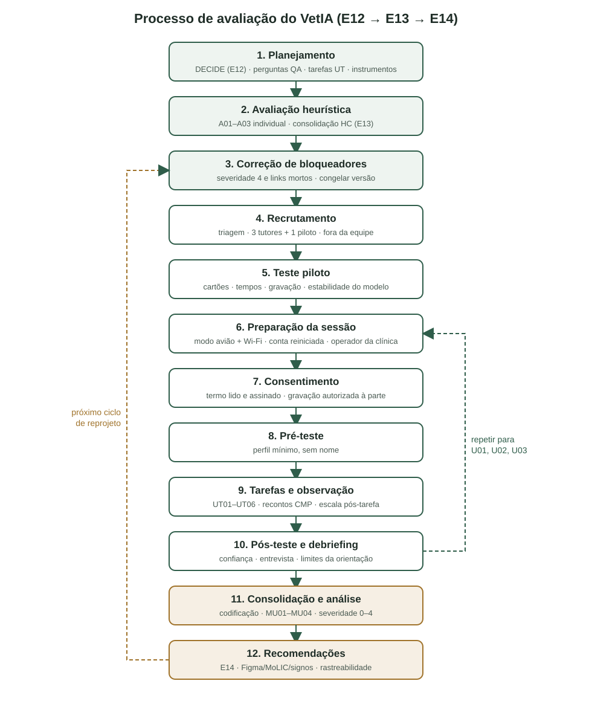

# Entrega 14 — Avaliação de usabilidade por observação de usuários

**Data:** 30/10/2026  
**Status:** 🟨 em andamento  
**Responsabilidade:** solução consolidada por equipe. O número de participantes finais observados deve ser igual ao número de integrantes, conforme o modelo da disciplina; recomenda-se que cada integrante seja responsável por conduzir/analisar ao menos um participante.

## Objetivo da atividade

Observar usuários representativos realizando tarefas reais ou realisticamente simuladas para identificar problemas de eficácia, eficiência, compreensão e satisfação que não podem ser inferidos apenas por inspeção.

> **Participantes finais não devem ser membros da equipe.** Um integrante pode participar do teste piloto apenas para validar roteiro/equipamentos, sem contar na amostra final.

### Quando o usuário é um perfil profissional especializado

Em TCCs técnicos, o público pode ser DBA, analista, pesquisador, administrador, técnico ou outro especialista. Priorize participantes que possuam relação real com as tarefas. Se não for possível recrutar o perfil ideal, qualquer participante aproximado/proxy deve ser **justificado previamente e tratado como limitação**; não apresente o resultado como equivalente ao de especialistas reais.

O teste avalia a **interação com o protótipo**. Não é necessário que o participante valide o desempenho científico do algoritmo. Resultados simulados podem ser usados quando declarados e coerentes com a tarefa.

Tarefas podem envolver, por exemplo, interpretar um dashboard, configurar uma análise, encontrar uma execução no histórico usando filtros, comparar resultados, gerar relatório, revisar alerta ou administrar permissões.

## A. Fluxograma do processo — equipe

O fluxograma deve representar, no mínimo: planejamento → recrutamento → consentimento → preparação → execução das tarefas/observação → pós-teste → consolidação/análise → recomendações.

## B. Procedimento de preparação e execução — equipe

### Passo 1 — Objetivos e versão avaliada

**Versão/commit/Figma:** [VetIA](https://vetia.chilecentral.cloudapp.azure.com/), versão mais recente do site.  
**Metas de usabilidade relacionadas:** MU01 (≥ 80% sem ajuda em UT01), MU02 (mediana ≤ 3 min em UT02), MU03 (mediana ≥ 4/5 por tarefa) e MU04 (100% de recontos compatíveis por situação crítica).

### Passo 2 — Participantes

| ID | Perfil | Critérios que justificam participação | Integrante responsável |
|---|---|---|---|
| U01 | faixa 18–29, tutora de dois cães, usa aplicativos de serviços todos os dias | Faixa 18–29, alta familiaridade com apps, perfil próximo de P01 | Julian (moderador) |
| U02 | faixa 30–44, tutora de um gato, já precisou de atendimento fora do horário comercial | Faixa 30–44, familiaridade média, experiência de urgência noturna, perfil próximo de P01 | Vinícius (moderador) |
| U03 | faixa 45–59, tutora de uma cadela idosa, quase nunca usa apps de saúde | Faixa 45–59, baixa familiaridade, perfil próximo de P02 | João (moderador) |

### Passo 3 — Consentimento e privacidade

- Termo/registro de consentimento: [termo de consentimento do teste](../instrumentos/teste_vetia_termo_consentimento.md).
- Gravação de tela/áudio/vídeo: não houve gravação.
- Forma de anonimização: IDs `U01`, `U02` e `U03`.
- Local e período de armazenamento: pasta restrita da equipe até o fim do semestre.

### Passo 4 — Teste piloto

**Data:** 30/10/2026.  
**O que foi validado:** Roteiro, duração, entendimento das instruções e funcionamento do protótipo.  
**Mudanças após piloto:** A abertura foi encurtada, a instrução de compartilhamento de UT03 ficou mais explícita e a planilha passou a registrar separadamente a espera pela resposta do sistema.

### Passo 5 — Tarefas

| ID | Cenário/instrução apresentada | Critério de sucesso | Métricas | Ligação com modelo |
|---|---|---|---|---|
| UT01 | "São 22h. Bob, cão de 5 anos, 22 kg, respirando muito rápido há 20 min, língua meio roxa, não quer levantar. Use o aplicativo para contar o que está vendo e saber o que fazer." | Relato com os sinais e orientação de emergência exibida, sem ajuda | sucesso, tempo, erros, ajudas, satisfação, CMP-1 | T01 · F1/F2 |
| UT02 | "Você está na FEI, em São Bernardo. Encontre um lugar funcionando agora e descubra como entraria em contato." | Unidade indicada como aberta selecionada e telefone ou ação de contato localizados | sucesso, tempo (MU02), erros, satisfação | T02 · F2 |
| UT03 | "A atendente do Hospital Aurora pediu as informações pelo aplicativo. O Bob vomitou às 17h. Faça o hospital receber o caso sabendo do vômito, sem ver tudo o que foi conversado." | Resumo corrigido com o vômito, status de envio exibido, conversa completa desmarcada | sucesso, tempo, erros de controle, satisfação, CMP-2 | T02 · F3 |
| UT04 | "Veja se o hospital respondeu e, se puder receber o Bob, avise que já está saindo." | Aceite localizado e saída comunicada pela ação de estado “Estou a caminho” | sucesso, tempo, erros, satisfação, CMP-3 | T02 · F5 |
| UT05 | "Nina, gata de 8 anos, comendo menos e mais quieta há dois dias; comeu metade do normal, não vomitou, não sabe se bebeu água. Use o aplicativo para saber o que fazer." | Envio, resposta apenas com dados disponíveis e chegada à orientação | sucesso, tempo, erros, satisfação, CMP-4 | T03 · F6 |
| UT06 | "Outro dia. Nina espirrou duas ou três vezes, mas come, brinca e se comporta como sempre. Use o aplicativo para saber se precisa fazer algo." | Relato enviado e orientação de não emergência lida | sucesso, tempo, erros, satisfação, CMP-5 | T03 |

### Passo 6 — Protocolo do moderador

1. Receber participante e explicar que **o produto está sendo avaliado, não a pessoa**.
2. Obter consentimento.
3. Aplicar perfil pré-teste mínimo necessário.
4. Ler instruções padronizadas.
5. Observar sem ensinar o caminho; registrar pedidos de ajuda separadamente.
6. Se usar *think aloud*, explicar e aplicar de forma consistente.
7. Após cada tarefa, registrar satisfação/SEQ ou escala definida.
8. Fazer pós-teste/entrevista breve.
9. Encerrar e explicar uso dos dados.

## C. Resultados — por participante

### U02 — faixa 30–44, familiaridade média, perfil próximo de P01

| Tarefa | Grau de sucesso | Erros | Tipos de erro/dificuldade | Ajudas | Tempo | Satisfação | Evidência/observação |
|---|---|---:|---|---:|---|---|---|
| UT01 | total | 1 | E (digitação: horário trocado) | 0 | 02:24 | 4 | Corrigiu após reler o cartão. CMP-1 compatível. |
| UT02 | total | 0 | — | 0 | 02:05 | 4 | Conferiu o horário antes de abrir o cartão da unidade |
| UT03 | parcial | 1 | C (manteve a conversa completa marcada) | N2 | 04:36 | 3 | "Deixa marcada, vai que precisa". CMP-2 compatível. |
| UT04 | total | 0 | — | 0 | 01:12 | 5 | Localizou o aceite pela lista de encaminhamentos. CMP-3 compatível. |
| UT05 | parcial | 1 | Navegação (dificuldade para sair da conversa) | N2 | 05:19 | 3 | Respondeu "não sei" sobre água, mas precisou o início. CMP-4 parcial. |
| UT06 | total | 0 | — | 0 | 01:58 | 4 | Leu a orientação em voz alta, sem dificuldade. CMP-5 compatível. |

**Link da gravação (se autorizado):** não se aplica.  
**Resposta pós-teste:** Confiança 3/5. Relatou dúvida sobre onde corrigir o resumo e quais informações seriam enviadas.
